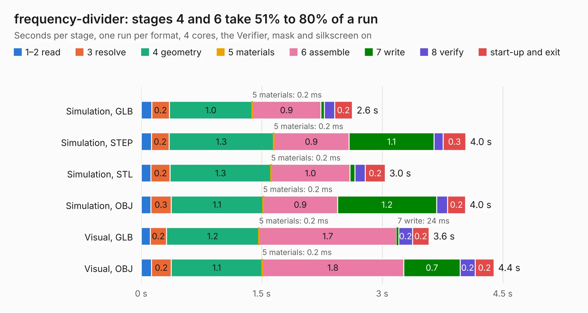

# 2471. frequency-divider

Board 2,471 of the 3,109 of [Corpus Testing](../Corpus-Testing.md), on [Corpus Page 23](../CorpusTestingPages/Corpus-Testing-23.md#2471-frequency-divider).

| Mode and format | 1–2 read | 3 resolve | 4 geometry | 5 materials | 6 assemble | 7 write | 8 verify | start-up and exit | Total |
|---|---:|---:|---:|---:|---:|---:|---:|---:|---:|
| Simulation, GLB | 0.1 | 0.2 | 1.0 | 0.2&nbsp;ms | 0.9 | 45&nbsp;ms | 0.1 | 0.2 | 2.6 |
| Simulation, STEP | 0.1 | 0.2 | 1.3 | 0.2&nbsp;ms | 0.9 | 1.1 | 0.1 | 0.3 | 4.0 |
| Simulation, STL | 0.1 | 0.2 | 1.3 | 0.2&nbsp;ms | 1.0 | 62&nbsp;ms | 0.1 | 0.2 | 3.0 |
| Simulation, OBJ | 0.1 | 0.3 | 1.1 | 0.2&nbsp;ms | 0.9 | 1.2 | 0.1 | 0.2 | 4.0 |
| Visual, GLB | 0.1 | 0.2 | 1.2 | 0.2&nbsp;ms | 1.7 | 24&nbsp;ms | 0.2 | 0.2 | 3.6 |
| Visual, OBJ | 0.1 | 0.2 | 1.1 | 0.2&nbsp;ms | 1.8 | 0.7 | 0.2 | 0.2 | 4.4 |

<table align="center"><tr><td valign="top">

| Board | Repo: [rusefi/rusefi-hardware](https://github.com/rusefi/rusefi-hardware) Board: `frequency-divider.kicad_pcb` |
|---|---|
| Folder | frequency-divider |
| Complexity | 219&nbsp;/&nbsp;1000 (size&nbsp;129, features&nbsp;90) |
| KESE&nbsp;features | through vias, rounded, trapezoid or chamfered pads, filled zones, curved board outline, stack-up, dielectric εr and tanδ, mask and silkscreen colours |
| Tested | 9th November 2026 |
| Copper&nbsp;layers | 2 |
| File&nbsp;format | KiCad 6 (20210824) |
| Parts,&nbsp;tracks,&nbsp;vias | 15, 41, 37 |
| Triangles,&nbsp;simulation | 269,140 in 21 parts |
| Verifier | PASS in all six runs |

</td><td valign="top">

<table>
<tr><th>File type</th><th>File size</th><th>Peak memory used</th></tr>
<tr><th colspan="3" align="left">Simulation</th></tr>
<tr><td>GLB</td><td align="right">9.1&nbsp;MB</td><td align="right">252&nbsp;MB</td></tr>
<tr><td>STEP</td><td align="right">36&nbsp;MB</td><td align="right">254&nbsp;MB</td></tr>
<tr><td>STL</td><td align="right">13&nbsp;MB</td><td align="right">234&nbsp;MB</td></tr>
<tr><td>OBJ</td><td align="right">26&nbsp;MB</td><td align="right">250&nbsp;MB</td></tr>
<tr><th colspan="3" align="left">Visual</th></tr>
<tr><td>GLB</td><td align="right">5.9&nbsp;MB</td><td align="right">211&nbsp;MB</td></tr>
<tr><td>OBJ</td><td align="right">17&nbsp;MB</td><td align="right">213&nbsp;MB</td></tr>
</table>

</td></tr></table>

| Previous | Next |
|:---|---:|
| [2470. mmc_usb_1](b2470b_rusefi-hardware_classic-designs-rusefi-hardware-history-usb-mmc-spi-rev00-30-usb-mmc-spi_mmc-usb-1.md) | [2472. GDI-4ch](b2472b_rusefi-hardware_GDI-4ch.md) |
