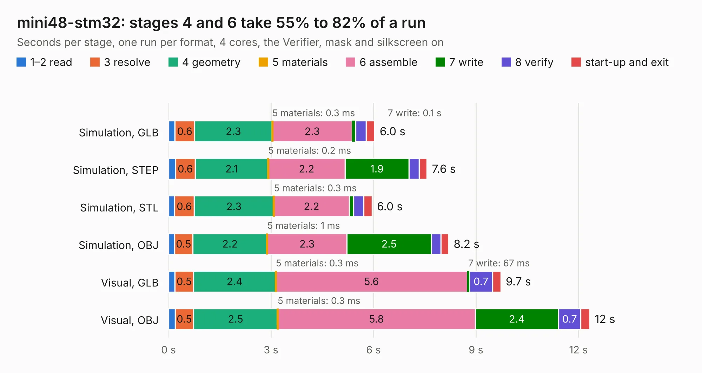

# 2472. mini48-stm32

Board 2,472 of the 3,123 of [Corpus Testing](../Corpus-Testing.md), on [Corpus Page 23](../CorpusTestingPages/Corpus-Testing-23.md#2472-mini48-stm32).

| Mode and format | 1–2 read | 3 resolve | 4 geometry | 5 materials | 6 assemble | 7 write | 8 verify | start-up and exit | Total |
|---|---:|---:|---:|---:|---:|---:|---:|---:|---:|
| Simulation, GLB | 0.2 | 0.6 | 2.3 | 0.3&nbsp;ms | 2.3 | 0.1 | 0.3 | 0.2 | 6.0 |
| Simulation, STEP | 0.2 | 0.6 | 2.1 | 0.2&nbsp;ms | 2.2 | 1.9 | 0.3 | 0.2 | 7.6 |
| Simulation, STL | 0.2 | 0.6 | 2.3 | 0.3&nbsp;ms | 2.2 | 0.1 | 0.3 | 0.2 | 6.0 |
| Simulation, OBJ | 0.2 | 0.5 | 2.2 | 1&nbsp;ms | 2.3 | 2.5 | 0.3 | 0.2 | 8.2 |
| Visual, GLB | 0.2 | 0.5 | 2.4 | 0.3&nbsp;ms | 5.6 | 67&nbsp;ms | 0.7 | 0.2 | 9.7 |
| Visual, OBJ | 0.2 | 0.5 | 2.5 | 0.3&nbsp;ms | 5.8 | 2.4 | 0.7 | 0.3 | 12.3 |

<table align="center"><tr><td valign="top">

| Board | Repo: [rusefi/rusefi-hardware](https://github.com/rusefi/rusefi-hardware) Board: `mini48-stm32.kicad_pcb` |
|---|---|
| Folder | classic-designs / rusefi_hardware_history / mini48-stm32_rev00.20 / mini48-stm32 |
| Complexity | 246&nbsp;/&nbsp;1000 (size&nbsp;201, features&nbsp;45) |
| KESE&nbsp;features | through vias, filled zones, curved board outline |
| Tested | 9th November 2026 |
| Copper&nbsp;layers | 2 |
| File&nbsp;format | KiCad 3 (3) |
| Parts,&nbsp;tracks,&nbsp;vias | 36, 496, 45 |
| Triangles,&nbsp;simulation | 603,828 in 66 parts |
| Verifier | PASS in all six runs |

</td><td valign="top">

<table>
<tr><th>File type</th><th>File size</th><th>Peak memory used</th></tr>
<tr><th colspan="3" align="left">Simulation</th></tr>
<tr><td>GLB</td><td align="right">21&nbsp;MB</td><td align="right">337&nbsp;MB</td></tr>
<tr><td>STEP</td><td align="right">107&nbsp;MB</td><td align="right">396&nbsp;MB</td></tr>
<tr><td>STL</td><td align="right">30&nbsp;MB</td><td align="right">357&nbsp;MB</td></tr>
<tr><td>OBJ</td><td align="right">61&nbsp;MB</td><td align="right">449&nbsp;MB</td></tr>
<tr><th colspan="3" align="left">Visual</th></tr>
<tr><td>GLB</td><td align="right">17&nbsp;MB</td><td align="right">443&nbsp;MB</td></tr>
<tr><td>OBJ</td><td align="right">52&nbsp;MB</td><td align="right">464&nbsp;MB</td></tr>
</table>

</td></tr></table>

| Previous | Next |
|:---|---:|
| [2471. Map_MPX](b2471b_rusefi-hardware_Map-MPX.md) | [2473. NGC_38_connector](b2473b_rusefi-hardware_classic-designs-rusefi-hardware-history-NGC-38-connector-rev00-10-NGC-38-connector_NGC-38-connector.md) |
