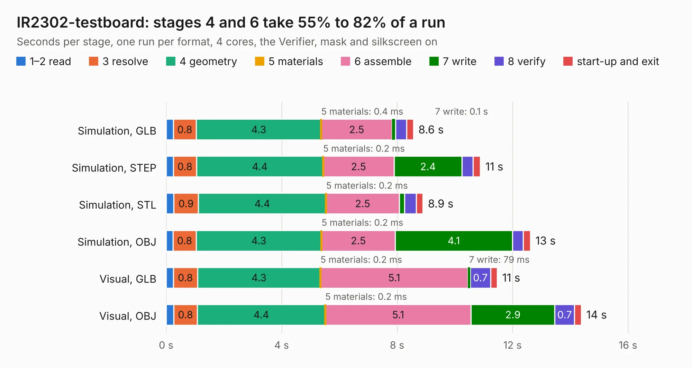

# 2476. IR2302-testboard

Board 2,476 of the 3,110 of [Corpus Testing](../Corpus-Testing.md), on [Corpus Page 23](../CorpusTestingPages/Corpus-Testing-23.md#2476-ir2302-testboard).

| Mode and format | 1–2 read | 3 resolve | 4 geometry | 5 materials | 6 assemble | 7 write | 8 verify | start-up and exit | Total |
|---|---:|---:|---:|---:|---:|---:|---:|---:|---:|
| Simulation, GLB | 0.2 | 0.8 | 4.3 | 0.4&nbsp;ms | 2.5 | 0.1 | 0.4 | 0.2 | 8.6 |
| Simulation, STEP | 0.2 | 0.8 | 4.4 | 0.2&nbsp;ms | 2.5 | 2.4 | 0.4 | 0.3 | 10.9 |
| Simulation, STL | 0.3 | 0.9 | 4.4 | 0.2&nbsp;ms | 2.5 | 0.2 | 0.4 | 0.2 | 8.9 |
| Simulation, OBJ | 0.2 | 0.8 | 4.3 | 0.2&nbsp;ms | 2.5 | 4.1 | 0.4 | 0.2 | 12.6 |
| Visual, GLB | 0.2 | 0.8 | 4.3 | 0.2&nbsp;ms | 5.1 | 79&nbsp;ms | 0.7 | 0.2 | 11.5 |
| Visual, OBJ | 0.3 | 0.8 | 4.4 | 0.2&nbsp;ms | 5.1 | 2.9 | 0.7 | 0.2 | 14.4 |

<table align="center"><tr><td valign="top">

| Board | Repo: [rusefi/rusefi-hardware](https://github.com/rusefi/rusefi-hardware) Board: `IR2302-testboard.kicad_pcb` |
|---|---|
| Folder | IR2302-testboard |
| Complexity | 251&nbsp;/&nbsp;1000 (size&nbsp;166, features&nbsp;85) |
| KESE&nbsp;features | through vias, rounded, trapezoid or chamfered pads, filled zones, curved board outline, stack-up, dielectric εr and tanδ |
| Tested | 9th November 2026 |
| Copper&nbsp;layers | 2 |
| File&nbsp;format | KiCad 7 (20221018) |
| Parts,&nbsp;tracks,&nbsp;vias | 49, 153, 169 |
| Triangles,&nbsp;simulation | 709,584 in 38 parts |
| Verifier | PASS in all six runs |

</td><td valign="top">

<table>
<tr><th>File type</th><th>File size</th><th>Peak memory used</th></tr>
<tr><th colspan="3" align="left">Simulation</th></tr>
<tr><td>GLB</td><td align="right">25&nbsp;MB</td><td align="right">386&nbsp;MB</td></tr>
<tr><td>STEP</td><td align="right">117&nbsp;MB</td><td align="right">436&nbsp;MB</td></tr>
<tr><td>STL</td><td align="right">35&nbsp;MB</td><td align="right">390&nbsp;MB</td></tr>
<tr><td>OBJ</td><td align="right">72&nbsp;MB</td><td align="right">539&nbsp;MB</td></tr>
<tr><th colspan="3" align="left">Visual</th></tr>
<tr><td>GLB</td><td align="right">17&nbsp;MB</td><td align="right">416&nbsp;MB</td></tr>
<tr><td>OBJ</td><td align="right">50&nbsp;MB</td><td align="right">417&nbsp;MB</td></tr>
</table>

</td></tr></table>

| Previous | Next |
|:---|---:|
| [2475. GDI-STM](b2475b_rusefi-hardware_GDI-STM.md) | [2477. micro_rusEFI](b2477b_rusefi-hardware_micro-rusEFI.md) |
