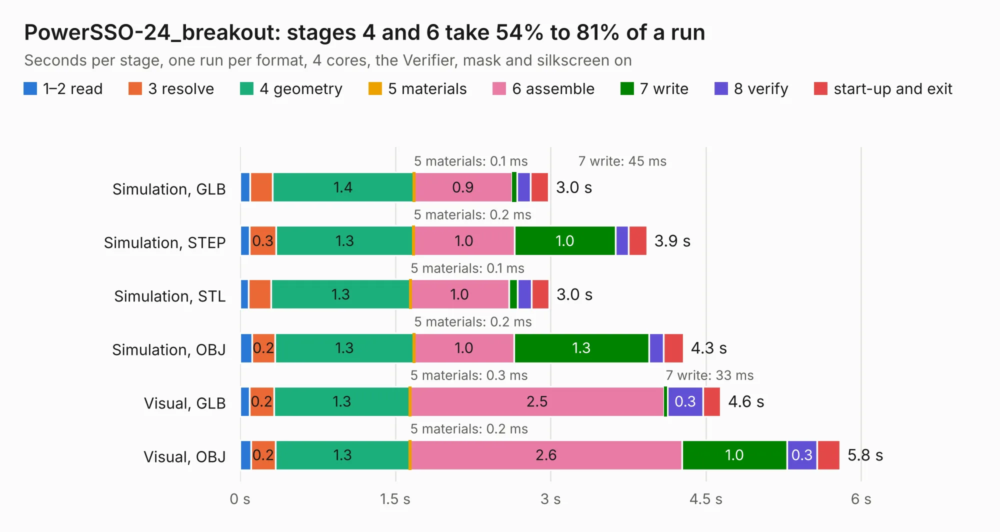

# 2477. PowerSSO-24_breakout

Board 2,477 of the 3,122 of [Corpus Testing](../Corpus-Testing.md), on [Corpus Page 23](../CorpusTestingPages/Corpus-Testing-23.md#2477-powersso-24_breakout).

| Mode and format | 1–2 read | 3 resolve | 4 geometry | 5 materials | 6 assemble | 7 write | 8 verify | start-up and exit | Total |
|---|---:|---:|---:|---:|---:|---:|---:|---:|---:|
| Simulation, GLB | 95&nbsp;ms | 0.2 | 1.4 | 0.1&nbsp;ms | 0.9 | 45&nbsp;ms | 0.1 | 0.2 | 3.0 |
| Simulation, STEP | 91&nbsp;ms | 0.3 | 1.3 | 0.2&nbsp;ms | 1.0 | 1.0 | 0.1 | 0.2 | 3.9 |
| Simulation, STL | 83&nbsp;ms | 0.2 | 1.3 | 0.1&nbsp;ms | 1.0 | 83&nbsp;ms | 0.1 | 0.2 | 3.0 |
| Simulation, OBJ | 0.1 | 0.2 | 1.3 | 0.2&nbsp;ms | 1.0 | 1.3 | 0.1 | 0.2 | 4.3 |
| Visual, GLB | 90&nbsp;ms | 0.2 | 1.3 | 0.3&nbsp;ms | 2.5 | 33&nbsp;ms | 0.3 | 0.2 | 4.6 |
| Visual, OBJ | 0.1 | 0.2 | 1.3 | 0.2&nbsp;ms | 2.6 | 1.0 | 0.3 | 0.2 | 5.8 |

<table align="center"><tr><td valign="top">

| Board | Repo: [rusefi/rusefi-hardware](https://github.com/rusefi/rusefi-hardware) Board: `PowerSSO-24_breakout.kicad_pcb` |
|---|---|
| Folder | classic-designs / rusefi_hardware_history / PowerSSO-24_breakout_rev00.10 / PowerSSO-24_breakout |
| Complexity | 178&nbsp;/&nbsp;1000 (size&nbsp;143, features&nbsp;35) |
| KESE&nbsp;features | through vias, filled zones |
| Tested | 9th November 2026 |
| Copper&nbsp;layers | 2 |
| File&nbsp;format | KiCad 3 (3) |
| Parts,&nbsp;tracks,&nbsp;vias | 14, 125, 85 |
| Triangles,&nbsp;simulation | 331,308 in 24 parts |
| Verifier | PASS in all six runs |

</td><td valign="top">

<table>
<tr><th>File type</th><th>File size</th><th>Peak memory used</th></tr>
<tr><th colspan="3" align="left">Simulation</th></tr>
<tr><td>GLB</td><td align="right">11&nbsp;MB</td><td align="right">255&nbsp;MB</td></tr>
<tr><td>STEP</td><td align="right">48&nbsp;MB</td><td align="right">273&nbsp;MB</td></tr>
<tr><td>STL</td><td align="right">17&nbsp;MB</td><td align="right">251&nbsp;MB</td></tr>
<tr><td>OBJ</td><td align="right">33&nbsp;MB</td><td align="right">250&nbsp;MB</td></tr>
<tr><th colspan="3" align="left">Visual</th></tr>
<tr><td>GLB</td><td align="right">8.9&nbsp;MB</td><td align="right">275&nbsp;MB</td></tr>
<tr><td>OBJ</td><td align="right">26&nbsp;MB</td><td align="right">279&nbsp;MB</td></tr>
</table>

</td></tr></table>

| Previous | Next |
|:---|---:|
| [2476. PWR_buck_12V_switcher](b2476b_rusefi-hardware_classic-designs-rusefi-hardware-history-power-supply-kb1gtt-rev00-10_PWR-buck-12V-switcher.md) | [2478. Stimulator](b2478b_rusefi-hardware_classic-designs-rusefi-hardware-history-Stimulator-rev00-10_Stimulator.md) |
