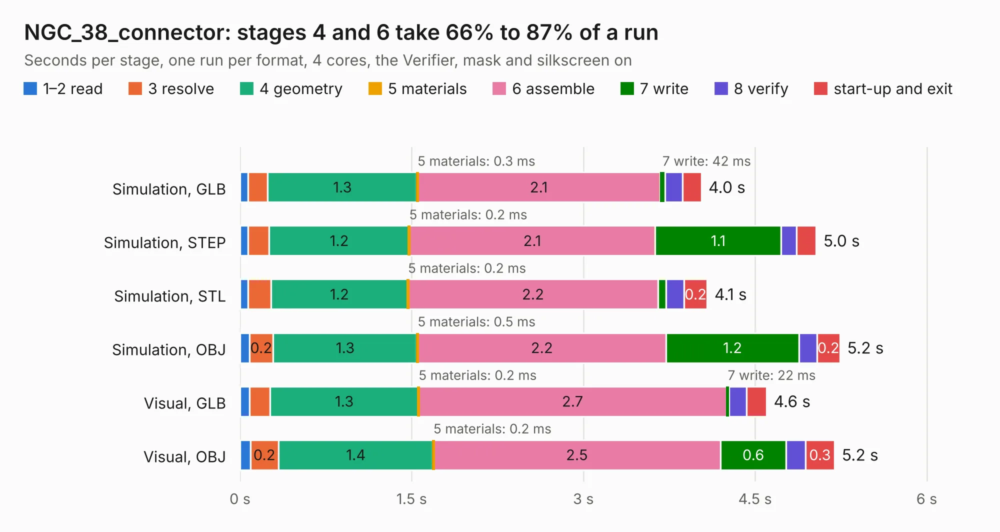

# 2478. NGC_38_connector

Board 2,478 of the 3,126 of [Corpus Testing](../Corpus-Testing.md), on [Corpus Page 23](../CorpusTestingPages/Corpus-Testing-23.md#2478-ngc_38_connector).

| Mode and format | 1–2 read | 3 resolve | 4 geometry | 5 materials | 6 assemble | 7 write | 8 verify | start-up and exit | Total |
|---|---:|---:|---:|---:|---:|---:|---:|---:|---:|
| Simulation, GLB | 69&nbsp;ms | 0.2 | 1.3 | 0.3&nbsp;ms | 2.1 | 42&nbsp;ms | 0.2 | 0.2 | 4.0 |
| Simulation, STEP | 70&nbsp;ms | 0.2 | 1.2 | 0.2&nbsp;ms | 2.1 | 1.1 | 0.1 | 0.2 | 5.0 |
| Simulation, STL | 71&nbsp;ms | 0.2 | 1.2 | 0.2&nbsp;ms | 2.2 | 70&nbsp;ms | 0.2 | 0.2 | 4.1 |
| Simulation, OBJ | 82&nbsp;ms | 0.2 | 1.3 | 0.5&nbsp;ms | 2.2 | 1.2 | 0.2 | 0.2 | 5.2 |
| Visual, GLB | 85&nbsp;ms | 0.2 | 1.3 | 0.2&nbsp;ms | 2.7 | 22&nbsp;ms | 0.2 | 0.2 | 4.6 |
| Visual, OBJ | 90&nbsp;ms | 0.2 | 1.4 | 0.2&nbsp;ms | 2.5 | 0.6 | 0.2 | 0.3 | 5.2 |

<table align="center"><tr><td valign="top">

| Board | Repo: [rusefi/rusefi-hardware](https://github.com/rusefi/rusefi-hardware) Board: `NGC_38_connector.kicad_pcb` |
|---|---|
| Folder | classic-designs / rusefi_hardware_history / NGC_38_connector_rev00.20 / NGC_38_connector |
| Complexity | 111&nbsp;/&nbsp;1000 (size&nbsp;111, features&nbsp;0) |
| Tested | 9th November 2026 |
| Copper&nbsp;layers | 2 |
| File&nbsp;format | KiCad 3 (3) |
| Parts,&nbsp;tracks,&nbsp;vias | 5, 96, 0 |
| Triangles,&nbsp;simulation | 271,710 in 49 parts |
| Verifier | PASS in all six runs |

</td><td valign="top">

<table>
<tr><th>File type</th><th>File size</th><th>Peak memory used</th></tr>
<tr><th colspan="3" align="left">Simulation</th></tr>
<tr><td>GLB</td><td align="right">9.2&nbsp;MB</td><td align="right">227&nbsp;MB</td></tr>
<tr><td>STEP</td><td align="right">41&nbsp;MB</td><td align="right">255&nbsp;MB</td></tr>
<tr><td>STL</td><td align="right">14&nbsp;MB</td><td align="right">228&nbsp;MB</td></tr>
<tr><td>OBJ</td><td align="right">27&nbsp;MB</td><td align="right">228&nbsp;MB</td></tr>
<tr><th colspan="3" align="left">Visual</th></tr>
<tr><td>GLB</td><td align="right">4.9&nbsp;MB</td><td align="right">216&nbsp;MB</td></tr>
<tr><td>OBJ</td><td align="right">14&nbsp;MB</td><td align="right">216&nbsp;MB</td></tr>
</table>

</td></tr></table>

| Previous | Next |
|:---|---:|
| [2477. NGC_38_connector](b2477b_rusefi-hardware_classic-designs-rusefi-hardware-history-NGC-38-connector-rev00-11-NGC-38-connector_NGC-38-connector.md) | [2479. NGC_38_connector](b2479b_rusefi-hardware_classic-designs-rusefi-hardware-history-NGC-38-connector-rev00-30-NGC-38-connector_NGC-38-connector.md) |
