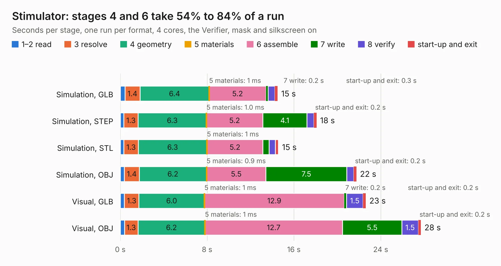

# 2478. Stimulator

Board 2,478 of the 3,121 of [Corpus Testing](../Corpus-Testing.md), on [Corpus Page 23](../CorpusTestingPages/Corpus-Testing-23.md#2478-stimulator).

| Mode and format | 1–2 read | 3 resolve | 4 geometry | 5 materials | 6 assemble | 7 write | 8 verify | start-up and exit | Total |
|---|---:|---:|---:|---:|---:|---:|---:|---:|---:|
| Simulation, GLB | 0.4 | 1.4 | 6.4 | 1&nbsp;ms | 5.2 | 0.2 | 0.6 | 0.3 | 14.5 |
| Simulation, STEP | 0.3 | 1.3 | 6.3 | 1.0&nbsp;ms | 5.2 | 4.1 | 0.6 | 0.2 | 18.1 |
| Simulation, STL | 0.3 | 1.3 | 6.3 | 1&nbsp;ms | 5.2 | 0.6 | 0.6 | 0.3 | 14.6 |
| Simulation, OBJ | 0.4 | 1.4 | 6.2 | 0.9&nbsp;ms | 5.5 | 7.5 | 0.6 | 0.2 | 21.8 |
| Visual, GLB | 0.4 | 1.3 | 6.0 | 1&nbsp;ms | 12.9 | 0.2 | 1.5 | 0.2 | 22.6 |
| Visual, OBJ | 0.4 | 1.3 | 6.2 | 1&nbsp;ms | 12.7 | 5.5 | 1.5 | 0.2 | 27.7 |

<table align="center"><tr><td valign="top">

| Board | Repo: [rusefi/rusefi-hardware](https://github.com/rusefi/rusefi-hardware) Board: `Stimulator.kicad_pcb` |
|---|---|
| Folder | classic-designs / rusefi_hardware_history / Stimulator_rev00.20 |
| Complexity | 211&nbsp;/&nbsp;1000 (size&nbsp;176, features&nbsp;35) |
| KESE&nbsp;features | through vias, filled zones |
| Tested | 9th November 2026 |
| Copper&nbsp;layers | 2 |
| File&nbsp;format | KiCad 3 (3) |
| Parts,&nbsp;tracks,&nbsp;vias | 83, 768, 31 |
| Triangles,&nbsp;simulation | 1,529,424 in 133 parts |
| Verifier | PASS in all six runs |

</td><td valign="top">

<table>
<tr><th>File type</th><th>File size</th><th>Peak memory used</th></tr>
<tr><th colspan="3" align="left">Simulation</th></tr>
<tr><td>GLB</td><td align="right">52&nbsp;MB</td><td align="right">638&nbsp;MB</td></tr>
<tr><td>STEP</td><td align="right">272&nbsp;MB</td><td align="right">713&nbsp;MB</td></tr>
<tr><td>STL</td><td align="right">76&nbsp;MB</td><td align="right">674&nbsp;MB</td></tr>
<tr><td>OBJ</td><td align="right">159&nbsp;MB</td><td align="right">1.0&nbsp;GB</td></tr>
<tr><th colspan="3" align="left">Visual</th></tr>
<tr><td>GLB</td><td align="right">41&nbsp;MB</td><td align="right">801&nbsp;MB</td></tr>
<tr><td>OBJ</td><td align="right">125&nbsp;MB</td><td align="right">896&nbsp;MB</td></tr>
</table>

</td></tr></table>

| Previous | Next |
|:---|---:|
| [2477. Stimulator](b2477b_rusefi-hardware_classic-designs-rusefi-hardware-history-Stimulator-rev00-10_Stimulator.md) | [2479. thermocouple_module](b2479b_rusefi-hardware_thermocouple-module.md) |
