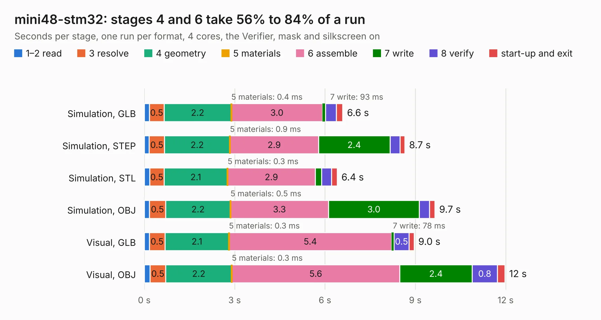

# 2479. mini48-stm32

Board 2,479 of the 3,108 of [Corpus Testing](../Corpus-Testing.md), on [Corpus Page 23](../CorpusTestingPages/Corpus-Testing-23.md#2479-mini48-stm32).

| Mode and format | 1–2 read | 3 resolve | 4 geometry | 5 materials | 6 assemble | 7 write | 8 verify | start-up and exit | Total |
|---|---:|---:|---:|---:|---:|---:|---:|---:|---:|
| Simulation, GLB | 0.2 | 0.5 | 2.2 | 0.4&nbsp;ms | 3.0 | 93&nbsp;ms | 0.4 | 0.2 | 6.6 |
| Simulation, STEP | 0.2 | 0.5 | 2.2 | 0.9&nbsp;ms | 2.9 | 2.4 | 0.3 | 0.2 | 8.7 |
| Simulation, STL | 0.2 | 0.5 | 2.1 | 0.3&nbsp;ms | 2.9 | 0.2 | 0.3 | 0.2 | 6.4 |
| Simulation, OBJ | 0.2 | 0.5 | 2.2 | 0.5&nbsp;ms | 3.3 | 3.0 | 0.3 | 0.2 | 9.7 |
| Visual, GLB | 0.2 | 0.5 | 2.1 | 0.3&nbsp;ms | 5.4 | 78&nbsp;ms | 0.5 | 0.2 | 9.0 |
| Visual, OBJ | 0.2 | 0.5 | 2.2 | 0.3&nbsp;ms | 5.6 | 2.4 | 0.8 | 0.3 | 12.0 |

<table align="center"><tr><td valign="top">

| Board | Repo: [rusefi/rusefi-hardware](https://github.com/rusefi/rusefi-hardware) Board: `mini48-stm32.kicad_pcb` |
|---|---|
| Folder | mini48-stm32 |
| Complexity | 259&nbsp;/&nbsp;1000 (size&nbsp;204, features&nbsp;55) |
| KESE&nbsp;features | through vias, rounded, trapezoid or chamfered pads, filled zones, curved board outline |
| Tested | 9th November 2026 |
| Copper&nbsp;layers | 2 |
| File&nbsp;format | KiCad 5 (20171130) |
| Parts,&nbsp;tracks,&nbsp;vias | 37, 523, 69 |
| Triangles,&nbsp;simulation | 738,906 in 66 parts |
| Verifier | PASS in all six runs |

</td><td valign="top">

<table>
<tr><th>File type</th><th>File size</th><th>Peak memory used</th></tr>
<tr><th colspan="3" align="left">Simulation</th></tr>
<tr><td>GLB</td><td align="right">25&nbsp;MB</td><td align="right">371&nbsp;MB</td></tr>
<tr><td>STEP</td><td align="right">118&nbsp;MB</td><td align="right">430&nbsp;MB</td></tr>
<tr><td>STL</td><td align="right">37&nbsp;MB</td><td align="right">378&nbsp;MB</td></tr>
<tr><td>OBJ</td><td align="right">74&nbsp;MB</td><td align="right">519&nbsp;MB</td></tr>
<tr><th colspan="3" align="left">Visual</th></tr>
<tr><td>GLB</td><td align="right">20&nbsp;MB</td><td align="right">535&nbsp;MB</td></tr>
<tr><td>OBJ</td><td align="right">61&nbsp;MB</td><td align="right">499&nbsp;MB</td></tr>
</table>

</td></tr></table>

| Previous | Next |
|:---|---:|
| [2478. MC33810-breakout](b2478b_rusefi-hardware_MC33810-breakout.md) | [2480. ncv1124-micro](b2480b_rusefi-hardware_ncv1124-micro.md) |
