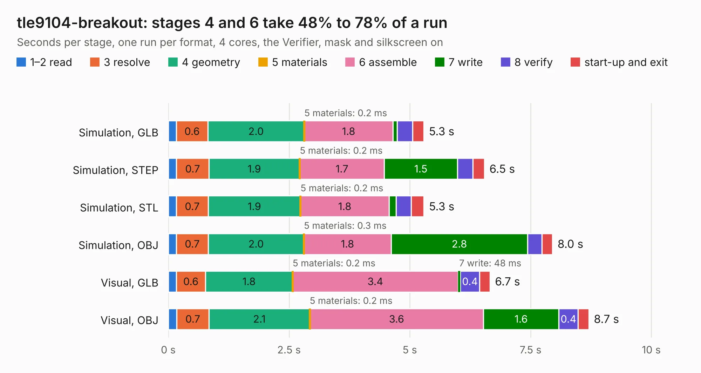

# 2481. tle9104-breakout

Board 2,481 of the 3,106 of [Corpus Testing](../Corpus-Testing.md), on [Corpus Page 23](../CorpusTestingPages/Corpus-Testing-23.md#2481-tle9104-breakout).

| Mode and format | 1–2 read | 3 resolve | 4 geometry | 5 materials | 6 assemble | 7 write | 8 verify | start-up and exit | Total |
|---|---:|---:|---:|---:|---:|---:|---:|---:|---:|
| Simulation, GLB | 0.2 | 0.6 | 2.0 | 0.2&nbsp;ms | 1.8 | 90&nbsp;ms | 0.3 | 0.2 | 5.3 |
| Simulation, STEP | 0.2 | 0.7 | 1.9 | 0.2&nbsp;ms | 1.7 | 1.5 | 0.3 | 0.2 | 6.5 |
| Simulation, STL | 0.2 | 0.7 | 1.9 | 0.2&nbsp;ms | 1.8 | 0.1 | 0.3 | 0.3 | 5.3 |
| Simulation, OBJ | 0.2 | 0.7 | 2.0 | 0.3&nbsp;ms | 1.8 | 2.8 | 0.3 | 0.2 | 8.0 |
| Visual, GLB | 0.2 | 0.6 | 1.8 | 0.2&nbsp;ms | 3.4 | 48&nbsp;ms | 0.4 | 0.2 | 6.7 |
| Visual, OBJ | 0.2 | 0.7 | 2.1 | 0.2&nbsp;ms | 3.6 | 1.6 | 0.4 | 0.2 | 8.7 |

<table align="center"><tr><td valign="top">

| Board | Repo: [rusefi/rusefi-hardware](https://github.com/rusefi/rusefi-hardware) Board: `tle9104-breakout.kicad_pcb` |
|---|---|
| Folder | tle9104-breakout |
| Complexity | 207&nbsp;/&nbsp;1000 (size&nbsp;162, features&nbsp;45) |
| KESE&nbsp;features | through vias, rounded, trapezoid or chamfered pads, filled zones |
| Tested | 9th November 2026 |
| Copper&nbsp;layers | 4 |
| File&nbsp;format | KiCad 7 (20221018) |
| Parts,&nbsp;tracks,&nbsp;vias | 15, 152, 86 |
| Triangles,&nbsp;simulation | 581,310 in 32 parts |
| Verifier | PASS in all six runs |

</td><td valign="top">

<table>
<tr><th>File type</th><th>File size</th><th>Peak memory used</th></tr>
<tr><th colspan="3" align="left">Simulation</th></tr>
<tr><td>GLB</td><td align="right">20&nbsp;MB</td><td align="right">323&nbsp;MB</td></tr>
<tr><td>STEP</td><td align="right">72&nbsp;MB</td><td align="right">342&nbsp;MB</td></tr>
<tr><td>STL</td><td align="right">29&nbsp;MB</td><td align="right">319&nbsp;MB</td></tr>
<tr><td>OBJ</td><td align="right">59&nbsp;MB</td><td align="right">429&nbsp;MB</td></tr>
<tr><th colspan="3" align="left">Visual</th></tr>
<tr><td>GLB</td><td align="right">11&nbsp;MB</td><td align="right">303&nbsp;MB</td></tr>
<tr><td>OBJ</td><td align="right">32&nbsp;MB</td><td align="right">309&nbsp;MB</td></tr>
</table>

</td></tr></table>

| Previous | Next |
|:---|---:|
| [2480. superseal-igbt](b2480b_rusefi-hardware_superseal-igbt.md) | [2482. uaBrain-gm-e38](b2482b_rusefi-hardware_uaBrain-gm-e38.md) |
