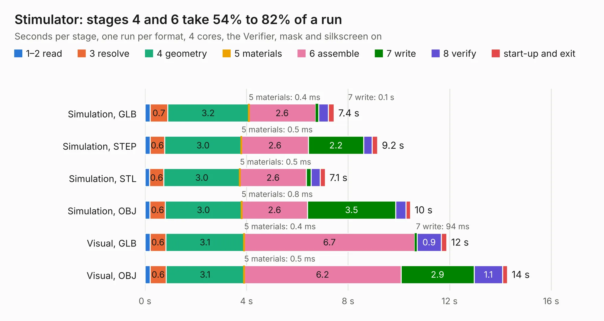

# 2482. Stimulator

Board 2,482 of the 3,127 of [Corpus Testing](../Corpus-Testing.md), on [Corpus Page 23](../CorpusTestingPages/Corpus-Testing-23.md#2482-stimulator).

| Mode and format | 1–2 read | 3 resolve | 4 geometry | 5 materials | 6 assemble | 7 write | 8 verify | start-up and exit | Total |
|---|---:|---:|---:|---:|---:|---:|---:|---:|---:|
| Simulation, GLB | 0.2 | 0.7 | 3.2 | 0.4&nbsp;ms | 2.6 | 0.1 | 0.4 | 0.2 | 7.4 |
| Simulation, STEP | 0.2 | 0.6 | 3.0 | 0.5&nbsp;ms | 2.6 | 2.2 | 0.3 | 0.2 | 9.2 |
| Simulation, STL | 0.2 | 0.6 | 3.0 | 0.5&nbsp;ms | 2.6 | 0.2 | 0.4 | 0.2 | 7.1 |
| Simulation, OBJ | 0.2 | 0.6 | 3.0 | 0.8&nbsp;ms | 2.6 | 3.5 | 0.4 | 0.2 | 10.5 |
| Visual, GLB | 0.2 | 0.6 | 3.1 | 0.4&nbsp;ms | 6.7 | 94&nbsp;ms | 0.9 | 0.2 | 11.9 |
| Visual, OBJ | 0.2 | 0.6 | 3.1 | 0.5&nbsp;ms | 6.2 | 2.9 | 1.1 | 0.2 | 14.3 |

<table align="center"><tr><td valign="top">

| Board | Repo: [rusefi/rusefi-hardware](https://github.com/rusefi/rusefi-hardware) Board: `Stimulator.kicad_pcb` |
|---|---|
| Folder | classic-designs / rusefi_hardware_history / Stimulator_rev00.10 |
| Complexity | 201&nbsp;/&nbsp;1000 (size&nbsp;166, features&nbsp;35) |
| KESE&nbsp;features | through vias, filled zones |
| Tested | 9th November 2026 |
| Copper&nbsp;layers | 2 |
| File&nbsp;format | KiCad 3 (3) |
| Parts,&nbsp;tracks,&nbsp;vias | 46, 614, 25 |
| Triangles,&nbsp;simulation | 883,034 in 98 parts |
| Verifier | PASS in all six runs |

</td><td valign="top">

<table>
<tr><th>File type</th><th>File size</th><th>Peak memory used</th></tr>
<tr><th colspan="3" align="left">Simulation</th></tr>
<tr><td>GLB</td><td align="right">30&nbsp;MB</td><td align="right">416&nbsp;MB</td></tr>
<tr><td>STEP</td><td align="right">148&nbsp;MB</td><td align="right">498&nbsp;MB</td></tr>
<tr><td>STL</td><td align="right">44&nbsp;MB</td><td align="right">415&nbsp;MB</td></tr>
<tr><td>OBJ</td><td align="right">89&nbsp;MB</td><td align="right">640&nbsp;MB</td></tr>
<tr><th colspan="3" align="left">Visual</th></tr>
<tr><td>GLB</td><td align="right">24&nbsp;MB</td><td align="right">581&nbsp;MB</td></tr>
<tr><td>OBJ</td><td align="right">71&nbsp;MB</td><td align="right">550&nbsp;MB</td></tr>
</table>

</td></tr></table>

| Previous | Next |
|:---|---:|
| [2481. PowerSSO-24_breakout](b2481b_rusefi-hardware_PowerSSO-24-breakout.md) | [2483. Stimulator](b2483b_rusefi-hardware_classic-designs-rusefi-hardware-history-Stimulator-rev00-20_Stimulator.md) |
