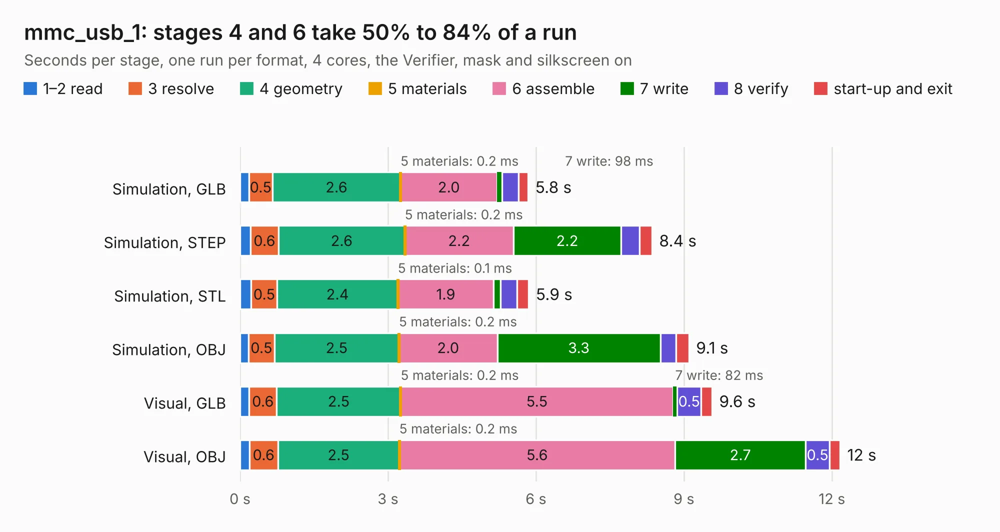

# 2482. mmc_usb_1

Board 2,482 of the 3,123 of [Corpus Testing](../Corpus-Testing.md), on [Corpus Page 23](../CorpusTestingPages/Corpus-Testing-23.md#2482-mmc_usb_1).

| Mode and format | 1–2 read | 3 resolve | 4 geometry | 5 materials | 6 assemble | 7 write | 8 verify | start-up and exit | Total |
|---|---:|---:|---:|---:|---:|---:|---:|---:|---:|
| Simulation, GLB | 0.2 | 0.5 | 2.6 | 0.2&nbsp;ms | 2.0 | 98&nbsp;ms | 0.3 | 0.2 | 5.8 |
| Simulation, STEP | 0.2 | 0.6 | 2.6 | 0.2&nbsp;ms | 2.2 | 2.2 | 0.4 | 0.3 | 8.4 |
| Simulation, STL | 0.2 | 0.5 | 2.4 | 0.1&nbsp;ms | 1.9 | 0.1 | 0.3 | 0.2 | 5.9 |
| Simulation, OBJ | 0.2 | 0.5 | 2.5 | 0.2&nbsp;ms | 2.0 | 3.3 | 0.3 | 0.3 | 9.1 |
| Visual, GLB | 0.2 | 0.6 | 2.5 | 0.2&nbsp;ms | 5.5 | 82&nbsp;ms | 0.5 | 0.2 | 9.6 |
| Visual, OBJ | 0.2 | 0.6 | 2.5 | 0.2&nbsp;ms | 5.6 | 2.7 | 0.5 | 0.2 | 12.2 |

<table align="center"><tr><td valign="top">

| Board | Repo: [rusefi/rusefi-hardware](https://github.com/rusefi/rusefi-hardware) Board: `mmc_usb_1.kicad_pcb` |
|---|---|
| Folder | classic-designs / rusefi_hardware_history / usb_mmc_spi_rev00.10 |
| Complexity | 201&nbsp;/&nbsp;1000 (size&nbsp;156, features&nbsp;45) |
| KESE&nbsp;features | through vias, filled zones, curved board outline |
| Tested | 9th November 2026 |
| Copper&nbsp;layers | 2 |
| File&nbsp;format | KiCad 3 (3) |
| Parts,&nbsp;tracks,&nbsp;vias | 22, 488, 48 |
| Triangles,&nbsp;simulation | 605,962 in 35 parts |
| Verifier | PASS in all six runs |

</td><td valign="top">

<table>
<tr><th>File type</th><th>File size</th><th>Peak memory used</th></tr>
<tr><th colspan="3" align="left">Simulation</th></tr>
<tr><td>GLB</td><td align="right">21&nbsp;MB</td><td align="right">335&nbsp;MB</td></tr>
<tr><td>STEP</td><td align="right">101&nbsp;MB</td><td align="right">390&nbsp;MB</td></tr>
<tr><td>STL</td><td align="right">30&nbsp;MB</td><td align="right">333&nbsp;MB</td></tr>
<tr><td>OBJ</td><td align="right">61&nbsp;MB</td><td align="right">431&nbsp;MB</td></tr>
<tr><th colspan="3" align="left">Visual</th></tr>
<tr><td>GLB</td><td align="right">17&nbsp;MB</td><td align="right">435&nbsp;MB</td></tr>
<tr><td>OBJ</td><td align="right">51&nbsp;MB</td><td align="right">468&nbsp;MB</td></tr>
</table>

</td></tr></table>

| Previous | Next |
|:---|---:|
| [2481. thermocouple_module](b2481b_rusefi-hardware_thermocouple-module.md) | [2483. mmc_usb_1](b2483b_rusefi-hardware_classic-designs-rusefi-hardware-history-usb-mmc-spi-rev00-20_mmc-usb-1.md) |
