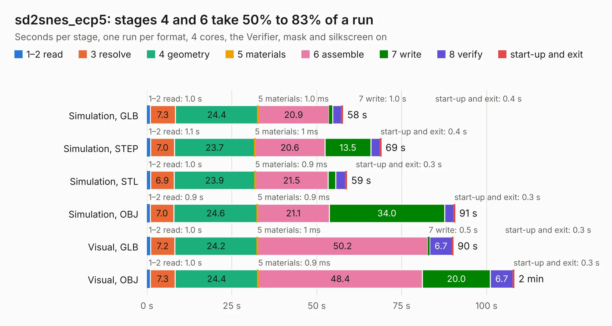

# 2482. sd2snes_ecp5

Board 2,482 of the 3,100 of [Corpus Testing](../Corpus-Testing.md), on [Corpus Page 23](../CorpusTestingPages/Corpus-Testing-23.md#2482-sd2snes_ecp5).

| Mode and format | 1–2 read | 3 resolve | 4 geometry | 5 materials | 6 assemble | 7 write | 8 verify | start-up and exit | Total |
|---|---:|---:|---:|---:|---:|---:|---:|---:|---:|
| Simulation, GLB | 1.0 | 7.3 | 24.4 | 1.0&nbsp;ms | 20.9 | 1.0 | 2.7 | 0.4 | 57.7 |
| Simulation, STEP | 1.1 | 7.0 | 23.7 | 1&nbsp;ms | 20.6 | 13.5 | 2.7 | 0.4 | 69.0 |
| Simulation, STL | 1.0 | 6.9 | 23.9 | 0.9&nbsp;ms | 21.5 | 2.3 | 2.9 | 0.3 | 58.9 |
| Simulation, OBJ | 0.9 | 7.0 | 24.6 | 0.9&nbsp;ms | 21.1 | 34.0 | 2.7 | 0.3 | 90.7 |
| Visual, GLB | 1.0 | 7.2 | 24.2 | 1&nbsp;ms | 50.2 | 0.5 | 6.7 | 0.3 | 90.2 |
| Visual, OBJ | 1.0 | 7.3 | 24.4 | 0.9&nbsp;ms | 48.4 | 20.0 | 6.7 | 0.3 | 108.1 |

<table align="center"><tr><td valign="top">

| Board | Repo: [samlittlewood/sd2snes_ecp5](https://github.com/samlittlewood/sd2snes_ecp5) Board: `sd2snes_ecp5.kicad_pcb` |
|---|---|
| Complexity | 390&nbsp;/&nbsp;1000 (size&nbsp;300, features&nbsp;90) |
| KESE&nbsp;features | through vias, slotted holes, custom pads, rounded, trapezoid or chamfered pads, filled zones, copper drawings, curved board outline |
| Tested | 9th November 2026 |
| Copper&nbsp;layers | 4 |
| File&nbsp;format | KiCad 5 (20171130) |
| Parts,&nbsp;tracks,&nbsp;vias | 174, 3,190, 1,021 |
| Triangles,&nbsp;simulation | 5,798,382 in 429 parts |
| Verifier | PASS in all six runs |

</td><td valign="top">

<table>
<tr><th>File type</th><th>File size</th><th>Peak memory used</th></tr>
<tr><th colspan="3" align="left">Simulation</th></tr>
<tr><td>GLB</td><td align="right">199&nbsp;MB</td><td align="right">1.7&nbsp;GB</td></tr>
<tr><td>STEP</td><td align="right">824&nbsp;MB</td><td align="right">2.2&nbsp;GB</td></tr>
<tr><td>STL</td><td align="right">290&nbsp;MB</td><td align="right">1.7&nbsp;GB</td></tr>
<tr><td>OBJ</td><td align="right">633&nbsp;MB</td><td align="right">3.8&nbsp;GB</td></tr>
<tr><th colspan="3" align="left">Visual</th></tr>
<tr><td>GLB</td><td align="right">122&nbsp;MB</td><td align="right">2.0&nbsp;GB</td></tr>
<tr><td>OBJ</td><td align="right">396&nbsp;MB</td><td align="right">2.6&nbsp;GB</td></tr>
</table>

</td></tr></table>

| Previous | Next |
|:---|---:|
| [2481. uaefi](b2481b_uaefi_uaefi.md) | [2483. tv070hat](b2483b_tv070wxm-hat_tv070hat.md) |
