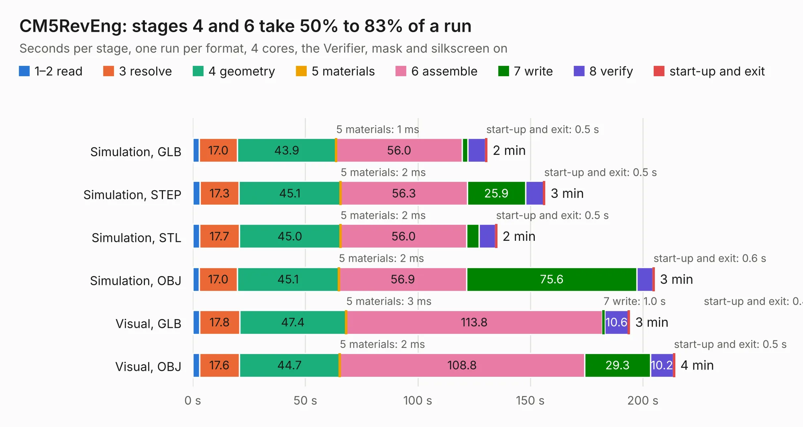

# 2484. CM5RevEng

Board 2,484 of the 3,100 of [Corpus Testing](../Corpus-Testing.md), on [Corpus Page 23](../CorpusTestingPages/Corpus-Testing-23.md#2484-cm5reveng).

| Mode and format | 1–2 read | 3 resolve | 4 geometry | 5 materials | 6 assemble | 7 write | 8 verify | start-up and exit | Total |
|---|---:|---:|---:|---:|---:|---:|---:|---:|---:|
| Simulation, GLB | 2.9 | 17.0 | 43.9 | 1&nbsp;ms | 56.0 | 2.6 | 7.9 | 0.5 | 130.7 |
| Simulation, STEP | 3.3 | 17.3 | 45.1 | 2&nbsp;ms | 56.3 | 25.9 | 8.0 | 0.5 | 156.4 |
| Simulation, STL | 3.0 | 17.7 | 45.0 | 2&nbsp;ms | 56.0 | 5.6 | 7.3 | 0.5 | 135.1 |
| Simulation, OBJ | 2.9 | 17.0 | 45.1 | 2&nbsp;ms | 56.9 | 75.6 | 7.1 | 0.6 | 205.0 |
| Visual, GLB | 3.1 | 17.8 | 47.4 | 3&nbsp;ms | 113.8 | 1.0 | 10.6 | 0.4 | 194.0 |
| Visual, OBJ | 3.0 | 17.6 | 44.7 | 2&nbsp;ms | 108.8 | 29.3 | 10.2 | 0.5 | 214.1 |

<table align="center"><tr><td valign="top">

| Board | Repo: [schlae/cm5-reveng](https://github.com/schlae/cm5-reveng) Board: `CM5RevEng.kicad_pcb` |
|---|---|
| Complexity | 537&nbsp;/&nbsp;1000 (size&nbsp;347, features&nbsp;190) |
| KESE&nbsp;features | through vias, blind and buried vias, microvias, custom pads, rounded, trapezoid or chamfered pads, filled zones, copper drawings, curved board outline, stack-up, dielectric εr and tanδ |
| Tested | 9th November 2026 |
| Copper&nbsp;layers | 10 |
| File&nbsp;format | KiCad 9 (20241229) |
| Parts,&nbsp;tracks,&nbsp;vias | 417, 8,115, 2,902 |
| Triangles,&nbsp;simulation | 13,000,160 in 456 parts |
| Verifier | Simulation, GLB: Verifier FAIL Simulation, STEP: Verifier FAIL Simulation, STL: Verifier FAIL Simulation, OBJ: Verifier FAIL |
| Bad&nbsp;design | Bad design according to KESE: copper of two nets on top of each other in the file, a short KiCad's DRC reports; a GND via and a `CM5_1V8` via 0.056 mm apart at (128.38, 64.01) mm. KESE models what the file says, so the Verifier rightly finds the two nets' solids overlapping |

</td><td valign="top">

<table>
<tr><th>File type</th><th>File size</th><th>Peak memory used</th></tr>
<tr><th colspan="3" align="left">Simulation</th></tr>
<tr><td>GLB</td><td align="right">444&nbsp;MB</td><td align="right">2.9&nbsp;GB</td></tr>
<tr><td>STEP</td><td align="right">1.6&nbsp;GB</td><td align="right">4.0&nbsp;GB</td></tr>
<tr><td>STL</td><td align="right">650&nbsp;MB</td><td align="right">2.8&nbsp;GB</td></tr>
<tr><td>OBJ</td><td align="right">1.4&nbsp;GB</td><td align="right">8.2&nbsp;GB</td></tr>
<tr><th colspan="3" align="left">Visual</th></tr>
<tr><td>GLB</td><td align="right">198&nbsp;MB</td><td align="right">3.5&nbsp;GB</td></tr>
<tr><td>OBJ</td><td align="right">655&nbsp;MB</td><td align="right">4.3&nbsp;GB</td></tr>
</table>

</td></tr></table>

| Previous | Next |
|:---|---:|
| [2483. tv070hat](b2483b_tv070wxm-hat_tv070hat.md) | [2485. rpi-rm0](b2485b_cm5-reveng_rpi-rm0.md) |
