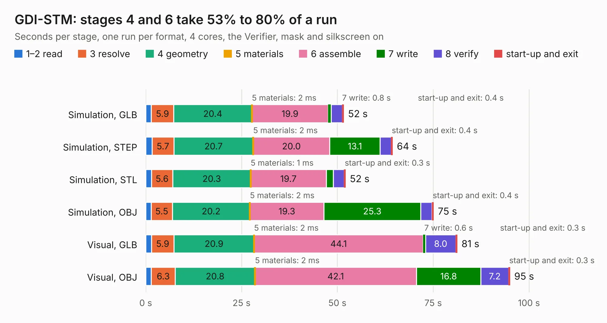

# 2484. GDI-STM

Board 2,484 of the 3,119 of [Corpus Testing](../Corpus-Testing.md), on [Corpus Page 23](../CorpusTestingPages/Corpus-Testing-23.md#2484-gdi-stm).

| Mode and format | 1–2 read | 3 resolve | 4 geometry | 5 materials | 6 assemble | 7 write | 8 verify | start-up and exit | Total |
|---|---:|---:|---:|---:|---:|---:|---:|---:|---:|
| Simulation, GLB | 1.4 | 5.9 | 20.4 | 2&nbsp;ms | 19.9 | 0.8 | 2.9 | 0.4 | 51.7 |
| Simulation, STEP | 1.6 | 5.7 | 20.7 | 2&nbsp;ms | 20.0 | 13.1 | 2.9 | 0.4 | 64.4 |
| Simulation, STL | 1.5 | 5.6 | 20.3 | 1&nbsp;ms | 19.7 | 1.8 | 2.8 | 0.3 | 52.1 |
| Simulation, OBJ | 1.4 | 5.5 | 20.2 | 2&nbsp;ms | 19.3 | 25.3 | 3.0 | 0.4 | 75.1 |
| Visual, GLB | 1.5 | 5.9 | 20.9 | 2&nbsp;ms | 44.1 | 0.6 | 8.0 | 0.3 | 81.3 |
| Visual, OBJ | 1.4 | 6.3 | 20.8 | 2&nbsp;ms | 42.1 | 16.8 | 7.2 | 0.3 | 95.0 |

<table align="center"><tr><td valign="top">

| Board | Repo: [rusefi/rusefi-hardware](https://github.com/rusefi/rusefi-hardware) Board: `GDI-STM.kicad_pcb` |
|---|---|
| Folder | GDI-STM |
| Complexity | 357&nbsp;/&nbsp;1000 (size&nbsp;272, features&nbsp;85) |
| KESE&nbsp;features | through vias, rounded, trapezoid or chamfered pads, filled zones, curved board outline, stack-up, dielectric εr and tanδ |
| Tested | 9th November 2026 |
| Copper&nbsp;layers | 4 |
| File&nbsp;format | KiCad 9 (20241229) |
| Parts,&nbsp;tracks,&nbsp;vias | 306, 2,211, 687 |
| Triangles,&nbsp;simulation | 4,938,506 in 310 parts |
| Verifier | PASS in all six runs |

</td><td valign="top">

<table>
<tr><th>File type</th><th>File size</th><th>Peak memory used</th></tr>
<tr><th colspan="3" align="left">Simulation</th></tr>
<tr><td>GLB</td><td align="right">163&nbsp;MB</td><td align="right">1.4&nbsp;GB</td></tr>
<tr><td>STEP</td><td align="right">655&nbsp;MB</td><td align="right">2.0&nbsp;GB</td></tr>
<tr><td>STL</td><td align="right">247&nbsp;MB</td><td align="right">1.5&nbsp;GB</td></tr>
<tr><td>OBJ</td><td align="right">521&nbsp;MB</td><td align="right">3.1&nbsp;GB</td></tr>
<tr><th colspan="3" align="left">Visual</th></tr>
<tr><td>GLB</td><td align="right">111&nbsp;MB</td><td align="right">1.8&nbsp;GB</td></tr>
<tr><td>OBJ</td><td align="right">354&nbsp;MB</td><td align="right">2.4&nbsp;GB</td></tr>
</table>

</td></tr></table>

| Previous | Next |
|:---|---:|
| [2483. GDI-6ch](b2483b_rusefi-hardware_GDI-6ch.md) | [2485. IR2302-testboard](b2485b_rusefi-hardware_IR2302-testboard.md) |
