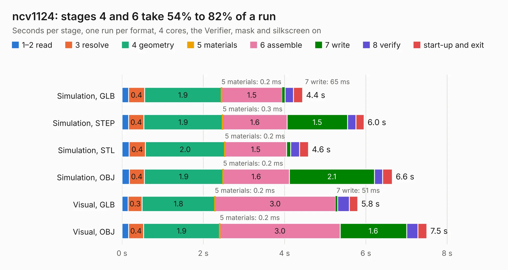

# 2484. ncv1124

Board 2,484 of the 3,106 of [Corpus Testing](../Corpus-Testing.md), on [Corpus Page 23](../CorpusTestingPages/Corpus-Testing-23.md#2484-ncv1124).

| Mode and format | 1–2 read | 3 resolve | 4 geometry | 5 materials | 6 assemble | 7 write | 8 verify | start-up and exit | Total |
|---|---:|---:|---:|---:|---:|---:|---:|---:|---:|
| Simulation, GLB | 0.2 | 0.4 | 1.9 | 0.2&nbsp;ms | 1.5 | 65&nbsp;ms | 0.2 | 0.2 | 4.4 |
| Simulation, STEP | 0.2 | 0.4 | 1.9 | 0.3&nbsp;ms | 1.6 | 1.5 | 0.2 | 0.2 | 6.0 |
| Simulation, STL | 0.2 | 0.4 | 2.0 | 0.2&nbsp;ms | 1.5 | 98&nbsp;ms | 0.2 | 0.2 | 4.6 |
| Simulation, OBJ | 0.2 | 0.4 | 1.9 | 0.2&nbsp;ms | 1.6 | 2.1 | 0.2 | 0.2 | 6.6 |
| Visual, GLB | 0.2 | 0.3 | 1.8 | 0.2&nbsp;ms | 3.0 | 51&nbsp;ms | 0.3 | 0.2 | 5.8 |
| Visual, OBJ | 0.2 | 0.4 | 1.9 | 0.2&nbsp;ms | 3.0 | 1.6 | 0.3 | 0.2 | 7.5 |

<table align="center"><tr><td valign="top">

| Board | Repo: [rusefi/rusefi-hardware](https://github.com/rusefi/rusefi-hardware) Board: `ncv1124.kicad_pcb` |
|---|---|
| Folder | VR_ncv1124_test_module |
| Complexity | 201&nbsp;/&nbsp;1000 (size&nbsp;146, features&nbsp;55) |
| KESE&nbsp;features | through vias, rounded, trapezoid or chamfered pads, filled zones, curved board outline |
| Tested | 9th November 2026 |
| Copper&nbsp;layers | 2 |
| File&nbsp;format | KiCad 5 (20171130) |
| Parts,&nbsp;tracks,&nbsp;vias | 34, 80, 60 |
| Triangles,&nbsp;simulation | 397,716 in 30 parts |
| Verifier | PASS in all six runs |

</td><td valign="top">

<table>
<tr><th>File type</th><th>File size</th><th>Peak memory used</th></tr>
<tr><th colspan="3" align="left">Simulation</th></tr>
<tr><td>GLB</td><td align="right">14&nbsp;MB</td><td align="right">272&nbsp;MB</td></tr>
<tr><td>STEP</td><td align="right">62&nbsp;MB</td><td align="right">328&nbsp;MB</td></tr>
<tr><td>STL</td><td align="right">20&nbsp;MB</td><td align="right">271&nbsp;MB</td></tr>
<tr><td>OBJ</td><td align="right">40&nbsp;MB</td><td align="right">322&nbsp;MB</td></tr>
<tr><th colspan="3" align="left">Visual</th></tr>
<tr><td>GLB</td><td align="right">11&nbsp;MB</td><td align="right">316&nbsp;MB</td></tr>
<tr><td>OBJ</td><td align="right">31&nbsp;MB</td><td align="right">317&nbsp;MB</td></tr>
</table>

</td></tr></table>

| Previous | Next |
|:---|---:|
| [2483. VR-Hall](b2483b_rusefi-hardware_VR-Hall.md) | [2485. wideband_controller](b2485b_rusefi-hardware_wideband-controller.md) |
