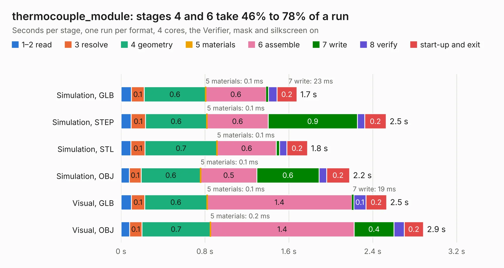

# 2484. thermocouple_module

Board 2,484 of the 3,126 of [Corpus Testing](../Corpus-Testing.md), on [Corpus Page 23](../CorpusTestingPages/Corpus-Testing-23.md#2484-thermocouple_module).

| Mode and format | 1–2 read | 3 resolve | 4 geometry | 5 materials | 6 assemble | 7 write | 8 verify | start-up and exit | Total |
|---|---:|---:|---:|---:|---:|---:|---:|---:|---:|
| Simulation, GLB | 98&nbsp;ms | 0.1 | 0.6 | 0.1&nbsp;ms | 0.6 | 23&nbsp;ms | 80&nbsp;ms | 0.2 | 1.7 |
| Simulation, STEP | 96&nbsp;ms | 0.1 | 0.6 | 0.1&nbsp;ms | 0.6 | 0.9 | 69&nbsp;ms | 0.2 | 2.5 |
| Simulation, STL | 94&nbsp;ms | 0.1 | 0.7 | 0.1&nbsp;ms | 0.6 | 32&nbsp;ms | 70&nbsp;ms | 0.2 | 1.8 |
| Simulation, OBJ | 80&nbsp;ms | 0.1 | 0.6 | 0.1&nbsp;ms | 0.5 | 0.6 | 73&nbsp;ms | 0.2 | 2.2 |
| Visual, GLB | 97&nbsp;ms | 0.1 | 0.6 | 0.1&nbsp;ms | 1.4 | 19&nbsp;ms | 0.1 | 0.2 | 2.5 |
| Visual, OBJ | 81&nbsp;ms | 0.1 | 0.7 | 0.2&nbsp;ms | 1.4 | 0.4 | 98&nbsp;ms | 0.2 | 2.9 |

<table align="center"><tr><td valign="top">

| Board | Repo: [rusefi/rusefi-hardware](https://github.com/rusefi/rusefi-hardware) Board: `thermocouple_module.kicad_pcb` |
|---|---|
| Folder | classic-designs / rusefi_hardware_history / thermocouiple_module_rev00.10 / thermocouiple_module |
| Complexity | 137&nbsp;/&nbsp;1000 (size&nbsp;102, features&nbsp;35) |
| KESE&nbsp;features | through vias, filled zones |
| Tested | 9th November 2026 |
| Copper&nbsp;layers | 2 |
| File&nbsp;format | KiCad 3 (3) |
| Parts,&nbsp;tracks,&nbsp;vias | 6, 41, 3 |
| Triangles,&nbsp;simulation | 136,198 in 19 parts |
| Verifier | PASS in all six runs |

</td><td valign="top">

<table>
<tr><th>File type</th><th>File size</th><th>Peak memory used</th></tr>
<tr><th colspan="3" align="left">Simulation</th></tr>
<tr><td>GLB</td><td align="right">4.8&nbsp;MB</td><td align="right">188&nbsp;MB</td></tr>
<tr><td>STEP</td><td align="right">24&nbsp;MB</td><td align="right">198&nbsp;MB</td></tr>
<tr><td>STL</td><td align="right">6.8&nbsp;MB</td><td align="right">192&nbsp;MB</td></tr>
<tr><td>OBJ</td><td align="right">14&nbsp;MB</td><td align="right">186&nbsp;MB</td></tr>
<tr><th colspan="3" align="left">Visual</th></tr>
<tr><td>GLB</td><td align="right">3.3&nbsp;MB</td><td align="right">158&nbsp;MB</td></tr>
<tr><td>OBJ</td><td align="right">9.4&nbsp;MB</td><td align="right">159&nbsp;MB</td></tr>
</table>

</td></tr></table>

| Previous | Next |
|:---|---:|
| [2483. Stimulator](b2483b_rusefi-hardware_classic-designs-rusefi-hardware-history-Stimulator-rev00-20_Stimulator.md) | [2485. mmc_usb_1](b2485b_rusefi-hardware_classic-designs-rusefi-hardware-history-usb-mmc-spi-rev00-10_mmc-usb-1.md) |
