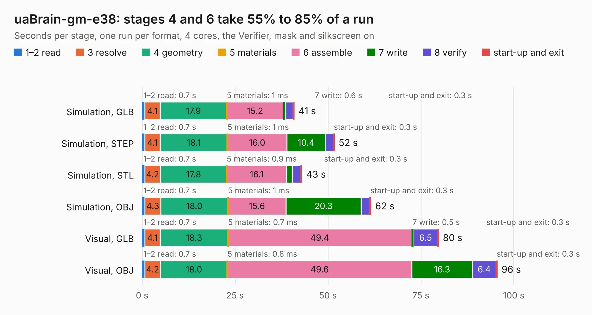

# 2484. uaBrain-gm-e38

Board 2,484 of the 3,108 of [Corpus Testing](../Corpus-Testing.md), on [Corpus Page 23](../CorpusTestingPages/Corpus-Testing-23.md#2484-uabrain-gm-e38).

| Mode and format | 1–2 read | 3 resolve | 4 geometry | 5 materials | 6 assemble | 7 write | 8 verify | start-up and exit | Total |
|---|---:|---:|---:|---:|---:|---:|---:|---:|---:|
| Simulation, GLB | 0.7 | 4.1 | 17.9 | 1&nbsp;ms | 15.2 | 0.6 | 2.0 | 0.3 | 40.9 |
| Simulation, STEP | 0.7 | 4.1 | 18.1 | 1&nbsp;ms | 16.0 | 10.4 | 2.1 | 0.3 | 51.7 |
| Simulation, STL | 0.7 | 4.2 | 17.8 | 0.9&nbsp;ms | 16.1 | 1.5 | 2.3 | 0.3 | 43.0 |
| Simulation, OBJ | 0.7 | 4.3 | 18.0 | 1&nbsp;ms | 15.6 | 20.3 | 2.3 | 0.3 | 61.6 |
| Visual, GLB | 0.7 | 4.1 | 18.3 | 0.7&nbsp;ms | 49.4 | 0.5 | 6.5 | 0.3 | 79.8 |
| Visual, OBJ | 0.7 | 4.2 | 18.0 | 0.8&nbsp;ms | 49.6 | 16.3 | 6.4 | 0.3 | 95.6 |

<table align="center"><tr><td valign="top">

| Board | Repo: [rusefi/rusefi-hardware](https://github.com/rusefi/rusefi-hardware) Board: `uaBrain-gm-e38.kicad_pcb` |
|---|---|
| Folder | uaBrain-gm-e38 |
| Complexity | 314&nbsp;/&nbsp;1000 (size&nbsp;209, features&nbsp;105) |
| KESE&nbsp;features | through vias, rounded, trapezoid or chamfered pads, filled zones, curved board outline, knockout text, stack-up, dielectric εr and tanδ, mask and silkscreen colours |
| Tested | 9th November 2026 |
| Copper&nbsp;layers | 2 |
| File&nbsp;format | KiCad 10 (20260206) |
| Parts,&nbsp;tracks,&nbsp;vias | 120, 2,865, 804 |
| Triangles,&nbsp;simulation | 4,579,816 in 229 parts |
| Verifier | PASS in all six runs |

</td><td valign="top">

<table>
<tr><th>File type</th><th>File size</th><th>Peak memory used</th></tr>
<tr><th colspan="3" align="left">Simulation</th></tr>
<tr><td>GLB</td><td align="right">157&nbsp;MB</td><td align="right">1.6&nbsp;GB</td></tr>
<tr><td>STEP</td><td align="right">745&nbsp;MB</td><td align="right">1.8&nbsp;GB</td></tr>
<tr><td>STL</td><td align="right">229&nbsp;MB</td><td align="right">1.5&nbsp;GB</td></tr>
<tr><td>OBJ</td><td align="right">488&nbsp;MB</td><td align="right">2.9&nbsp;GB</td></tr>
<tr><th colspan="3" align="left">Visual</th></tr>
<tr><td>GLB</td><td align="right">132&nbsp;MB</td><td align="right">2.1&nbsp;GB</td></tr>
<tr><td>OBJ</td><td align="right">416&nbsp;MB</td><td align="right">2.6&nbsp;GB</td></tr>
</table>

</td></tr></table>

| Previous | Next |
|:---|---:|
| [2483. tle9104-breakout](b2483b_rusefi-hardware_tle9104-breakout.md) | [2485. VR-Hall](b2485b_rusefi-hardware_VR-Hall.md) |
