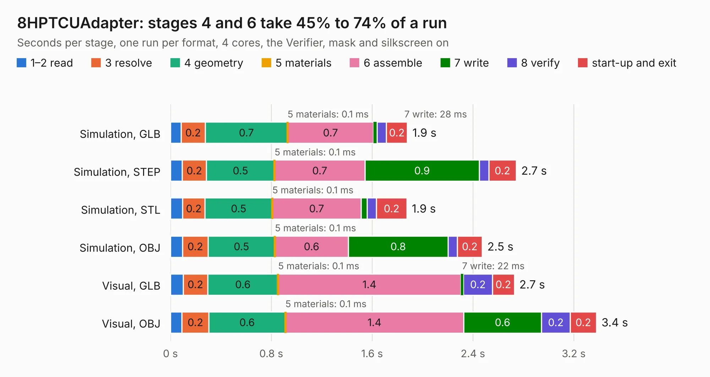

# 2486. 8HPTCUAdapter

Board 2,486 of the 3,106 of [Corpus Testing](../Corpus-Testing.md), on [Corpus Page 24](../CorpusTestingPages/Corpus-Testing-24.md#2486-8hptcuadapter).

| Mode and format | 1–2 read | 3 resolve | 4 geometry | 5 materials | 6 assemble | 7 write | 8 verify | start-up and exit | Total |
|---|---:|---:|---:|---:|---:|---:|---:|---:|---:|
| Simulation, GLB | 83&nbsp;ms | 0.2 | 0.7 | 0.1&nbsp;ms | 0.7 | 28&nbsp;ms | 74&nbsp;ms | 0.2 | 1.9 |
| Simulation, STEP | 93&nbsp;ms | 0.2 | 0.5 | 0.1&nbsp;ms | 0.7 | 0.9 | 76&nbsp;ms | 0.2 | 2.7 |
| Simulation, STL | 97&nbsp;ms | 0.2 | 0.5 | 0.1&nbsp;ms | 0.7 | 50&nbsp;ms | 73&nbsp;ms | 0.2 | 1.9 |
| Simulation, OBJ | 96&nbsp;ms | 0.2 | 0.5 | 0.1&nbsp;ms | 0.6 | 0.8 | 72&nbsp;ms | 0.2 | 2.5 |
| Visual, GLB | 0.1 | 0.2 | 0.6 | 0.1&nbsp;ms | 1.4 | 22&nbsp;ms | 0.2 | 0.2 | 2.7 |
| Visual, OBJ | 91&nbsp;ms | 0.2 | 0.6 | 0.1&nbsp;ms | 1.4 | 0.6 | 0.2 | 0.2 | 3.4 |

<table align="center"><tr><td valign="top">

| Board | Repo: [rusefi/rusefi-hardware](https://github.com/rusefi/rusefi-hardware) Board: `8HPTCUAdapter.kicad_pcb` |
|---|---|
| Folder | ZF8HP Transmission |
| Complexity | 219&nbsp;/&nbsp;1000 (size&nbsp;104, features&nbsp;115) |
| KESE&nbsp;features | blind and buried vias, custom pads, filled zones, curved board outline, stack-up, dielectric εr and tanδ |
| Tested | 9th November 2026 |
| Copper&nbsp;layers | 2 |
| File&nbsp;format | KiCad 9 (20241229) |
| Parts,&nbsp;tracks,&nbsp;vias | 1, 98, 10 |
| Triangles,&nbsp;simulation | 184,320 in 23 parts |
| Verifier | PASS in all six runs |

</td><td valign="top">

<table>
<tr><th>File type</th><th>File size</th><th>Peak memory used</th></tr>
<tr><th colspan="3" align="left">Simulation</th></tr>
<tr><td>GLB</td><td align="right">6.6&nbsp;MB</td><td align="right">217&nbsp;MB</td></tr>
<tr><td>STEP</td><td align="right">34&nbsp;MB</td><td align="right">234&nbsp;MB</td></tr>
<tr><td>STL</td><td align="right">9.2&nbsp;MB</td><td align="right">208&nbsp;MB</td></tr>
<tr><td>OBJ</td><td align="right">19&nbsp;MB</td><td align="right">207&nbsp;MB</td></tr>
<tr><th colspan="3" align="left">Visual</th></tr>
<tr><td>GLB</td><td align="right">5.3&nbsp;MB</td><td align="right">194&nbsp;MB</td></tr>
<tr><td>OBJ</td><td align="right">15&nbsp;MB</td><td align="right">194&nbsp;MB</td></tr>
</table>

</td></tr></table>

| Previous | Next |
|:---|---:|
| [2485. wideband_controller](b2485b_rusefi-hardware_wideband-controller.md) | [2487. uaefi](b2487b_uaefi_uaefi.md) |
