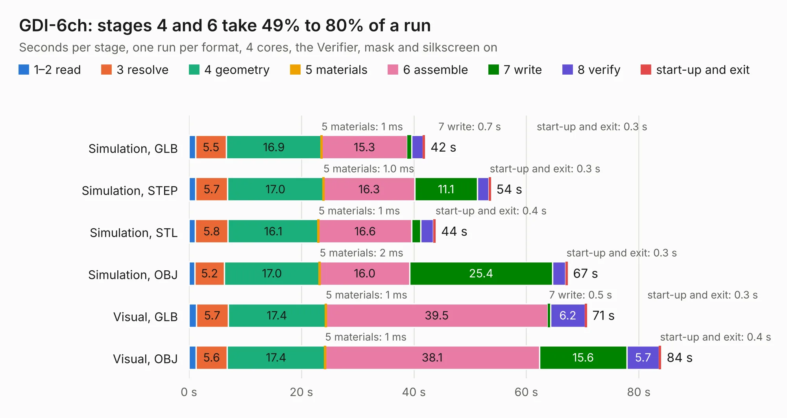

# 2486. GDI-6ch

Board 2,486 of the 3,122 of [Corpus Testing](../Corpus-Testing.md), on [Corpus Page 24](../CorpusTestingPages/Corpus-Testing-24.md#2486-gdi-6ch).

| Mode and format | 1–2 read | 3 resolve | 4 geometry | 5 materials | 6 assemble | 7 write | 8 verify | start-up and exit | Total |
|---|---:|---:|---:|---:|---:|---:|---:|---:|---:|
| Simulation, GLB | 1.2 | 5.5 | 16.9 | 1&nbsp;ms | 15.3 | 0.7 | 2.1 | 0.3 | 42.0 |
| Simulation, STEP | 1.2 | 5.7 | 17.0 | 1.0&nbsp;ms | 16.3 | 11.1 | 2.1 | 0.3 | 53.7 |
| Simulation, STL | 1.1 | 5.8 | 16.1 | 1&nbsp;ms | 16.6 | 1.6 | 2.2 | 0.4 | 43.8 |
| Simulation, OBJ | 1.1 | 5.2 | 17.0 | 2&nbsp;ms | 16.0 | 25.4 | 2.3 | 0.3 | 67.3 |
| Visual, GLB | 1.3 | 5.7 | 17.4 | 1&nbsp;ms | 39.5 | 0.5 | 6.2 | 0.3 | 70.8 |
| Visual, OBJ | 1.2 | 5.6 | 17.4 | 1&nbsp;ms | 38.1 | 15.6 | 5.7 | 0.4 | 84.0 |

<table align="center"><tr><td valign="top">

| Board | Repo: [rusefi/rusefi-hardware](https://github.com/rusefi/rusefi-hardware) Board: `GDI-6ch.kicad_pcb` |
|---|---|
| Folder | GDI-6ch |
| Complexity | 386&nbsp;/&nbsp;1000 (size&nbsp;276, features&nbsp;110) |
| KESE&nbsp;features | through vias, custom pads, rounded, trapezoid or chamfered pads, filled zones, copper drawings, curved board outline, stack-up, dielectric εr and tanδ |
| Tested | 9th November 2026 |
| Copper&nbsp;layers | 4 |
| File&nbsp;format | KiCad 8 (20240108) |
| Parts,&nbsp;tracks,&nbsp;vias | 245, 2,076, 647 |
| Triangles,&nbsp;simulation | 4,888,790 in 278 parts |
| Verifier | PASS in all six runs |

</td><td valign="top">

<table>
<tr><th>File type</th><th>File size</th><th>Peak memory used</th></tr>
<tr><th colspan="3" align="left">Simulation</th></tr>
<tr><td>GLB</td><td align="right">162&nbsp;MB</td><td align="right">1.3&nbsp;GB</td></tr>
<tr><td>STEP</td><td align="right">627&nbsp;MB</td><td align="right">1.9&nbsp;GB</td></tr>
<tr><td>STL</td><td align="right">244&nbsp;MB</td><td align="right">1.3&nbsp;GB</td></tr>
<tr><td>OBJ</td><td align="right">517&nbsp;MB</td><td align="right">3.1&nbsp;GB</td></tr>
<tr><th colspan="3" align="left">Visual</th></tr>
<tr><td>GLB</td><td align="right">106&nbsp;MB</td><td align="right">1.8&nbsp;GB</td></tr>
<tr><td>OBJ</td><td align="right">339&nbsp;MB</td><td align="right">2.2&nbsp;GB</td></tr>
</table>

</td></tr></table>

| Previous | Next |
|:---|---:|
| [2485. GDI-4ch](b2485b_rusefi-hardware_GDI-4ch.md) | [2487. GDI-STM](b2487b_rusefi-hardware_GDI-STM.md) |
