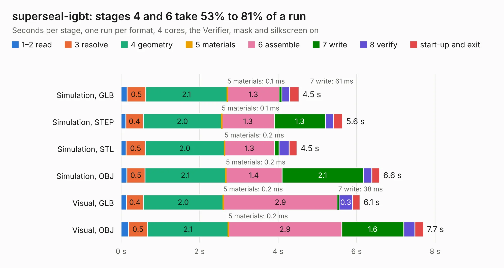

# 2486. superseal-igbt

Board 2,486 of the 3,112 of [Corpus Testing](../Corpus-Testing.md), on [Corpus Page 24](../CorpusTestingPages/Corpus-Testing-24.md#2486-superseal-igbt).

| Mode and format | 1–2 read | 3 resolve | 4 geometry | 5 materials | 6 assemble | 7 write | 8 verify | start-up and exit | Total |
|---|---:|---:|---:|---:|---:|---:|---:|---:|---:|
| Simulation, GLB | 0.2 | 0.5 | 2.1 | 0.1&nbsp;ms | 1.3 | 61&nbsp;ms | 0.2 | 0.2 | 4.5 |
| Simulation, STEP | 0.1 | 0.4 | 2.0 | 0.1&nbsp;ms | 1.3 | 1.3 | 0.2 | 0.2 | 5.6 |
| Simulation, STL | 0.1 | 0.5 | 2.0 | 0.2&nbsp;ms | 1.3 | 0.1 | 0.3 | 0.2 | 4.5 |
| Simulation, OBJ | 0.2 | 0.5 | 2.1 | 0.2&nbsp;ms | 1.4 | 2.1 | 0.2 | 0.2 | 6.6 |
| Visual, GLB | 0.1 | 0.4 | 2.0 | 0.2&nbsp;ms | 2.9 | 38&nbsp;ms | 0.3 | 0.2 | 6.1 |
| Visual, OBJ | 0.2 | 0.5 | 2.1 | 0.2&nbsp;ms | 2.9 | 1.6 | 0.3 | 0.2 | 7.7 |

<table align="center"><tr><td valign="top">

| Board | Repo: [rusefi/rusefi-hardware](https://github.com/rusefi/rusefi-hardware) Board: `superseal-igbt.kicad_pcb` |
|---|---|
| Folder | superseal-igbt |
| Complexity | 234&nbsp;/&nbsp;1000 (size&nbsp;149, features&nbsp;85) |
| KESE&nbsp;features | through vias, rounded, trapezoid or chamfered pads, filled zones, curved board outline, stack-up, dielectric εr and tanδ |
| Tested | 9th November 2026 |
| Copper&nbsp;layers | 2 |
| File&nbsp;format | KiCad 8 (20240108) |
| Parts,&nbsp;tracks,&nbsp;vias | 13, 71, 166 |
| Triangles,&nbsp;simulation | 437,540 in 37 parts |
| Verifier | PASS in all six runs |

</td><td valign="top">

<table>
<tr><th>File type</th><th>File size</th><th>Peak memory used</th></tr>
<tr><th colspan="3" align="left">Simulation</th></tr>
<tr><td>GLB</td><td align="right">15&nbsp;MB</td><td align="right">255&nbsp;MB</td></tr>
<tr><td>STEP</td><td align="right">48&nbsp;MB</td><td align="right">301&nbsp;MB</td></tr>
<tr><td>STL</td><td align="right">22&nbsp;MB</td><td align="right">256&nbsp;MB</td></tr>
<tr><td>OBJ</td><td align="right">44&nbsp;MB</td><td align="right">340&nbsp;MB</td></tr>
<tr><th colspan="3" align="left">Visual</th></tr>
<tr><td>GLB</td><td align="right">9.6&nbsp;MB</td><td align="right">299&nbsp;MB</td></tr>
<tr><td>OBJ</td><td align="right">29&nbsp;MB</td><td align="right">295&nbsp;MB</td></tr>
</table>

</td></tr></table>

| Previous | Next |
|:---|---:|
| [2485. quad-igbt](b2485b_rusefi-hardware_quad-igbt.md) | [2487. tle9104-breakout](b2487b_rusefi-hardware_tle9104-breakout.md) |
