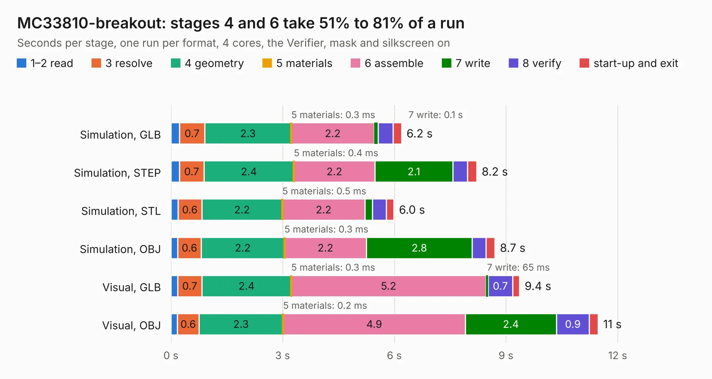

# 2488. MC33810-breakout

Board 2,488 of the 3,118 of [Corpus Testing](../Corpus-Testing.md), on [Corpus Page 24](../CorpusTestingPages/Corpus-Testing-24.md#2488-mc33810-breakout).

| Mode and format | 1–2 read | 3 resolve | 4 geometry | 5 materials | 6 assemble | 7 write | 8 verify | start-up and exit | Total |
|---|---:|---:|---:|---:|---:|---:|---:|---:|---:|
| Simulation, GLB | 0.2 | 0.7 | 2.3 | 0.3&nbsp;ms | 2.2 | 0.1 | 0.4 | 0.2 | 6.2 |
| Simulation, STEP | 0.2 | 0.7 | 2.4 | 0.4&nbsp;ms | 2.2 | 2.1 | 0.4 | 0.2 | 8.2 |
| Simulation, STL | 0.2 | 0.6 | 2.2 | 0.5&nbsp;ms | 2.2 | 0.2 | 0.4 | 0.2 | 6.0 |
| Simulation, OBJ | 0.2 | 0.6 | 2.2 | 0.3&nbsp;ms | 2.2 | 2.8 | 0.4 | 0.2 | 8.7 |
| Visual, GLB | 0.2 | 0.7 | 2.4 | 0.3&nbsp;ms | 5.2 | 65&nbsp;ms | 0.7 | 0.2 | 9.4 |
| Visual, OBJ | 0.2 | 0.6 | 2.3 | 0.2&nbsp;ms | 4.9 | 2.4 | 0.9 | 0.2 | 11.5 |

<table align="center"><tr><td valign="top">

| Board | Repo: [rusefi/rusefi-hardware](https://github.com/rusefi/rusefi-hardware) Board: `MC33810-breakout.kicad_pcb` |
|---|---|
| Folder | MC33810-breakout |
| Complexity | 252&nbsp;/&nbsp;1000 (size&nbsp;167, features&nbsp;85) |
| KESE&nbsp;features | through vias, rounded, trapezoid or chamfered pads, filled zones, curved board outline, stack-up, dielectric εr and tanδ |
| Tested | 9th November 2026 |
| Copper&nbsp;layers | 2 |
| File&nbsp;format | KiCad 7 (20221018) |
| Parts,&nbsp;tracks,&nbsp;vias | 31, 491, 153 |
| Triangles,&nbsp;simulation | 631,044 in 52 parts |
| Verifier | PASS in all six runs |

</td><td valign="top">

<table>
<tr><th>File type</th><th>File size</th><th>Peak memory used</th></tr>
<tr><th colspan="3" align="left">Simulation</th></tr>
<tr><td>GLB</td><td align="right">22&nbsp;MB</td><td align="right">342&nbsp;MB</td></tr>
<tr><td>STEP</td><td align="right">97&nbsp;MB</td><td align="right">420&nbsp;MB</td></tr>
<tr><td>STL</td><td align="right">32&nbsp;MB</td><td align="right">334&nbsp;MB</td></tr>
<tr><td>OBJ</td><td align="right">63&nbsp;MB</td><td align="right">457&nbsp;MB</td></tr>
<tr><th colspan="3" align="left">Visual</th></tr>
<tr><td>GLB</td><td align="right">18&nbsp;MB</td><td align="right">478&nbsp;MB</td></tr>
<tr><td>OBJ</td><td align="right">54&nbsp;MB</td><td align="right">475&nbsp;MB</td></tr>
</table>

</td></tr></table>

| Previous | Next |
|:---|---:|
| [2487. LM1949_Driver](b2487b_rusefi-hardware_LM1949-Driver.md) | [2489. mini48-stm32](b2489b_rusefi-hardware_mini48-stm32_mini48-stm32.md) |
