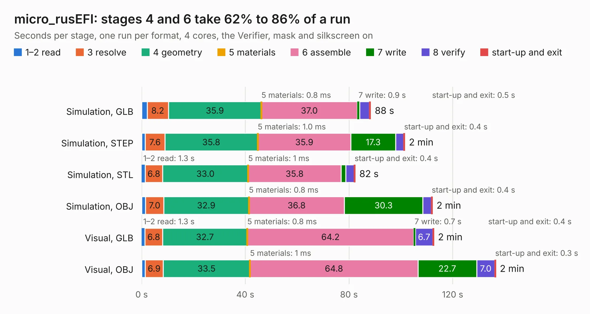

# 2488. micro_rusEFI

Board 2,488 of the 3,121 of [Corpus Testing](../Corpus-Testing.md), on [Corpus Page 24](../CorpusTestingPages/Corpus-Testing-24.md#2488-micro_rusefi).

| Mode and format | 1–2 read | 3 resolve | 4 geometry | 5 materials | 6 assemble | 7 write | 8 verify | start-up and exit | Total |
|---|---:|---:|---:|---:|---:|---:|---:|---:|---:|
| Simulation, GLB | 2.1 | 8.2 | 35.9 | 0.8&nbsp;ms | 37.0 | 0.9 | 3.8 | 0.5 | 88.3 |
| Simulation, STEP | 1.4 | 7.6 | 35.8 | 1.0&nbsp;ms | 35.9 | 17.3 | 3.1 | 0.4 | 101.5 |
| Simulation, STL | 1.3 | 6.8 | 33.0 | 1&nbsp;ms | 35.8 | 1.9 | 3.2 | 0.4 | 82.4 |
| Simulation, OBJ | 1.5 | 7.0 | 32.9 | 0.8&nbsp;ms | 36.8 | 30.3 | 3.2 | 0.4 | 112.2 |
| Visual, GLB | 1.3 | 6.8 | 32.7 | 0.8&nbsp;ms | 64.2 | 0.7 | 6.7 | 0.4 | 112.7 |
| Visual, OBJ | 1.4 | 6.9 | 33.5 | 1&nbsp;ms | 64.8 | 22.7 | 7.0 | 0.3 | 136.6 |

<table align="center"><tr><td valign="top">

| Board | Repo: [rusefi/rusefi-hardware](https://github.com/rusefi/rusefi-hardware) Board: `micro_rusEFI.kicad_pcb` |
|---|---|
| Folder | L9779WD-breakout |
| Complexity | 342&nbsp;/&nbsp;1000 (size&nbsp;267, features&nbsp;75) |
| KESE&nbsp;features | through vias, slotted holes, rounded, trapezoid or chamfered pads, filled zones, copper text, curved board outline |
| Tested | 9th November 2026 |
| Copper&nbsp;layers | 2 |
| File&nbsp;format | KiCad 5 (20171130) |
| Parts,&nbsp;tracks,&nbsp;vias | 233, 4,021, 857 |
| Triangles,&nbsp;simulation | 4,757,940 in 237 parts |
| Verifier | PASS in all six runs |

</td><td valign="top">

<table>
<tr><th>File type</th><th>File size</th><th>Peak memory used</th></tr>
<tr><th colspan="3" align="left">Simulation</th></tr>
<tr><td>GLB</td><td align="right">166&nbsp;MB</td><td align="right">1.5&nbsp;GB</td></tr>
<tr><td>STEP</td><td align="right">872&nbsp;MB</td><td align="right">2.0&nbsp;GB</td></tr>
<tr><td>STL</td><td align="right">238&nbsp;MB</td><td align="right">1.5&nbsp;GB</td></tr>
<tr><td>OBJ</td><td align="right">513&nbsp;MB</td><td align="right">3.1&nbsp;GB</td></tr>
<tr><th colspan="3" align="left">Visual</th></tr>
<tr><td>GLB</td><td align="right">135&nbsp;MB</td><td align="right">2.1&nbsp;GB</td></tr>
<tr><td>OBJ</td><td align="right">427&nbsp;MB</td><td align="right">2.7&nbsp;GB</td></tr>
</table>

</td></tr></table>

| Previous | Next |
|:---|---:|
| [2487. IR2302-testboard](b2487b_rusefi-hardware_IR2302-testboard.md) | [2489. lambda-x2](b2489b_rusefi-hardware_lambda-x2.md) |
