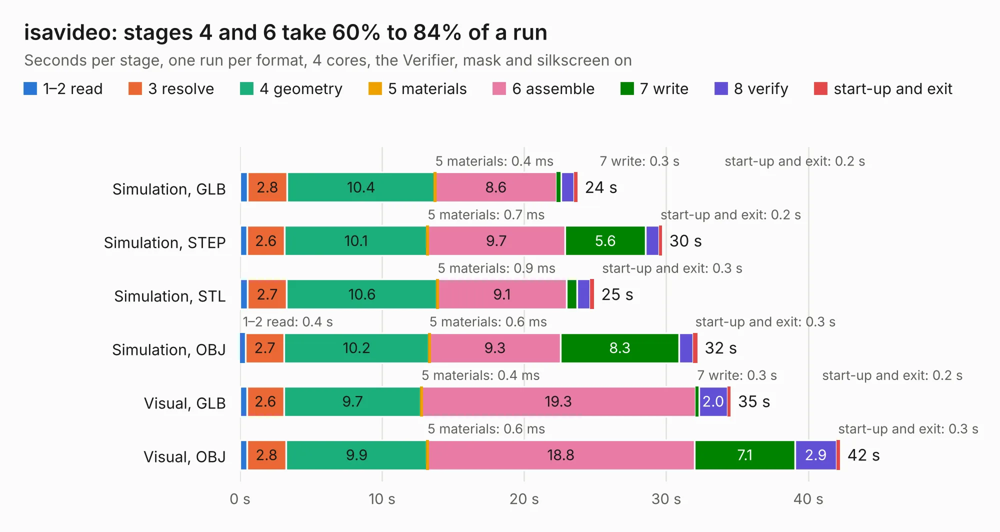

# 2489. isavideo

Board 2,489 of the 3,102 of [Corpus Testing](../Corpus-Testing.md), on [Corpus Page 24](../CorpusTestingPages/Corpus-Testing-24.md#2489-isavideo).

| Mode and format | 1–2 read | 3 resolve | 4 geometry | 5 materials | 6 assemble | 7 write | 8 verify | start-up and exit | Total |
|---|---:|---:|---:|---:|---:|---:|---:|---:|---:|
| Simulation, GLB | 0.5 | 2.8 | 10.4 | 0.4&nbsp;ms | 8.6 | 0.3 | 0.9 | 0.2 | 23.8 |
| Simulation, STEP | 0.5 | 2.6 | 10.1 | 0.7&nbsp;ms | 9.7 | 5.6 | 0.9 | 0.2 | 29.7 |
| Simulation, STL | 0.5 | 2.7 | 10.6 | 0.9&nbsp;ms | 9.1 | 0.8 | 0.9 | 0.3 | 24.9 |
| Simulation, OBJ | 0.4 | 2.7 | 10.2 | 0.6&nbsp;ms | 9.3 | 8.3 | 1.0 | 0.3 | 32.2 |
| Visual, GLB | 0.5 | 2.6 | 9.7 | 0.4&nbsp;ms | 19.3 | 0.3 | 2.0 | 0.2 | 34.5 |
| Visual, OBJ | 0.5 | 2.8 | 9.9 | 0.6&nbsp;ms | 18.8 | 7.1 | 2.9 | 0.3 | 42.2 |

<table align="center"><tr><td valign="top">

| Board | Repo: [schlae/graphics-gremlin](https://github.com/schlae/graphics-gremlin) Board: `isavideo.kicad_pcb` |
|---|---|
| Complexity | 329&nbsp;/&nbsp;1000 (size&nbsp;249, features&nbsp;80) |
| KESE&nbsp;features | through vias, slotted holes, custom pads, filled zones, copper drawings, curved board outline |
| Tested | 9th November 2026 |
| Copper&nbsp;layers | 2 |
| File&nbsp;format | KiCad 5 (20171130) |
| Parts,&nbsp;tracks,&nbsp;vias | 93, 2,062, 258 |
| Triangles,&nbsp;simulation | 1,773,268 in 218 parts |
| Verifier | PASS in all six runs |

</td><td valign="top">

<table>
<tr><th>File type</th><th>File size</th><th>Peak memory used</th></tr>
<tr><th colspan="3" align="left">Simulation</th></tr>
<tr><td>GLB</td><td align="right">63&nbsp;MB</td><td align="right">756&nbsp;MB</td></tr>
<tr><td>STEP</td><td align="right">331&nbsp;MB</td><td align="right">909&nbsp;MB</td></tr>
<tr><td>STL</td><td align="right">89&nbsp;MB</td><td align="right">778&nbsp;MB</td></tr>
<tr><td>OBJ</td><td align="right">191&nbsp;MB</td><td align="right">1.3&nbsp;GB</td></tr>
<tr><th colspan="3" align="left">Visual</th></tr>
<tr><td>GLB</td><td align="right">54&nbsp;MB</td><td align="right">1.2&nbsp;GB</td></tr>
<tr><td>OBJ</td><td align="right">164&nbsp;MB</td><td align="right">1.2&nbsp;GB</td></tr>
</table>

</td></tr></table>

| Previous | Next |
|:---|---:|
| [2488. GreengateDS3](b2488b_goodgreat-ds3_GreengateDS3.md) | [2490. SnarkBarker](b2490b_snark-barker_SnarkBarker.md) |
