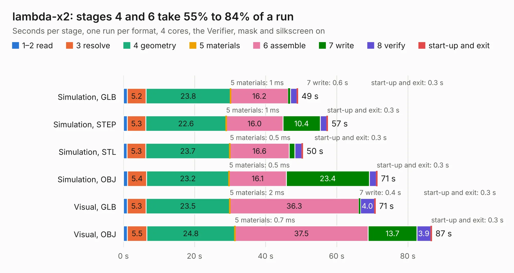

# 2489. lambda-x2

Board 2,489 of the 3,121 of [Corpus Testing](../Corpus-Testing.md), on [Corpus Page 24](../CorpusTestingPages/Corpus-Testing-24.md#2489-lambda-x2).

| Mode and format | 1–2 read | 3 resolve | 4 geometry | 5 materials | 6 assemble | 7 write | 8 verify | start-up and exit | Total |
|---|---:|---:|---:|---:|---:|---:|---:|---:|---:|
| Simulation, GLB | 1.1 | 5.2 | 23.8 | 1&nbsp;ms | 16.2 | 0.6 | 1.8 | 0.3 | 49.1 |
| Simulation, STEP | 1.1 | 5.3 | 22.6 | 1&nbsp;ms | 16.0 | 10.4 | 1.8 | 0.3 | 57.5 |
| Simulation, STL | 1.0 | 5.3 | 23.7 | 0.5&nbsp;ms | 16.6 | 1.6 | 2.0 | 0.3 | 50.5 |
| Simulation, OBJ | 1.2 | 5.4 | 23.2 | 0.5&nbsp;ms | 16.1 | 23.4 | 1.9 | 0.3 | 71.4 |
| Visual, GLB | 1.1 | 5.3 | 23.5 | 2&nbsp;ms | 36.3 | 0.4 | 4.0 | 0.3 | 70.9 |
| Visual, OBJ | 1.1 | 5.5 | 24.8 | 0.7&nbsp;ms | 37.5 | 13.7 | 3.9 | 0.3 | 86.7 |

<table align="center"><tr><td valign="top">

| Board | Repo: [rusefi/rusefi-hardware](https://github.com/rusefi/rusefi-hardware) Board: `lambda-x2.kicad_pcb` |
|---|---|
| Folder | lambda-x2 |
| Complexity | 371&nbsp;/&nbsp;1000 (size&nbsp;271, features&nbsp;100) |
| KESE&nbsp;features | through vias, slotted holes, custom pads, rounded, trapezoid or chamfered pads, filled zones, copper drawings, copper text, curved board outline |
| Tested | 9th November 2026 to 10th November 2026 |
| Copper&nbsp;layers | 4 |
| File&nbsp;format | KiCad 6 (20211014) |
| Parts,&nbsp;tracks,&nbsp;vias | 266, 2,183, 706 |
| Triangles,&nbsp;simulation | 4,213,238 in 179 parts |
| Verifier | PASS in all six runs |
| Run&nbsp;again | Visual, GLB; Visual, OBJ: failed in the corpus run, run again with fixes to KESE made after the corpus run, and passed |

</td><td valign="top">

<table>
<tr><th>File type</th><th>File size</th><th>Peak memory used</th></tr>
<tr><th colspan="3" align="left">Simulation</th></tr>
<tr><td>GLB</td><td align="right">147&nbsp;MB</td><td align="right">1.3&nbsp;GB</td></tr>
<tr><td>STEP</td><td align="right">653&nbsp;MB</td><td align="right">1.7&nbsp;GB</td></tr>
<tr><td>STL</td><td align="right">211&nbsp;MB</td><td align="right">1.3&nbsp;GB</td></tr>
<tr><td>OBJ</td><td align="right">455&nbsp;MB</td><td align="right">2.8&nbsp;GB</td></tr>
<tr><th colspan="3" align="left">Visual</th></tr>
<tr><td>GLB</td><td align="right">92&nbsp;MB</td><td align="right">1.5&nbsp;GB</td></tr>
<tr><td>OBJ</td><td align="right">288&nbsp;MB</td><td align="right">2.0&nbsp;GB</td></tr>
</table>

</td></tr></table>

| Previous | Next |
|:---|---:|
| [2488. micro_rusEFI](b2488b_rusefi-hardware_micro-rusEFI.md) | [2490. LM1949_Driver](b2490b_rusefi-hardware_LM1949-Driver.md) |
