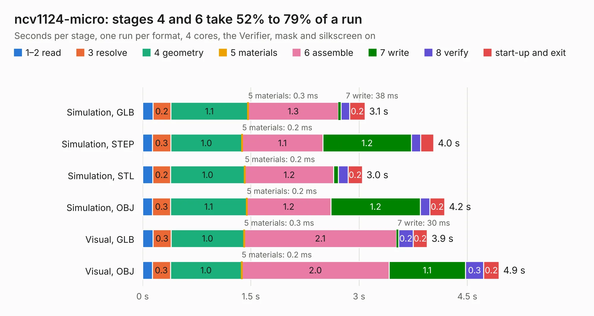

# 2493. ncv1124-micro

Board 2,493 of the 3,121 of [Corpus Testing](../Corpus-Testing.md), on [Corpus Page 24](../CorpusTestingPages/Corpus-Testing-24.md#2493-ncv1124-micro).

| Mode and format | 1–2 read | 3 resolve | 4 geometry | 5 materials | 6 assemble | 7 write | 8 verify | start-up and exit | Total |
|---|---:|---:|---:|---:|---:|---:|---:|---:|---:|
| Simulation, GLB | 0.1 | 0.2 | 1.1 | 0.3&nbsp;ms | 1.3 | 38&nbsp;ms | 0.1 | 0.2 | 3.1 |
| Simulation, STEP | 0.1 | 0.3 | 1.0 | 0.2&nbsp;ms | 1.1 | 1.2 | 0.1 | 0.2 | 4.0 |
| Simulation, STL | 0.1 | 0.2 | 1.0 | 0.2&nbsp;ms | 1.2 | 66&nbsp;ms | 0.1 | 0.2 | 3.0 |
| Simulation, OBJ | 0.1 | 0.3 | 1.1 | 0.2&nbsp;ms | 1.2 | 1.2 | 0.1 | 0.2 | 4.2 |
| Visual, GLB | 0.1 | 0.3 | 1.0 | 0.3&nbsp;ms | 2.1 | 30&nbsp;ms | 0.2 | 0.2 | 3.9 |
| Visual, OBJ | 0.1 | 0.3 | 1.0 | 0.2&nbsp;ms | 2.0 | 1.1 | 0.3 | 0.2 | 4.9 |

<table align="center"><tr><td valign="top">

| Board | Repo: [rusefi/rusefi-hardware](https://github.com/rusefi/rusefi-hardware) Board: `ncv1124-micro.kicad_pcb` |
|---|---|
| Folder | ncv1124-micro |
| Complexity | 242&nbsp;/&nbsp;1000 (size&nbsp;142, features&nbsp;100) |
| KESE&nbsp;features | through vias, rounded, trapezoid or chamfered pads, filled zones, curved board outline, knockout text, stack-up, dielectric εr and tanδ |
| Tested | 9th November 2026 |
| Copper&nbsp;layers | 2 |
| File&nbsp;format | KiCad 10 (20260206) |
| Parts,&nbsp;tracks,&nbsp;vias | 26, 99, 45 |
| Triangles,&nbsp;simulation | 235,422 in 31 parts |
| Verifier | PASS in all six runs |

</td><td valign="top">

<table>
<tr><th>File type</th><th>File size</th><th>Peak memory used</th></tr>
<tr><th colspan="3" align="left">Simulation</th></tr>
<tr><td>GLB</td><td align="right">8.1&nbsp;MB</td><td align="right">228&nbsp;MB</td></tr>
<tr><td>STEP</td><td align="right">40&nbsp;MB</td><td align="right">253&nbsp;MB</td></tr>
<tr><td>STL</td><td align="right">12&nbsp;MB</td><td align="right">228&nbsp;MB</td></tr>
<tr><td>OBJ</td><td align="right">23&nbsp;MB</td><td align="right">228&nbsp;MB</td></tr>
<tr><th colspan="3" align="left">Visual</th></tr>
<tr><td>GLB</td><td align="right">6.8&nbsp;MB</td><td align="right">237&nbsp;MB</td></tr>
<tr><td>OBJ</td><td align="right">20&nbsp;MB</td><td align="right">238&nbsp;MB</td></tr>
</table>

</td></tr></table>

| Previous | Next |
|:---|---:|
| [2492. mini48-stm32](b2492b_rusefi-hardware_mini48-stm32_mini48-stm32.md) | [2494. quad-igbt](b2494b_rusefi-hardware_quad-igbt.md) |
