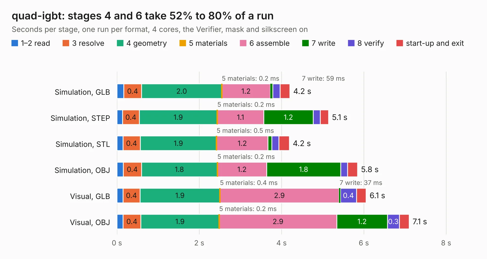

# 2493. quad-igbt

Board 2,493 of the 3,120 of [Corpus Testing](../Corpus-Testing.md), on [Corpus Page 24](../CorpusTestingPages/Corpus-Testing-24.md#2493-quad-igbt).

| Mode and format | 1–2 read | 3 resolve | 4 geometry | 5 materials | 6 assemble | 7 write | 8 verify | start-up and exit | Total |
|---|---:|---:|---:|---:|---:|---:|---:|---:|---:|
| Simulation, GLB | 0.2 | 0.4 | 2.0 | 0.2&nbsp;ms | 1.2 | 59&nbsp;ms | 0.2 | 0.2 | 4.2 |
| Simulation, STEP | 0.1 | 0.4 | 1.9 | 0.2&nbsp;ms | 1.1 | 1.2 | 0.2 | 0.2 | 5.1 |
| Simulation, STL | 0.1 | 0.4 | 1.9 | 0.5&nbsp;ms | 1.2 | 92&nbsp;ms | 0.2 | 0.3 | 4.2 |
| Simulation, OBJ | 0.2 | 0.4 | 1.8 | 0.2&nbsp;ms | 1.2 | 1.8 | 0.2 | 0.2 | 5.8 |
| Visual, GLB | 0.1 | 0.4 | 1.9 | 0.4&nbsp;ms | 2.9 | 37&nbsp;ms | 0.4 | 0.2 | 6.1 |
| Visual, OBJ | 0.1 | 0.4 | 1.9 | 0.2&nbsp;ms | 2.9 | 1.2 | 0.3 | 0.2 | 7.1 |

<table align="center"><tr><td valign="top">

| Board | Repo: [rusefi/rusefi-hardware](https://github.com/rusefi/rusefi-hardware) Board: `quad-igbt.kicad_pcb` |
|---|---|
| Folder | quad-igbt |
| Complexity | 233&nbsp;/&nbsp;1000 (size&nbsp;148, features&nbsp;85) |
| KESE&nbsp;features | through vias, rounded, trapezoid or chamfered pads, filled zones, curved board outline, stack-up, dielectric εr and tanδ |
| Tested | 9th November 2026 |
| Copper&nbsp;layers | 2 |
| File&nbsp;format | KiCad 6 (20211014) |
| Parts,&nbsp;tracks,&nbsp;vias | 12, 17, 174 |
| Triangles,&nbsp;simulation | 369,518 in 24 parts |
| Verifier | PASS in all six runs |

</td><td valign="top">

<table>
<tr><th>File type</th><th>File size</th><th>Peak memory used</th></tr>
<tr><th colspan="3" align="left">Simulation</th></tr>
<tr><td>GLB</td><td align="right">13&nbsp;MB</td><td align="right">241&nbsp;MB</td></tr>
<tr><td>STEP</td><td align="right">40&nbsp;MB</td><td align="right">278&nbsp;MB</td></tr>
<tr><td>STL</td><td align="right">18&nbsp;MB</td><td align="right">243&nbsp;MB</td></tr>
<tr><td>OBJ</td><td align="right">37&nbsp;MB</td><td align="right">292&nbsp;MB</td></tr>
<tr><th colspan="3" align="left">Visual</th></tr>
<tr><td>GLB</td><td align="right">8.4&nbsp;MB</td><td align="right">265&nbsp;MB</td></tr>
<tr><td>OBJ</td><td align="right">25&nbsp;MB</td><td align="right">266&nbsp;MB</td></tr>
</table>

</td></tr></table>

| Previous | Next |
|:---|---:|
| [2492. ncv1124-micro](b2492b_rusefi-hardware_ncv1124-micro.md) | [2494. superseal-igbt](b2494b_rusefi-hardware_superseal-igbt.md) |
