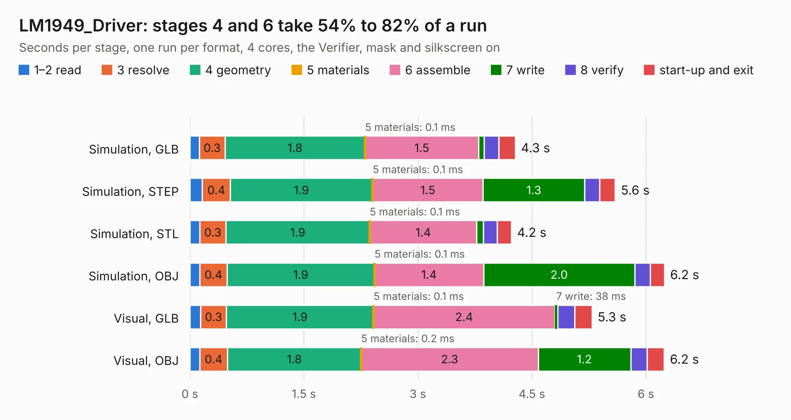

# 2494. LM1949_Driver

Board 2,494 of the 3,125 of [Corpus Testing](../Corpus-Testing.md), on [Corpus Page 24](../CorpusTestingPages/Corpus-Testing-24.md#2494-lm1949_driver).

| Mode and format | 1–2 read | 3 resolve | 4 geometry | 5 materials | 6 assemble | 7 write | 8 verify | start-up and exit | Total |
|---|---:|---:|---:|---:|---:|---:|---:|---:|---:|
| Simulation, GLB | 0.1 | 0.3 | 1.8 | 0.1&nbsp;ms | 1.5 | 73&nbsp;ms | 0.2 | 0.2 | 4.3 |
| Simulation, STEP | 0.2 | 0.4 | 1.9 | 0.1&nbsp;ms | 1.5 | 1.3 | 0.2 | 0.2 | 5.6 |
| Simulation, STL | 0.1 | 0.3 | 1.9 | 0.1&nbsp;ms | 1.4 | 88&nbsp;ms | 0.2 | 0.2 | 4.2 |
| Simulation, OBJ | 0.1 | 0.4 | 1.9 | 0.1&nbsp;ms | 1.4 | 2.0 | 0.2 | 0.2 | 6.2 |
| Visual, GLB | 0.1 | 0.3 | 1.9 | 0.1&nbsp;ms | 2.4 | 38&nbsp;ms | 0.2 | 0.2 | 5.3 |
| Visual, OBJ | 0.1 | 0.4 | 1.8 | 0.2&nbsp;ms | 2.3 | 1.2 | 0.2 | 0.2 | 6.2 |

<table align="center"><tr><td valign="top">

| Board | Repo: [rusefi/rusefi-hardware](https://github.com/rusefi/rusefi-hardware) Board: `LM1949_Driver.kicad_pcb` |
|---|---|
| Folder | Low-Z_LM1949 |
| Complexity | 223&nbsp;/&nbsp;1000 (size&nbsp;148, features&nbsp;75) |
| KESE&nbsp;features | through vias, rounded, trapezoid or chamfered pads, filled zones, stack-up, dielectric εr and tanδ |
| Tested | 9th November 2026 |
| Copper&nbsp;layers | 2 |
| File&nbsp;format | KiCad 6 (20211014) |
| Parts,&nbsp;tracks,&nbsp;vias | 17, 60, 129 |
| Triangles,&nbsp;simulation | 384,828 in 21 parts |
| Verifier | PASS in all six runs |

</td><td valign="top">

<table>
<tr><th>File type</th><th>File size</th><th>Peak memory used</th></tr>
<tr><th colspan="3" align="left">Simulation</th></tr>
<tr><td>GLB</td><td align="right">13&nbsp;MB</td><td align="right">255&nbsp;MB</td></tr>
<tr><td>STEP</td><td align="right">51&nbsp;MB</td><td align="right">299&nbsp;MB</td></tr>
<tr><td>STL</td><td align="right">19&nbsp;MB</td><td align="right">264&nbsp;MB</td></tr>
<tr><td>OBJ</td><td align="right">38&nbsp;MB</td><td align="right">286&nbsp;MB</td></tr>
<tr><th colspan="3" align="left">Visual</th></tr>
<tr><td>GLB</td><td align="right">7.9&nbsp;MB</td><td align="right">279&nbsp;MB</td></tr>
<tr><td>OBJ</td><td align="right">23&nbsp;MB</td><td align="right">281&nbsp;MB</td></tr>
</table>

</td></tr></table>

| Previous | Next |
|:---|---:|
| [2493. lambda-x2](b2493b_rusefi-hardware_lambda-x2.md) | [2495. MC33810-breakout](b2495b_rusefi-hardware_MC33810-breakout.md) |
