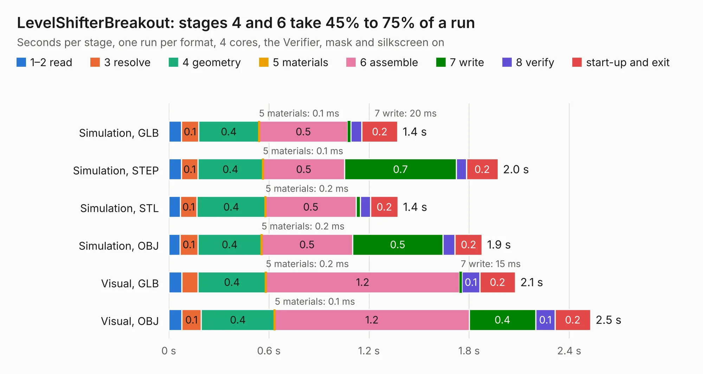

# 2494. LevelShifterBreakout

Board 2,494 of the 3,104 of [Corpus Testing](../Corpus-Testing.md), on [Corpus Page 24](../CorpusTestingPages/Corpus-Testing-24.md#2494-levelshifterbreakout).

| Mode and format | 1–2 read | 3 resolve | 4 geometry | 5 materials | 6 assemble | 7 write | 8 verify | start-up and exit | Total |
|---|---:|---:|---:|---:|---:|---:|---:|---:|---:|
| Simulation, GLB | 76&nbsp;ms | 0.1 | 0.4 | 0.1&nbsp;ms | 0.5 | 20&nbsp;ms | 65&nbsp;ms | 0.2 | 1.4 |
| Simulation, STEP | 75&nbsp;ms | 0.1 | 0.4 | 0.1&nbsp;ms | 0.5 | 0.7 | 61&nbsp;ms | 0.2 | 2.0 |
| Simulation, STL | 69&nbsp;ms | 0.1 | 0.4 | 0.2&nbsp;ms | 0.5 | 26&nbsp;ms | 61&nbsp;ms | 0.2 | 1.4 |
| Simulation, OBJ | 66&nbsp;ms | 0.1 | 0.4 | 0.2&nbsp;ms | 0.5 | 0.5 | 73&nbsp;ms | 0.2 | 1.9 |
| Visual, GLB | 78&nbsp;ms | 98&nbsp;ms | 0.4 | 0.2&nbsp;ms | 1.2 | 15&nbsp;ms | 0.1 | 0.2 | 2.1 |
| Visual, OBJ | 79&nbsp;ms | 0.1 | 0.4 | 0.1&nbsp;ms | 1.2 | 0.4 | 0.1 | 0.2 | 2.5 |

<table align="center"><tr><td valign="top">

| Board | Repo: [scottbez1/smartknob](https://github.com/scottbez1/smartknob) Board: `LevelShifterBreakout.kicad_pcb` |
|---|---|
| Folder | electronics / LevelShifterBreakout |
| Complexity | 156&nbsp;/&nbsp;1000 (size&nbsp;111, features&nbsp;45) |
| KESE&nbsp;features | through vias, rounded, trapezoid or chamfered pads, filled zones |
| Tested | 9th November 2026 |
| Copper&nbsp;layers | 2 |
| File&nbsp;format | KiCad 5 (20171130) |
| Parts,&nbsp;tracks,&nbsp;vias | 5, 63, 11 |
| Triangles,&nbsp;simulation | 137,936 in 27 parts |
| Verifier | PASS in all six runs |

</td><td valign="top">

<table>
<tr><th>File type</th><th>File size</th><th>Peak memory used</th></tr>
<tr><th colspan="3" align="left">Simulation</th></tr>
<tr><td>GLB</td><td align="right">4.7&nbsp;MB</td><td align="right">194&nbsp;MB</td></tr>
<tr><td>STEP</td><td align="right">18&nbsp;MB</td><td align="right">199&nbsp;MB</td></tr>
<tr><td>STL</td><td align="right">6.9&nbsp;MB</td><td align="right">192&nbsp;MB</td></tr>
<tr><td>OBJ</td><td align="right">13&nbsp;MB</td><td align="right">195&nbsp;MB</td></tr>
<tr><th colspan="3" align="left">Visual</th></tr>
<tr><td>GLB</td><td align="right">3.5&nbsp;MB</td><td align="right">160&nbsp;MB</td></tr>
<tr><td>OBJ</td><td align="right">10&nbsp;MB</td><td align="right">167&nbsp;MB</td></tr>
</table>

</td></tr></table>

| Previous | Next |
|:---|---:|
| [2493. BM28B0.6-24DSBreakout](b2493b_smartknob_BM28B0-6-24DSBreakout.md) | [2495. view_base](b2495b_smartknob_view-base.md) |
