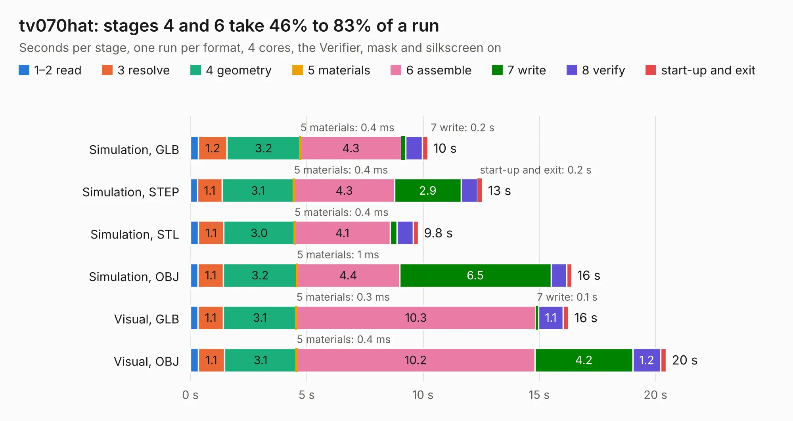

# 2501. tv070hat

Board 2,501 of the 3,118 of [Corpus Testing](../Corpus-Testing.md), on [Corpus Page 24](../CorpusTestingPages/Corpus-Testing-24.md#2501-tv070hat).

| Mode and format | 1–2 read | 3 resolve | 4 geometry | 5 materials | 6 assemble | 7 write | 8 verify | start-up and exit | Total |
|---|---:|---:|---:|---:|---:|---:|---:|---:|---:|
| Simulation, GLB | 0.3 | 1.2 | 3.2 | 0.4&nbsp;ms | 4.3 | 0.2 | 0.7 | 0.2 | 10.2 |
| Simulation, STEP | 0.3 | 1.1 | 3.1 | 0.4&nbsp;ms | 4.3 | 2.9 | 0.7 | 0.2 | 12.6 |
| Simulation, STL | 0.3 | 1.1 | 3.0 | 0.4&nbsp;ms | 4.1 | 0.3 | 0.7 | 0.2 | 9.8 |
| Simulation, OBJ | 0.3 | 1.1 | 3.2 | 1&nbsp;ms | 4.4 | 6.5 | 0.7 | 0.2 | 16.4 |
| Visual, GLB | 0.3 | 1.1 | 3.1 | 0.3&nbsp;ms | 10.3 | 0.1 | 1.1 | 0.2 | 16.3 |
| Visual, OBJ | 0.3 | 1.1 | 3.1 | 0.4&nbsp;ms | 10.2 | 4.2 | 1.2 | 0.2 | 20.5 |

<table align="center"><tr><td valign="top">

| Board | Repo: [ScandentLLC/tv070wxm-hat](https://github.com/ScandentLLC/tv070wxm-hat) Board: `tv070hat.kicad_pcb` |
|---|---|
| Complexity | 286&nbsp;/&nbsp;1000 (size&nbsp;196, features&nbsp;90) |
| KESE&nbsp;features | through vias, rounded, trapezoid or chamfered pads, arc tracks, filled zones, stack-up, dielectric εr and tanδ |
| Tested | 9th November 2026 |
| Copper&nbsp;layers | 4 |
| File&nbsp;format | KiCad 9 (20241229) |
| Parts,&nbsp;tracks,&nbsp;vias | 45, 1,061, 182 |
| Triangles,&nbsp;simulation | 1,240,344 in 99 parts |
| Verifier | PASS in all six runs |

</td><td valign="top">

<table>
<tr><th>File type</th><th>File size</th><th>Peak memory used</th></tr>
<tr><th colspan="3" align="left">Simulation</th></tr>
<tr><td>GLB</td><td align="right">42&nbsp;MB</td><td align="right">496&nbsp;MB</td></tr>
<tr><td>STEP</td><td align="right">157&nbsp;MB</td><td align="right">624&nbsp;MB</td></tr>
<tr><td>STL</td><td align="right">62&nbsp;MB</td><td align="right">515&nbsp;MB</td></tr>
<tr><td>OBJ</td><td align="right">127&nbsp;MB</td><td align="right">835&nbsp;MB</td></tr>
<tr><th colspan="3" align="left">Visual</th></tr>
<tr><td>GLB</td><td align="right">28&nbsp;MB</td><td align="right">684&nbsp;MB</td></tr>
<tr><td>OBJ</td><td align="right">87&nbsp;MB</td><td align="right">682&nbsp;MB</td></tr>
</table>

</td></tr></table>

| Previous | Next |
|:---|---:|
| [2500. sd2snes_ecp5](b2500b_sd2snes-ecp5_sd2snes-ecp5.md) | [2502. CM5RevEng](b2502b_cm5-reveng_CM5RevEng.md) |
