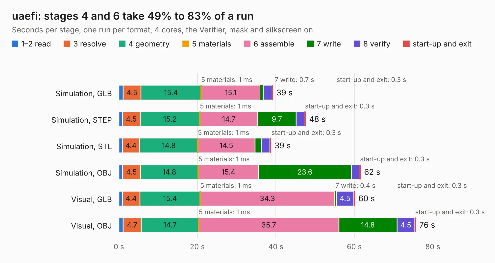

# 2501. uaefi

Board 2,501 of the 3,120 of [Corpus Testing](../Corpus-Testing.md), on [Corpus Page 24](../CorpusTestingPages/Corpus-Testing-24.md#2501-uaefi).

| Mode and format | 1–2 read | 3 resolve | 4 geometry | 5 materials | 6 assemble | 7 write | 8 verify | start-up and exit | Total |
|---|---:|---:|---:|---:|---:|---:|---:|---:|---:|
| Simulation, GLB | 1.1 | 4.5 | 15.4 | 1&nbsp;ms | 15.1 | 0.7 | 2.2 | 0.3 | 39.3 |
| Simulation, STEP | 0.9 | 4.5 | 15.2 | 1&nbsp;ms | 14.7 | 9.7 | 2.2 | 0.3 | 47.6 |
| Simulation, STL | 0.9 | 4.4 | 14.8 | 1&nbsp;ms | 14.5 | 1.6 | 2.2 | 0.3 | 38.8 |
| Simulation, OBJ | 1.0 | 4.5 | 14.8 | 1&nbsp;ms | 15.4 | 23.6 | 2.1 | 0.3 | 61.6 |
| Visual, GLB | 0.9 | 4.4 | 15.4 | 1&nbsp;ms | 34.3 | 0.4 | 4.5 | 0.3 | 60.2 |
| Visual, OBJ | 1.0 | 4.7 | 14.7 | 1&nbsp;ms | 35.7 | 14.8 | 4.5 | 0.3 | 75.7 |

<table align="center"><tr><td valign="top">

| Board | Repo: [rusefi/uaefi](https://github.com/rusefi/uaefi) Board: `uaefi.kicad_pcb` |
|---|---|
| Complexity | 314&nbsp;/&nbsp;1000 (size&nbsp;219, features&nbsp;95) |
| KESE&nbsp;features | through vias, slotted holes, rounded, trapezoid or chamfered pads, filled zones, curved board outline, stack-up, dielectric εr and tanδ |
| Tested | 9th November 2026 |
| Copper&nbsp;layers | 4 |
| File&nbsp;format | KiCad 8 (20240108) |
| Parts,&nbsp;tracks,&nbsp;vias | 156, 1,765, 376 |
| Triangles,&nbsp;simulation | 4,219,476 in 254 parts |
| Verifier | PASS in all six runs |

</td><td valign="top">

<table>
<tr><th>File type</th><th>File size</th><th>Peak memory used</th></tr>
<tr><th colspan="3" align="left">Simulation</th></tr>
<tr><td>GLB</td><td align="right">143&nbsp;MB</td><td align="right">1.3&nbsp;GB</td></tr>
<tr><td>STEP</td><td align="right">595&nbsp;MB</td><td align="right">1.6&nbsp;GB</td></tr>
<tr><td>STL</td><td align="right">211&nbsp;MB</td><td align="right">1.3&nbsp;GB</td></tr>
<tr><td>OBJ</td><td align="right">447&nbsp;MB</td><td align="right">2.7&nbsp;GB</td></tr>
<tr><th colspan="3" align="left">Visual</th></tr>
<tr><td>GLB</td><td align="right">93&nbsp;MB</td><td align="right">1.5&nbsp;GB</td></tr>
<tr><td>OBJ</td><td align="right">292&nbsp;MB</td><td align="right">2.0&nbsp;GB</td></tr>
</table>

</td></tr></table>

| Previous | Next |
|:---|---:|
| [2500. 8HPTCUAdapter](b2500b_rusefi-hardware_8HPTCUAdapter.md) | [2502. sd2snes_ecp5](b2502b_sd2snes-ecp5_sd2snes-ecp5.md) |
