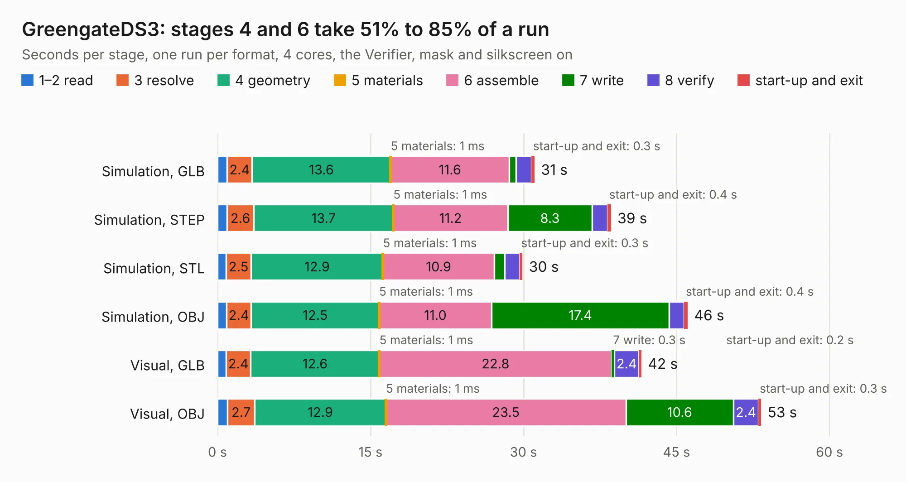

# 2502. GreengateDS3

Board 2,502 of the 3,116 of [Corpus Testing](../Corpus-Testing.md), on [Corpus Page 24](../CorpusTestingPages/Corpus-Testing-24.md#2502-greengateds3).

| Mode and format | 1–2 read | 3 resolve | 4 geometry | 5 materials | 6 assemble | 7 write | 8 verify | start-up and exit | Total |
|---|---:|---:|---:|---:|---:|---:|---:|---:|---:|
| Simulation, GLB | 0.9 | 2.4 | 13.6 | 1&nbsp;ms | 11.6 | 0.6 | 1.5 | 0.3 | 31.1 |
| Simulation, STEP | 0.9 | 2.6 | 13.7 | 1&nbsp;ms | 11.2 | 8.3 | 1.5 | 0.4 | 38.6 |
| Simulation, STL | 0.8 | 2.5 | 12.9 | 1&nbsp;ms | 10.9 | 1.0 | 1.5 | 0.3 | 29.9 |
| Simulation, OBJ | 0.9 | 2.4 | 12.5 | 1&nbsp;ms | 11.0 | 17.4 | 1.5 | 0.4 | 46.1 |
| Visual, GLB | 0.8 | 2.4 | 12.6 | 1&nbsp;ms | 22.8 | 0.3 | 2.4 | 0.2 | 41.6 |
| Visual, OBJ | 1.0 | 2.7 | 12.9 | 1&nbsp;ms | 23.5 | 10.6 | 2.4 | 0.3 | 53.3 |

<table align="center"><tr><td valign="top">

| Board | Repo: [schlae/goodgreat-ds3](https://github.com/schlae/goodgreat-ds3) Board: `GreengateDS3.kicad_pcb` |
|---|---|
| Complexity | 305&nbsp;/&nbsp;1000 (size&nbsp;195, features&nbsp;110) |
| KESE&nbsp;features | through vias, custom pads, rounded, trapezoid or chamfered pads, filled zones, copper drawings, copper text, stack-up, dielectric εr and tanδ |
| Tested | 9th November 2026 |
| Copper&nbsp;layers | 2 |
| File&nbsp;format | KiCad 7 (20221018) |
| Parts,&nbsp;tracks,&nbsp;vias | 70, 2,657, 168 |
| Triangles,&nbsp;simulation | 2,921,532 in 175 parts |
| Verifier | PASS in all six runs |

</td><td valign="top">

<table>
<tr><th>File type</th><th>File size</th><th>Peak memory used</th></tr>
<tr><th colspan="3" align="left">Simulation</th></tr>
<tr><td>GLB</td><td align="right">98&nbsp;MB</td><td align="right">1.0&nbsp;GB</td></tr>
<tr><td>STEP</td><td align="right">405&nbsp;MB</td><td align="right">1.2&nbsp;GB</td></tr>
<tr><td>STL</td><td align="right">146&nbsp;MB</td><td align="right">1.1&nbsp;GB</td></tr>
<tr><td>OBJ</td><td align="right">304&nbsp;MB</td><td align="right">1.9&nbsp;GB</td></tr>
<tr><th colspan="3" align="left">Visual</th></tr>
<tr><td>GLB</td><td align="right">62&nbsp;MB</td><td align="right">1.3&nbsp;GB</td></tr>
<tr><td>OBJ</td><td align="right">193&nbsp;MB</td><td align="right">1.4&nbsp;GB</td></tr>
</table>

</td></tr></table>

| Previous | Next |
|:---|---:|
| [2501. rpi-rm0](b2501b_cm5-reveng_rpi-rm0.md) | [2503. isavideo](b2503b_graphics-gremlin_isavideo.md) |
