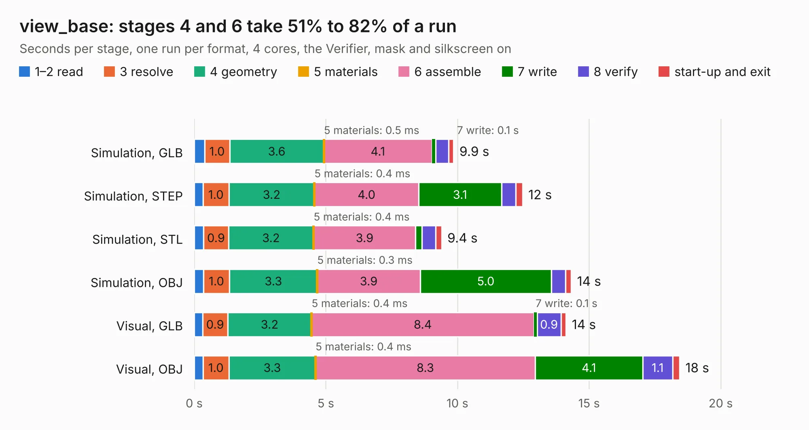

# 2502. view_base

Board 2,502 of the 3,111 of [Corpus Testing](../Corpus-Testing.md), on [Corpus Page 24](../CorpusTestingPages/Corpus-Testing-24.md#2502-view_base).

| Mode and format | 1–2 read | 3 resolve | 4 geometry | 5 materials | 6 assemble | 7 write | 8 verify | start-up and exit | Total |
|---|---:|---:|---:|---:|---:|---:|---:|---:|---:|
| Simulation, GLB | 0.4 | 1.0 | 3.6 | 0.5&nbsp;ms | 4.1 | 0.1 | 0.5 | 0.2 | 9.9 |
| Simulation, STEP | 0.3 | 1.0 | 3.2 | 0.4&nbsp;ms | 4.0 | 3.1 | 0.5 | 0.3 | 12.5 |
| Simulation, STL | 0.4 | 0.9 | 3.2 | 0.4&nbsp;ms | 3.9 | 0.2 | 0.5 | 0.2 | 9.4 |
| Simulation, OBJ | 0.3 | 1.0 | 3.3 | 0.3&nbsp;ms | 3.9 | 5.0 | 0.5 | 0.2 | 14.3 |
| Visual, GLB | 0.3 | 0.9 | 3.2 | 0.4&nbsp;ms | 8.4 | 0.1 | 0.9 | 0.2 | 14.1 |
| Visual, OBJ | 0.3 | 1.0 | 3.3 | 0.4&nbsp;ms | 8.3 | 4.1 | 1.1 | 0.3 | 18.4 |

<table align="center"><tr><td valign="top">

| Board | Repo: [scottbez1/smartknob](https://github.com/scottbez1/smartknob) Board: `view_base.kicad_pcb` |
|---|---|
| Folder | electronics / view_base |
| Complexity | 317&nbsp;/&nbsp;1000 (size&nbsp;182, features&nbsp;135) |
| KESE&nbsp;features | through vias, slotted holes, custom pads, rounded, trapezoid or chamfered pads, drill offsets, filled zones, copper drawings, curved board outline, stack-up, dielectric εr and tanδ, mask and silkscreen colours |
| Tested | 9th November 2026 |
| Copper&nbsp;layers | 2 |
| File&nbsp;format | KiCad 6 (20211014) |
| Parts,&nbsp;tracks,&nbsp;vias | 76, 834, 174 |
| Triangles,&nbsp;simulation | 919,322 in 102 parts |
| Verifier | PASS in all six runs |

</td><td valign="top">

<table>
<tr><th>File type</th><th>File size</th><th>Peak memory used</th></tr>
<tr><th colspan="3" align="left">Simulation</th></tr>
<tr><td>GLB</td><td align="right">32&nbsp;MB</td><td align="right">471&nbsp;MB</td></tr>
<tr><td>STEP</td><td align="right">159&nbsp;MB</td><td align="right">526&nbsp;MB</td></tr>
<tr><td>STL</td><td align="right">46&nbsp;MB</td><td align="right">461&nbsp;MB</td></tr>
<tr><td>OBJ</td><td align="right">93&nbsp;MB</td><td align="right">644&nbsp;MB</td></tr>
<tr><th colspan="3" align="left">Visual</th></tr>
<tr><td>GLB</td><td align="right">28&nbsp;MB</td><td align="right">584&nbsp;MB</td></tr>
<tr><td>OBJ</td><td align="right">84&nbsp;MB</td><td align="right">633&nbsp;MB</td></tr>
</table>

</td></tr></table>

| Previous | Next |
|:---|---:|
| [2501. LevelShifterBreakout](b2501b_smartknob_LevelShifterBreakout.md) | [2503. view_screen](b2503b_smartknob_view-screen.md) |
