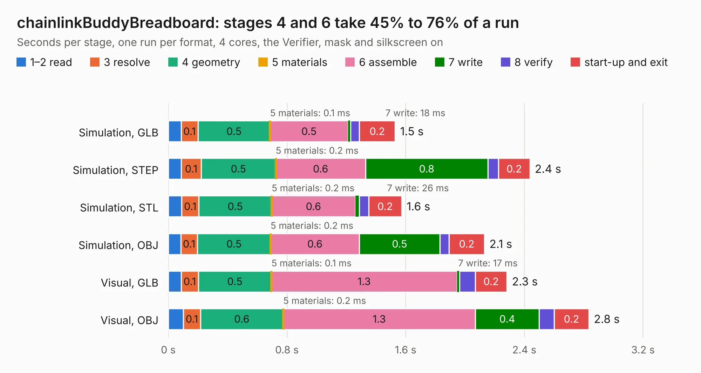

# 2504. chainlinkBuddyBreadboard

Board 2,504 of the 3,110 of [Corpus Testing](../Corpus-Testing.md), on [Corpus Page 24](../CorpusTestingPages/Corpus-Testing-24.md#2504-chainlinkbuddybreadboard).

| Mode and format | 1–2 read | 3 resolve | 4 geometry | 5 materials | 6 assemble | 7 write | 8 verify | start-up and exit | Total |
|---|---:|---:|---:|---:|---:|---:|---:|---:|---:|
| Simulation, GLB | 87&nbsp;ms | 0.1 | 0.5 | 0.1&nbsp;ms | 0.5 | 18&nbsp;ms | 59&nbsp;ms | 0.2 | 1.5 |
| Simulation, STEP | 87&nbsp;ms | 0.1 | 0.5 | 0.2&nbsp;ms | 0.6 | 0.8 | 72&nbsp;ms | 0.2 | 2.4 |
| Simulation, STL | 91&nbsp;ms | 0.1 | 0.5 | 0.2&nbsp;ms | 0.6 | 26&nbsp;ms | 64&nbsp;ms | 0.2 | 1.6 |
| Simulation, OBJ | 84&nbsp;ms | 0.1 | 0.5 | 0.2&nbsp;ms | 0.6 | 0.5 | 62&nbsp;ms | 0.2 | 2.1 |
| Visual, GLB | 87&nbsp;ms | 0.1 | 0.5 | 0.1&nbsp;ms | 1.3 | 17&nbsp;ms | 0.1 | 0.2 | 2.3 |
| Visual, OBJ | 0.1 | 0.1 | 0.6 | 0.2&nbsp;ms | 1.3 | 0.4 | 0.1 | 0.2 | 2.8 |

<table align="center"><tr><td valign="top">

| Board | Repo: [scottbez1/splitflap](https://github.com/scottbez1/splitflap) Board: `chainlinkBuddyBreadboard.kicad_pcb` |
|---|---|
| Folder | electronics / chainlinkBuddyBreadboard |
| Complexity | 129&nbsp;/&nbsp;1000 (size&nbsp;84, features&nbsp;45) |
| KESE&nbsp;features | through vias, rounded, trapezoid or chamfered pads, filled zones |
| Tested | 9th November 2026 |
| Copper&nbsp;layers | 2 |
| File&nbsp;format | KiCad 5 (20171130) |
| Parts,&nbsp;tracks,&nbsp;vias | 2, 13, 5 |
| Triangles,&nbsp;simulation | 109,334 in 16 parts |
| Verifier | PASS in all six runs |

</td><td valign="top">

<table>
<tr><th>File type</th><th>File size</th><th>Peak memory used</th></tr>
<tr><th colspan="3" align="left">Simulation</th></tr>
<tr><td>GLB</td><td align="right">3.8&nbsp;MB</td><td align="right">187&nbsp;MB</td></tr>
<tr><td>STEP</td><td align="right">17&nbsp;MB</td><td align="right">187&nbsp;MB</td></tr>
<tr><td>STL</td><td align="right">5.5&nbsp;MB</td><td align="right">187&nbsp;MB</td></tr>
<tr><td>OBJ</td><td align="right">11&nbsp;MB</td><td align="right">180&nbsp;MB</td></tr>
<tr><th colspan="3" align="left">Visual</th></tr>
<tr><td>GLB</td><td align="right">3.0&nbsp;MB</td><td align="right">152&nbsp;MB</td></tr>
<tr><td>OBJ</td><td align="right">8.4&nbsp;MB</td><td align="right">152&nbsp;MB</td></tr>
</table>

</td></tr></table>

| Previous | Next |
|:---|---:|
| [2503. chainlinkBase](b2503b_splitflap_chainlinkBase.md) | [2505. chainlinkBuddyTDisplay](b2505b_splitflap_chainlinkBuddyTDisplay.md) |
