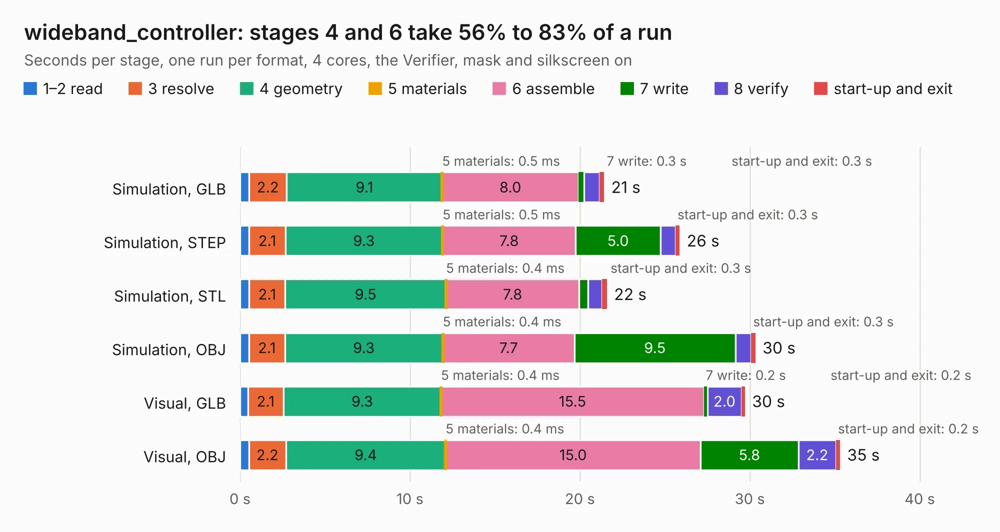

# 2505. wideband_controller

Board 2,505 of the 3,127 of [Corpus Testing](../Corpus-Testing.md), on [Corpus Page 24](../CorpusTestingPages/Corpus-Testing-24.md#2505-wideband_controller).

| Mode and format | 1–2 read | 3 resolve | 4 geometry | 5 materials | 6 assemble | 7 write | 8 verify | start-up and exit | Total |
|---|---:|---:|---:|---:|---:|---:|---:|---:|---:|
| Simulation, GLB | 0.5 | 2.2 | 9.1 | 0.5&nbsp;ms | 8.0 | 0.3 | 0.9 | 0.3 | 21.4 |
| Simulation, STEP | 0.5 | 2.1 | 9.3 | 0.5&nbsp;ms | 7.8 | 5.0 | 0.9 | 0.3 | 25.9 |
| Simulation, STL | 0.5 | 2.1 | 9.5 | 0.4&nbsp;ms | 7.8 | 0.5 | 0.9 | 0.3 | 21.6 |
| Simulation, OBJ | 0.5 | 2.1 | 9.3 | 0.4&nbsp;ms | 7.7 | 9.5 | 0.9 | 0.3 | 30.3 |
| Visual, GLB | 0.5 | 2.1 | 9.3 | 0.4&nbsp;ms | 15.5 | 0.2 | 2.0 | 0.2 | 29.7 |
| Visual, OBJ | 0.5 | 2.2 | 9.4 | 0.4&nbsp;ms | 15.0 | 5.8 | 2.2 | 0.2 | 35.3 |

<table align="center"><tr><td valign="top">

| Board | Repo: [rusefi/rusefi-hardware](https://github.com/rusefi/rusefi-hardware) Board: `wideband_controller.kicad_pcb` |
|---|---|
| Folder | wideband-F103 |
| Complexity | 304&nbsp;/&nbsp;1000 (size&nbsp;249, features&nbsp;55) |
| KESE&nbsp;features | through vias, rounded, trapezoid or chamfered pads, filled zones, curved board outline |
| Tested | 9th November 2026 |
| Copper&nbsp;layers | 4 |
| File&nbsp;format | KiCad 6 (20211014) |
| Parts,&nbsp;tracks,&nbsp;vias | 136, 1,183, 191 |
| Triangles,&nbsp;simulation | 1,985,478 in 132 parts |
| Verifier | PASS in all six runs |

</td><td valign="top">

<table>
<tr><th>File type</th><th>File size</th><th>Peak memory used</th></tr>
<tr><th colspan="3" align="left">Simulation</th></tr>
<tr><td>GLB</td><td align="right">70&nbsp;MB</td><td align="right">697&nbsp;MB</td></tr>
<tr><td>STEP</td><td align="right">351&nbsp;MB</td><td align="right">901&nbsp;MB</td></tr>
<tr><td>STL</td><td align="right">99&nbsp;MB</td><td align="right">802&nbsp;MB</td></tr>
<tr><td>OBJ</td><td align="right">211&nbsp;MB</td><td align="right">1.4&nbsp;GB</td></tr>
<tr><th colspan="3" align="left">Visual</th></tr>
<tr><td>GLB</td><td align="right">44&nbsp;MB</td><td align="right">792&nbsp;MB</td></tr>
<tr><td>OBJ</td><td align="right">134&nbsp;MB</td><td align="right">926&nbsp;MB</td></tr>
</table>

</td></tr></table>

| Previous | Next |
|:---|---:|
| [2504. ncv1124](b2504b_rusefi-hardware_ncv1124.md) | [2506. 8HPTCUAdapter](b2506b_rusefi-hardware_8HPTCUAdapter.md) |
