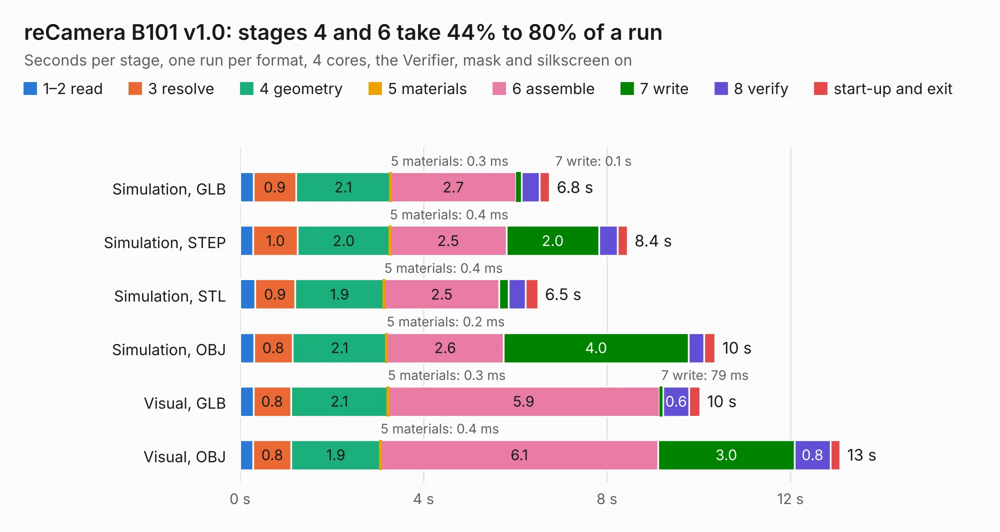

# 2506. reCamera B101 v1.0

Board 2,506 of the 3,105 of [Corpus Testing](../Corpus-Testing.md), on [Corpus Page 24](../CorpusTestingPages/Corpus-Testing-24.md#2506-recamera-b101-v10).

| Mode and format | 1–2 read | 3 resolve | 4 geometry | 5 materials | 6 assemble | 7 write | 8 verify | start-up and exit | Total |
|---|---:|---:|---:|---:|---:|---:|---:|---:|---:|
| Simulation, GLB | 0.3 | 0.9 | 2.1 | 0.3&nbsp;ms | 2.7 | 0.1 | 0.4 | 0.2 | 6.8 |
| Simulation, STEP | 0.3 | 1.0 | 2.0 | 0.4&nbsp;ms | 2.5 | 2.0 | 0.4 | 0.2 | 8.4 |
| Simulation, STL | 0.3 | 0.9 | 1.9 | 0.4&nbsp;ms | 2.5 | 0.2 | 0.4 | 0.3 | 6.5 |
| Simulation, OBJ | 0.3 | 0.8 | 2.1 | 0.2&nbsp;ms | 2.6 | 4.0 | 0.3 | 0.2 | 10.4 |
| Visual, GLB | 0.3 | 0.8 | 2.1 | 0.3&nbsp;ms | 5.9 | 79&nbsp;ms | 0.6 | 0.2 | 10.0 |
| Visual, OBJ | 0.3 | 0.8 | 1.9 | 0.4&nbsp;ms | 6.1 | 3.0 | 0.8 | 0.2 | 13.1 |

<table align="center"><tr><td valign="top">

| Board | Repo: [Seeed-Studio/OSHW-reCamera-Series](https://github.com/Seeed-Studio/OSHW-reCamera-Series) Board: `reCamera B101 v1.0.kicad_pcb` |
|---|---|
| Folder | hardware / recamera-2002 / base / b101-default / PCB / V1.0 |
| Complexity | 295&nbsp;/&nbsp;1000 (size&nbsp;185, features&nbsp;110) |
| KESE&nbsp;features | through vias, slotted holes, rounded, trapezoid or chamfered pads, filled zones, curved board outline, stack-up, dielectric εr and tanδ, copper finish |
| Tested | 9th November 2026 |
| Copper&nbsp;layers | 4 |
| File&nbsp;format | KiCad 8 (20240108) |
| Parts,&nbsp;tracks,&nbsp;vias | 46, 408, 133 |
| Triangles,&nbsp;simulation | 794,838 in 86 parts |
| Verifier | PASS in all six runs |

</td><td valign="top">

<table>
<tr><th>File type</th><th>File size</th><th>Peak memory used</th></tr>
<tr><th colspan="3" align="left">Simulation</th></tr>
<tr><td>GLB</td><td align="right">27&nbsp;MB</td><td align="right">393&nbsp;MB</td></tr>
<tr><td>STEP</td><td align="right">123&nbsp;MB</td><td align="right">455&nbsp;MB</td></tr>
<tr><td>STL</td><td align="right">40&nbsp;MB</td><td align="right">418&nbsp;MB</td></tr>
<tr><td>OBJ</td><td align="right">80&nbsp;MB</td><td align="right">550&nbsp;MB</td></tr>
<tr><th colspan="3" align="left">Visual</th></tr>
<tr><td>GLB</td><td align="right">19&nbsp;MB</td><td align="right">461&nbsp;MB</td></tr>
<tr><td>OBJ</td><td align="right">57&nbsp;MB</td><td align="right">454&nbsp;MB</td></tr>
</table>

</td></tr></table>

| Previous | Next |
|:---|---:|
| [2505. mppt](b2505b_mppt_mppt.md) | [2507. reCamera B101 v1.1](b2507b_OSHW-reCamera-Series_reCamera-B101-v1-1.md) |
