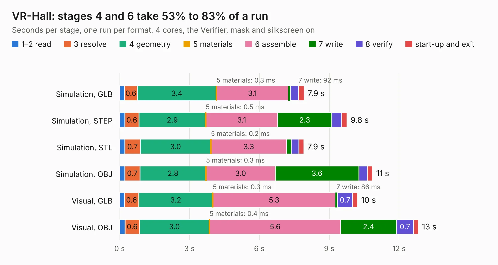

# 2506. VR-Hall

Board 2,506 of the 3,131 of [Corpus Testing](../Corpus-Testing.md), on [Corpus Page 24](../CorpusTestingPages/Corpus-Testing-24.md#2506-vr-hall).

| Mode and format | 1–2 read | 3 resolve | 4 geometry | 5 materials | 6 assemble | 7 write | 8 verify | start-up and exit | Total |
|---|---:|---:|---:|---:|---:|---:|---:|---:|---:|
| Simulation, GLB | 0.2 | 0.6 | 3.4 | 0.3&nbsp;ms | 3.1 | 92&nbsp;ms | 0.3 | 0.2 | 7.9 |
| Simulation, STEP | 0.2 | 0.6 | 2.9 | 0.5&nbsp;ms | 3.1 | 2.3 | 0.4 | 0.2 | 9.8 |
| Simulation, STL | 0.2 | 0.7 | 3.0 | 0.2&nbsp;ms | 3.3 | 0.2 | 0.3 | 0.2 | 7.9 |
| Simulation, OBJ | 0.2 | 0.7 | 2.8 | 0.3&nbsp;ms | 3.0 | 3.6 | 0.4 | 0.2 | 10.9 |
| Visual, GLB | 0.2 | 0.6 | 3.2 | 0.3&nbsp;ms | 5.3 | 86&nbsp;ms | 0.7 | 0.2 | 10.2 |
| Visual, OBJ | 0.2 | 0.6 | 3.0 | 0.4&nbsp;ms | 5.6 | 2.4 | 0.7 | 0.2 | 12.8 |

<table align="center"><tr><td valign="top">

| Board | Repo: [rusefi/rusefi-hardware](https://github.com/rusefi/rusefi-hardware) Board: `VR-Hall.kicad_pcb` |
|---|---|
| Folder | VR-Hall |
| Complexity | 257&nbsp;/&nbsp;1000 (size&nbsp;162, features&nbsp;95) |
| KESE&nbsp;features | through vias, slotted holes, rounded, trapezoid or chamfered pads, filled zones, curved board outline, stack-up, dielectric εr and tanδ |
| Tested | 9th November 2026 |
| Copper&nbsp;layers | 2 |
| File&nbsp;format | KiCad 7 (20221018) |
| Parts,&nbsp;tracks,&nbsp;vias | 56, 210, 94 |
| Triangles,&nbsp;simulation | 723,276 in 56 parts |
| Verifier | PASS in all six runs |

</td><td valign="top">

<table>
<tr><th>File type</th><th>File size</th><th>Peak memory used</th></tr>
<tr><th colspan="3" align="left">Simulation</th></tr>
<tr><td>GLB</td><td align="right">25&nbsp;MB</td><td align="right">366&nbsp;MB</td></tr>
<tr><td>STEP</td><td align="right">121&nbsp;MB</td><td align="right">451&nbsp;MB</td></tr>
<tr><td>STL</td><td align="right">36&nbsp;MB</td><td align="right">367&nbsp;MB</td></tr>
<tr><td>OBJ</td><td align="right">73&nbsp;MB</td><td align="right">523&nbsp;MB</td></tr>
<tr><th colspan="3" align="left">Visual</th></tr>
<tr><td>GLB</td><td align="right">19&nbsp;MB</td><td align="right">432&nbsp;MB</td></tr>
<tr><td>OBJ</td><td align="right">57&nbsp;MB</td><td align="right">499&nbsp;MB</td></tr>
</table>

</td></tr></table>

| Previous | Next |
|:---|---:|
| [2505. uaBrain-gm-e38](b2505b_rusefi-hardware_uaBrain-gm-e38.md) | [2507. ncv1124](b2507b_rusefi-hardware_ncv1124.md) |
