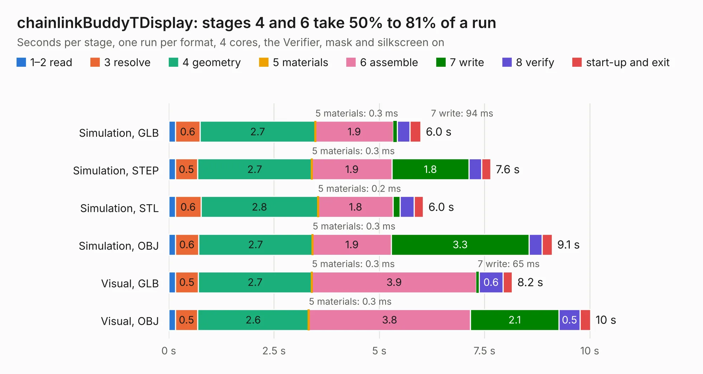

# 2511. chainlinkBuddyTDisplay

Board 2,511 of the 3,116 of [Corpus Testing](../Corpus-Testing.md), on [Corpus Page 24](../CorpusTestingPages/Corpus-Testing-24.md#2511-chainlinkbuddytdisplay).

| Mode and format | 1–2 read | 3 resolve | 4 geometry | 5 materials | 6 assemble | 7 write | 8 verify | start-up and exit | Total |
|---|---:|---:|---:|---:|---:|---:|---:|---:|---:|
| Simulation, GLB | 0.2 | 0.6 | 2.7 | 0.3&nbsp;ms | 1.9 | 94&nbsp;ms | 0.3 | 0.3 | 6.0 |
| Simulation, STEP | 0.2 | 0.5 | 2.7 | 0.3&nbsp;ms | 1.9 | 1.8 | 0.3 | 0.2 | 7.6 |
| Simulation, STL | 0.2 | 0.6 | 2.8 | 0.2&nbsp;ms | 1.8 | 0.2 | 0.3 | 0.2 | 6.0 |
| Simulation, OBJ | 0.2 | 0.6 | 2.7 | 0.3&nbsp;ms | 1.9 | 3.3 | 0.3 | 0.2 | 9.1 |
| Visual, GLB | 0.2 | 0.5 | 2.7 | 0.3&nbsp;ms | 3.9 | 65&nbsp;ms | 0.6 | 0.2 | 8.2 |
| Visual, OBJ | 0.2 | 0.5 | 2.6 | 0.3&nbsp;ms | 3.8 | 2.1 | 0.5 | 0.2 | 10.0 |

<table align="center"><tr><td valign="top">

| Board | Repo: [scottbez1/splitflap](https://github.com/scottbez1/splitflap) Board: `chainlinkBuddyTDisplay.kicad_pcb` |
|---|---|
| Folder | electronics / chainlinkBuddyTDisplay |
| Complexity | 159&nbsp;/&nbsp;1000 (size&nbsp;109, features&nbsp;50) |
| KESE&nbsp;features | slotted holes, rounded, trapezoid or chamfered pads, filled zones, curved board outline |
| Tested | 9th November 2026 |
| Copper&nbsp;layers | 2 |
| File&nbsp;format | KiCad 5 (20171130) |
| Parts,&nbsp;tracks,&nbsp;vias | 8, 64, 0 |
| Triangles,&nbsp;simulation | 587,596 in 33 parts |
| Verifier | PASS in all six runs |

</td><td valign="top">

<table>
<tr><th>File type</th><th>File size</th><th>Peak memory used</th></tr>
<tr><th colspan="3" align="left">Simulation</th></tr>
<tr><td>GLB</td><td align="right">19&nbsp;MB</td><td align="right">301&nbsp;MB</td></tr>
<tr><td>STEP</td><td align="right">83&nbsp;MB</td><td align="right">358&nbsp;MB</td></tr>
<tr><td>STL</td><td align="right">29&nbsp;MB</td><td align="right">290&nbsp;MB</td></tr>
<tr><td>OBJ</td><td align="right">59&nbsp;MB</td><td align="right">432&nbsp;MB</td></tr>
<tr><th colspan="3" align="left">Visual</th></tr>
<tr><td>GLB</td><td align="right">13&nbsp;MB</td><td align="right">368&nbsp;MB</td></tr>
<tr><td>OBJ</td><td align="right">39&nbsp;MB</td><td align="right">382&nbsp;MB</td></tr>
</table>

</td></tr></table>

| Previous | Next |
|:---|---:|
| [2510. chainlinkBuddyBreadboard](b2510b_splitflap_chainlinkBuddyBreadboard.md) | [2512. chainlinkDriver](b2512b_splitflap_chainlinkDriver.md) |
