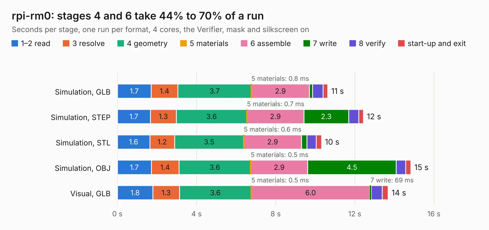

# 2513. rpi-rm0

Board 2,513 of the 3,130 of [Corpus Testing](../Corpus-Testing.md), on [Corpus Page 24](../CorpusTestingPages/Corpus-Testing-24.md#2513-rpi-rm0).

| Mode and format | 1–2 read | 3 resolve | 4 geometry | 5 materials | 6 assemble | 7 write | 8 verify | start-up and exit | Total |
|---|---:|---:|---:|---:|---:|---:|---:|---:|---:|
| Simulation, GLB | 1.7 | 1.4 | 3.7 | 0.8&nbsp;ms | 2.9 | 0.2 | 0.5 | 0.2 | 10.6 |
| Simulation, STEP | 1.7 | 1.3 | 3.6 | 0.7&nbsp;ms | 2.9 | 2.3 | 0.5 | 0.2 | 12.4 |
| Simulation, STL | 1.6 | 1.2 | 3.5 | 0.6&nbsp;ms | 2.9 | 0.3 | 0.5 | 0.3 | 10.3 |
| Simulation, OBJ | 1.7 | 1.4 | 3.6 | 0.5&nbsp;ms | 2.9 | 4.5 | 0.5 | 0.3 | 14.8 |
| Visual, GLB | 1.8 | 1.3 | 3.6 | 0.5&nbsp;ms | 6.0 | 69&nbsp;ms | 0.6 | 0.3 | 13.7 |
| Visual, OBJ | 1.7 | 1.3 | 3.6 | 0.8&nbsp;ms | 6.0 | 2.2 | 0.6 | 0.2 | 15.5 |

<table align="center"><tr><td valign="top">

| Board | Repo: [schlae/cm5-reveng](https://github.com/schlae/cm5-reveng) Board: `rpi-rm0.kicad_pcb` |
|---|---|
| Folder | rpi-rm0 |
| Complexity | 413&nbsp;/&nbsp;1000 (size&nbsp;258, features&nbsp;155) |
| KESE&nbsp;features | through vias, blind and buried vias, microvias, rounded, trapezoid or chamfered pads, filled zones, stack-up, dielectric εr and tanδ |
| Tested | 9th November 2026 |
| Copper&nbsp;layers | 6 |
| File&nbsp;format | KiCad 9 (20241229) |
| Parts,&nbsp;tracks,&nbsp;vias | 40, 465, 451 |
| Triangles,&nbsp;simulation | 897,508 in 114 parts |
| Verifier | PASS in all six runs |

</td><td valign="top">

<table>
<tr><th>File type</th><th>File size</th><th>Peak memory used</th></tr>
<tr><th colspan="3" align="left">Simulation</th></tr>
<tr><td>GLB</td><td align="right">30&nbsp;MB</td><td align="right">476&nbsp;MB</td></tr>
<tr><td>STEP</td><td align="right">93&nbsp;MB</td><td align="right">538&nbsp;MB</td></tr>
<tr><td>STL</td><td align="right">45&nbsp;MB</td><td align="right">488&nbsp;MB</td></tr>
<tr><td>OBJ</td><td align="right">90&nbsp;MB</td><td align="right">680&nbsp;MB</td></tr>
<tr><th colspan="3" align="left">Visual</th></tr>
<tr><td>GLB</td><td align="right">16&nbsp;MB</td><td align="right">458&nbsp;MB</td></tr>
<tr><td>OBJ</td><td align="right">48&nbsp;MB</td><td align="right">493&nbsp;MB</td></tr>
</table>

</td></tr></table>

| Previous | Next |
|:---|---:|
| [2512. CM5RevEng](b2512b_cm5-reveng_CM5RevEng.md) | [2514. GreengateDS3](b2514b_goodgreat-ds3_GreengateDS3.md) |
