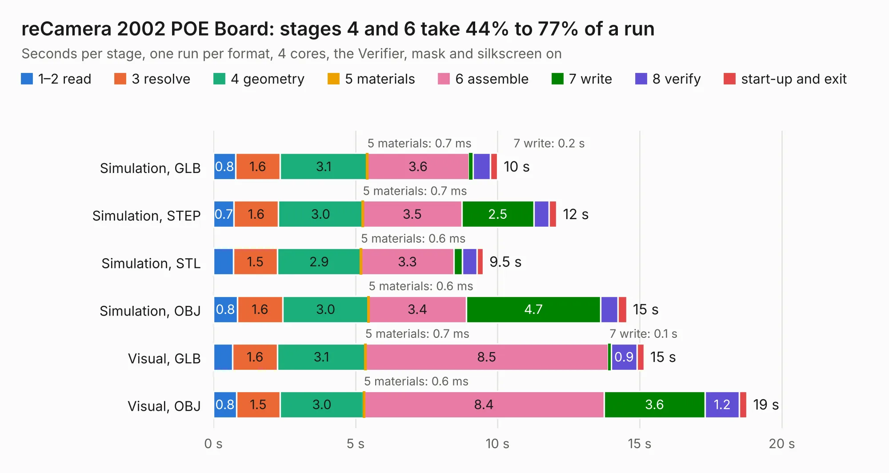

# 2514. reCamera 2002 POE Board

Board 2,514 of the 3,109 of [Corpus Testing](../Corpus-Testing.md), on [Corpus Page 24](../CorpusTestingPages/Corpus-Testing-24.md#2514-recamera-2002-poe-board).

| Mode and format | 1–2 read | 3 resolve | 4 geometry | 5 materials | 6 assemble | 7 write | 8 verify | start-up and exit | Total |
|---|---:|---:|---:|---:|---:|---:|---:|---:|---:|
| Simulation, GLB | 0.8 | 1.6 | 3.1 | 0.7&nbsp;ms | 3.6 | 0.2 | 0.6 | 0.2 | 10.0 |
| Simulation, STEP | 0.7 | 1.6 | 3.0 | 0.7&nbsp;ms | 3.5 | 2.5 | 0.5 | 0.3 | 12.1 |
| Simulation, STL | 0.7 | 1.5 | 2.9 | 0.6&nbsp;ms | 3.3 | 0.3 | 0.5 | 0.2 | 9.5 |
| Simulation, OBJ | 0.8 | 1.6 | 3.0 | 0.6&nbsp;ms | 3.4 | 4.7 | 0.6 | 0.3 | 14.5 |
| Visual, GLB | 0.7 | 1.6 | 3.1 | 0.7&nbsp;ms | 8.5 | 0.1 | 0.9 | 0.2 | 15.1 |
| Visual, OBJ | 0.8 | 1.5 | 3.0 | 0.6&nbsp;ms | 8.4 | 3.6 | 1.2 | 0.3 | 18.8 |

<table align="center"><tr><td valign="top">

| Board | Repo: [Seeed-Studio/OSHW-reCamera-Series](https://github.com/Seeed-Studio/OSHW-reCamera-Series) Board: `reCamera 2002 POE Board.kicad_pcb` |
|---|---|
| Folder | hardware / recamera-2002 / base / b301-poe / PCB |
| Complexity | 311&nbsp;/&nbsp;1000 (size&nbsp;196, features&nbsp;115) |
| KESE&nbsp;features | through vias, rounded, trapezoid or chamfered pads, arc tracks, filled zones, curved board outline, stack-up, dielectric εr and tanδ, copper finish |
| Tested | 9th November 2026 |
| Copper&nbsp;layers | 4 |
| File&nbsp;format | KiCad 9 (20241229) |
| Parts,&nbsp;tracks,&nbsp;vias | 63, 555, 260 |
| Triangles,&nbsp;simulation | 1,005,002 in 99 parts |
| Verifier | PASS in all six runs |

</td><td valign="top">

<table>
<tr><th>File type</th><th>File size</th><th>Peak memory used</th></tr>
<tr><th colspan="3" align="left">Simulation</th></tr>
<tr><td>GLB</td><td align="right">34&nbsp;MB</td><td align="right">518&nbsp;MB</td></tr>
<tr><td>STEP</td><td align="right">128&nbsp;MB</td><td align="right">559&nbsp;MB</td></tr>
<tr><td>STL</td><td align="right">50&nbsp;MB</td><td align="right">528&nbsp;MB</td></tr>
<tr><td>OBJ</td><td align="right">101&nbsp;MB</td><td align="right">742&nbsp;MB</td></tr>
<tr><th colspan="3" align="left">Visual</th></tr>
<tr><td>GLB</td><td align="right">23&nbsp;MB</td><td align="right">537&nbsp;MB</td></tr>
<tr><td>OBJ</td><td align="right">71&nbsp;MB</td><td align="right">562&nbsp;MB</td></tr>
</table>

</td></tr></table>

| Previous | Next |
|:---|---:|
| [2513. reCamera B101_B2_v0.1](b2513b_OSHW-reCamera-Series_reCamera-B101-B2-v0-1.md) | [2515. reCamera B101_B4_Gyro v0.1](b2515b_OSHW-reCamera-Series_reCamera-B101-B4-Gyro-v0-1.md) |
