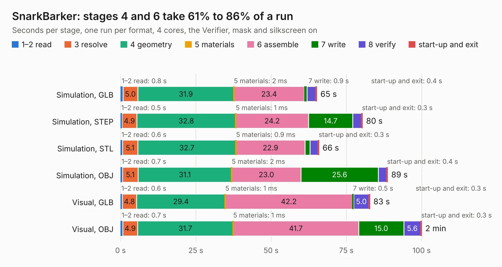

# 2514. SnarkBarker

Board 2,514 of the 3,128 of [Corpus Testing](../Corpus-Testing.md), on [Corpus Page 24](../CorpusTestingPages/Corpus-Testing-24.md#2514-snarkbarker).

| Mode and format | 1–2 read | 3 resolve | 4 geometry | 5 materials | 6 assemble | 7 write | 8 verify | start-up and exit | Total |
|---|---:|---:|---:|---:|---:|---:|---:|---:|---:|
| Simulation, GLB | 0.8 | 5.0 | 31.9 | 2&nbsp;ms | 23.4 | 0.9 | 2.9 | 0.4 | 65.2 |
| Simulation, STEP | 0.5 | 4.9 | 32.8 | 1&nbsp;ms | 24.2 | 14.7 | 3.0 | 0.3 | 80.4 |
| Simulation, STL | 0.6 | 5.1 | 32.7 | 0.9&nbsp;ms | 22.9 | 1.7 | 2.6 | 0.3 | 65.9 |
| Simulation, OBJ | 0.7 | 5.1 | 31.1 | 2&nbsp;ms | 23.0 | 25.6 | 2.8 | 0.4 | 88.7 |
| Visual, GLB | 0.6 | 4.8 | 29.4 | 1&nbsp;ms | 42.2 | 0.5 | 5.0 | 0.3 | 82.8 |
| Visual, OBJ | 0.7 | 4.9 | 31.7 | 1&nbsp;ms | 41.7 | 15.0 | 5.6 | 0.3 | 100.0 |

<table align="center"><tr><td valign="top">

| Board | Repo: [schlae/snark-barker](https://github.com/schlae/snark-barker) Board: `SnarkBarker.kicad_pcb` |
|---|---|
| Complexity | 244&nbsp;/&nbsp;1000 (size&nbsp;209, features&nbsp;35) |
| KESE&nbsp;features | through vias, filled zones |
| Tested | 9th November 2026 |
| Copper&nbsp;layers | 2 |
| File&nbsp;format | KiCad 4 (4) |
| Parts,&nbsp;tracks,&nbsp;vias | 192, 3,341, 189 |
| Triangles,&nbsp;simulation | 5,547,974 in 227 parts |
| Verifier | PASS in all six runs |

</td><td valign="top">

<table>
<tr><th>File type</th><th>File size</th><th>Peak memory used</th></tr>
<tr><th colspan="3" align="left">Simulation</th></tr>
<tr><td>GLB</td><td align="right">191&nbsp;MB</td><td align="right">1.7&nbsp;GB</td></tr>
<tr><td>STEP</td><td align="right">992&nbsp;MB</td><td align="right">2.0&nbsp;GB</td></tr>
<tr><td>STL</td><td align="right">277&nbsp;MB</td><td align="right">1.7&nbsp;GB</td></tr>
<tr><td>OBJ</td><td align="right">596&nbsp;MB</td><td align="right">3.6&nbsp;GB</td></tr>
<tr><th colspan="3" align="left">Visual</th></tr>
<tr><td>GLB</td><td align="right">106&nbsp;MB</td><td align="right">1.7&nbsp;GB</td></tr>
<tr><td>OBJ</td><td align="right">334&nbsp;MB</td><td align="right">2.2&nbsp;GB</td></tr>
</table>

</td></tr></table>

| Previous | Next |
|:---|---:|
| [2513. isavideo](b2513b_graphics-gremlin_isavideo.md) | [2515. BM28B0.6-24DSBreakout](b2515b_smartknob_BM28B0-6-24DSBreakout.md) |
