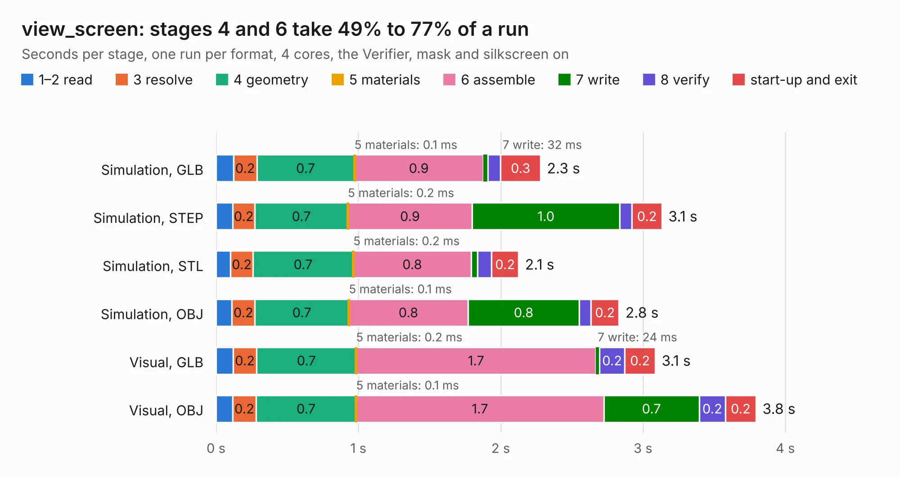

# 2515. view_screen

Board 2,515 of the 3,123 of [Corpus Testing](../Corpus-Testing.md), on [Corpus Page 24](../CorpusTestingPages/Corpus-Testing-24.md#2515-view_screen).

| Mode and format | 1–2 read | 3 resolve | 4 geometry | 5 materials | 6 assemble | 7 write | 8 verify | start-up and exit | Total |
|---|---:|---:|---:|---:|---:|---:|---:|---:|---:|
| Simulation, GLB | 0.1 | 0.2 | 0.7 | 0.1&nbsp;ms | 0.9 | 32&nbsp;ms | 91&nbsp;ms | 0.3 | 2.3 |
| Simulation, STEP | 0.1 | 0.2 | 0.7 | 0.2&nbsp;ms | 0.9 | 1.0 | 85&nbsp;ms | 0.2 | 3.1 |
| Simulation, STL | 0.1 | 0.2 | 0.7 | 0.2&nbsp;ms | 0.8 | 46&nbsp;ms | 98&nbsp;ms | 0.2 | 2.1 |
| Simulation, OBJ | 0.1 | 0.2 | 0.7 | 0.1&nbsp;ms | 0.8 | 0.8 | 81&nbsp;ms | 0.2 | 2.8 |
| Visual, GLB | 0.1 | 0.2 | 0.7 | 0.2&nbsp;ms | 1.7 | 24&nbsp;ms | 0.2 | 0.2 | 3.1 |
| Visual, OBJ | 0.1 | 0.2 | 0.7 | 0.1&nbsp;ms | 1.7 | 0.7 | 0.2 | 0.2 | 3.8 |

<table align="center"><tr><td valign="top">

| Board | Repo: [scottbez1/smartknob](https://github.com/scottbez1/smartknob) Board: `view_screen.kicad_pcb` |
|---|---|
| Folder | electronics / view_screen |
| Complexity | 212&nbsp;/&nbsp;1000 (size&nbsp;122, features&nbsp;90) |
| KESE&nbsp;features | through vias, rounded, trapezoid or chamfered pads, filled zones, curved board outline, stack-up, dielectric εr and tanδ, mask and silkscreen colours |
| Tested | 9th November 2026 |
| Copper&nbsp;layers | 2 |
| File&nbsp;format | KiCad 6 (20211014) |
| Parts,&nbsp;tracks,&nbsp;vias | 11, 58, 20 |
| Triangles,&nbsp;simulation | 161,874 in 23 parts |
| Verifier | PASS in all six runs |

</td><td valign="top">

<table>
<tr><th>File type</th><th>File size</th><th>Peak memory used</th></tr>
<tr><th colspan="3" align="left">Simulation</th></tr>
<tr><td>GLB</td><td align="right">5.7&nbsp;MB</td><td align="right">203&nbsp;MB</td></tr>
<tr><td>STEP</td><td align="right">31&nbsp;MB</td><td align="right">221&nbsp;MB</td></tr>
<tr><td>STL</td><td align="right">8.1&nbsp;MB</td><td align="right">204&nbsp;MB</td></tr>
<tr><td>OBJ</td><td align="right">16&nbsp;MB</td><td align="right">204&nbsp;MB</td></tr>
<tr><th colspan="3" align="left">Visual</th></tr>
<tr><td>GLB</td><td align="right">5.0&nbsp;MB</td><td align="right">200&nbsp;MB</td></tr>
<tr><td>OBJ</td><td align="right">14&nbsp;MB</td><td align="right">200&nbsp;MB</td></tr>
</table>

</td></tr></table>

| Previous | Next |
|:---|---:|
| [2514. view_base](b2514b_smartknob_view-base.md) | [2516. chainlinkBase](b2516b_splitflap_chainlinkBase.md) |
