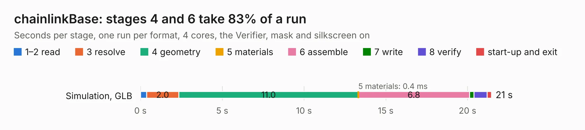

# 2516. chainlinkBase

Board 2,516 of the 3,123 of [Corpus Testing](../Corpus-Testing.md), on [Corpus Page 24](../CorpusTestingPages/Corpus-Testing-24.md#2516-chainlinkbase).

| Mode and format | 1–2 read | 3 resolve | 4 geometry | 5 materials | 6 assemble | 7 write | 8 verify | start-up and exit | Total |
|---|---:|---:|---:|---:|---:|---:|---:|---:|---:|
| Simulation, GLB | 0.4 | 2.0 | 11.0 | 0.4&nbsp;ms | 6.8 | 0.3 | 0.8 | 0.3 | 21.5 |
| Simulation, STEP | 0.3 | 2.1 | 10.6 | 0.5&nbsp;ms | 6.7 | 4.7 | 0.7 | 0.2 | 25.5 |
| Simulation, STL | 0.4 | 2.2 | 11.1 | 0.4&nbsp;ms | 6.8 | 0.6 | 0.8 | 0.3 | 22.3 |
| Simulation, OBJ | 0.4 | 2.1 | 11.1 | 0.4&nbsp;ms | 6.7 | 9.1 | 0.8 | 0.2 | 30.4 |
| Visual, GLB | 0.3 | 2.1 | 11.0 | 0.4&nbsp;ms | 15.7 | 0.2 | 1.7 | 0.2 | 31.2 |
| Visual, OBJ | 0.3 | 2.2 | 10.8 | 0.4&nbsp;ms | 16.1 | 6.4 | 1.8 | 0.3 | 38.0 |

<table align="center"><tr><td valign="top">

| Board | Repo: [scottbez1/splitflap](https://github.com/scottbez1/splitflap) Board: `chainlinkBase.kicad_pcb` |
|---|---|
| Folder | electronics / chainlinkBase |
| Complexity | 236&nbsp;/&nbsp;1000 (size&nbsp;191, features&nbsp;45) |
| KESE&nbsp;features | through vias, rounded, trapezoid or chamfered pads, filled zones |
| Tested | 9th November 2026 |
| Copper&nbsp;layers | 2 |
| File&nbsp;format | KiCad 5 (20171130) |
| Parts,&nbsp;tracks,&nbsp;vias | 119, 932, 259 |
| Triangles,&nbsp;simulation | 1,978,438 in 112 parts |
| Verifier | PASS in all six runs |

</td><td valign="top">

<table>
<tr><th>File type</th><th>File size</th><th>Peak memory used</th></tr>
<tr><th colspan="3" align="left">Simulation</th></tr>
<tr><td>GLB</td><td align="right">68&nbsp;MB</td><td align="right">699&nbsp;MB</td></tr>
<tr><td>STEP</td><td align="right">332&nbsp;MB</td><td align="right">849&nbsp;MB</td></tr>
<tr><td>STL</td><td align="right">99&nbsp;MB</td><td align="right">791&nbsp;MB</td></tr>
<tr><td>OBJ</td><td align="right">211&nbsp;MB</td><td align="right">1.3&nbsp;GB</td></tr>
<tr><th colspan="3" align="left">Visual</th></tr>
<tr><td>GLB</td><td align="right">46&nbsp;MB</td><td align="right">855&nbsp;MB</td></tr>
<tr><td>OBJ</td><td align="right">138&nbsp;MB</td><td align="right">1.0&nbsp;GB</td></tr>
</table>

</td></tr></table>

| Previous | Next |
|:---|---:|
| [2515. view_screen](b2515b_smartknob_view-screen.md) | [2517. chainlinkBuddyBreadboard](b2517b_splitflap_chainlinkBuddyBreadboard.md) |
