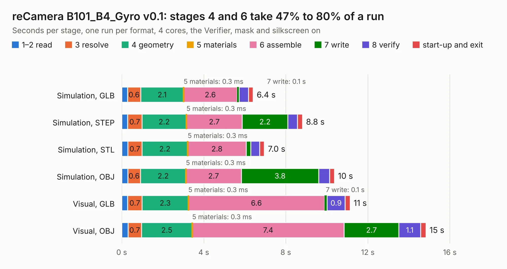

# 2518. reCamera B101_B4_Gyro v0.1

Board 2,518 of the 3,112 of [Corpus Testing](../Corpus-Testing.md), on [Corpus Page 24](../CorpusTestingPages/Corpus-Testing-24.md#2518-recamera-b101_b4_gyro-v01).

| Mode and format | 1–2 read | 3 resolve | 4 geometry | 5 materials | 6 assemble | 7 write | 8 verify | start-up and exit | Total |
|---|---:|---:|---:|---:|---:|---:|---:|---:|---:|
| Simulation, GLB | 0.3 | 0.6 | 2.1 | 0.3&nbsp;ms | 2.6 | 0.1 | 0.5 | 0.2 | 6.4 |
| Simulation, STEP | 0.3 | 0.7 | 2.2 | 0.3&nbsp;ms | 2.7 | 2.2 | 0.5 | 0.2 | 8.8 |
| Simulation, STL | 0.3 | 0.7 | 2.2 | 0.3&nbsp;ms | 2.8 | 0.2 | 0.4 | 0.2 | 7.0 |
| Simulation, OBJ | 0.3 | 0.6 | 2.2 | 0.3&nbsp;ms | 2.7 | 3.8 | 0.5 | 0.2 | 10.4 |
| Visual, GLB | 0.3 | 0.7 | 2.3 | 0.3&nbsp;ms | 6.6 | 0.1 | 0.9 | 0.2 | 11.1 |
| Visual, OBJ | 0.3 | 0.7 | 2.5 | 0.3&nbsp;ms | 7.4 | 2.7 | 1.1 | 0.3 | 14.8 |

<table align="center"><tr><td valign="top">

| Board | Repo: [Seeed-Studio/OSHW-reCamera-Series](https://github.com/Seeed-Studio/OSHW-reCamera-Series) Board: `reCamera B101_B4_Gyro v0.1.kicad_pcb` |
|---|---|
| Folder | hardware / recamera-2002 / base / b401-can / PCB / B4_v0.1 |
| Complexity | 296&nbsp;/&nbsp;1000 (size&nbsp;186, features&nbsp;110) |
| KESE&nbsp;features | through vias, slotted holes, rounded, trapezoid or chamfered pads, filled zones, curved board outline, stack-up, dielectric εr and tanδ, copper finish |
| Tested | 9th November 2026 |
| Copper&nbsp;layers | 4 |
| File&nbsp;format | KiCad 8 (20240108) |
| Parts,&nbsp;tracks,&nbsp;vias | 51, 520, 95 |
| Triangles,&nbsp;simulation | 714,652 in 87 parts |
| Verifier | PASS in all six runs |

</td><td valign="top">

<table>
<tr><th>File type</th><th>File size</th><th>Peak memory used</th></tr>
<tr><th colspan="3" align="left">Simulation</th></tr>
<tr><td>GLB</td><td align="right">25&nbsp;MB</td><td align="right">355&nbsp;MB</td></tr>
<tr><td>STEP</td><td align="right">119&nbsp;MB</td><td align="right">440&nbsp;MB</td></tr>
<tr><td>STL</td><td align="right">36&nbsp;MB</td><td align="right">351&nbsp;MB</td></tr>
<tr><td>OBJ</td><td align="right">72&nbsp;MB</td><td align="right">538&nbsp;MB</td></tr>
<tr><th colspan="3" align="left">Visual</th></tr>
<tr><td>GLB</td><td align="right">18&nbsp;MB</td><td align="right">440&nbsp;MB</td></tr>
<tr><td>OBJ</td><td align="right">53&nbsp;MB</td><td align="right">480&nbsp;MB</td></tr>
</table>

</td></tr></table>

| Previous | Next |
|:---|---:|
| [2517. reCamera 2002 POE Board](b2517b_OSHW-reCamera-Series_reCamera-2002-POE-Board.md) | [2519. reCamera Gimbal](b2519b_OSHW-reCamera-Series_reCamera-Gimbal.md) |
