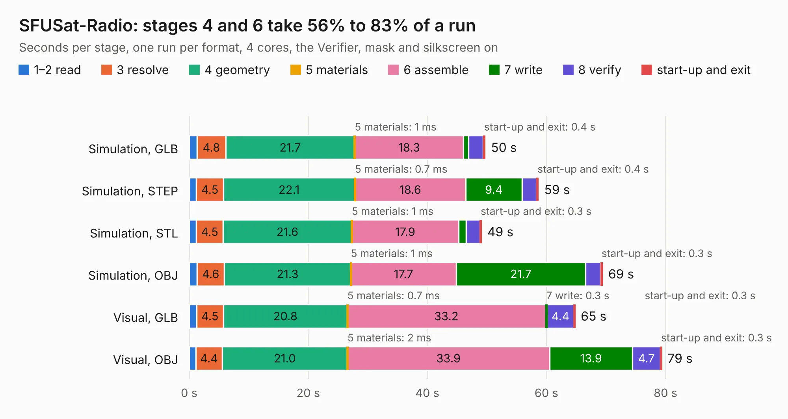

# 2518. SFUSat-Radio

Board 2,518 of the 3,106 of [Corpus Testing](../Corpus-Testing.md), on [Corpus Page 24](../CorpusTestingPages/Corpus-Testing-24.md#2518-sfusat-radio).

| Mode and format | 1–2 read | 3 resolve | 4 geometry | 5 materials | 6 assemble | 7 write | 8 verify | start-up and exit | Total |
|---|---:|---:|---:|---:|---:|---:|---:|---:|---:|
| Simulation, GLB | 1.3 | 4.8 | 21.7 | 1&nbsp;ms | 18.3 | 0.9 | 2.4 | 0.4 | 49.7 |
| Simulation, STEP | 1.2 | 4.5 | 22.1 | 0.7&nbsp;ms | 18.6 | 9.4 | 2.5 | 0.4 | 58.7 |
| Simulation, STL | 1.2 | 4.5 | 21.6 | 1&nbsp;ms | 17.9 | 1.2 | 2.3 | 0.3 | 49.1 |
| Simulation, OBJ | 1.3 | 4.6 | 21.3 | 1&nbsp;ms | 17.7 | 21.7 | 2.5 | 0.3 | 69.4 |
| Visual, GLB | 1.2 | 4.5 | 20.8 | 0.7&nbsp;ms | 33.2 | 0.3 | 4.4 | 0.3 | 64.8 |
| Visual, OBJ | 1.1 | 4.4 | 21.0 | 2&nbsp;ms | 33.9 | 13.9 | 4.7 | 0.3 | 79.4 |

<table align="center"><tr><td valign="top">

| Board | Repo: [sfusatclub/cubesat-radio](https://github.com/sfusatclub/cubesat-radio) Board: `SFUSat-Radio.kicad_pcb` |
|---|---|
| Complexity | 264&nbsp;/&nbsp;1000 (size&nbsp;229, features&nbsp;35) |
| KESE&nbsp;features | through vias, filled zones |
| Tested | 9th November 2026 |
| Copper&nbsp;layers | 4 |
| File&nbsp;format | KiCad 4 (4) |
| Parts,&nbsp;tracks,&nbsp;vias | 251, 1,996, 649 |
| Triangles,&nbsp;simulation | 3,534,654 in 217 parts |
| Verifier | PASS in all six runs |

</td><td valign="top">

<table>
<tr><th>File type</th><th>File size</th><th>Peak memory used</th></tr>
<tr><th colspan="3" align="left">Simulation</th></tr>
<tr><td>GLB</td><td align="right">120&nbsp;MB</td><td align="right">1.1&nbsp;GB</td></tr>
<tr><td>STEP</td><td align="right">431&nbsp;MB</td><td align="right">1.5&nbsp;GB</td></tr>
<tr><td>STL</td><td align="right">177&nbsp;MB</td><td align="right">1.0&nbsp;GB</td></tr>
<tr><td>OBJ</td><td align="right">373&nbsp;MB</td><td align="right">2.3&nbsp;GB</td></tr>
<tr><th colspan="3" align="left">Visual</th></tr>
<tr><td>GLB</td><td align="right">74&nbsp;MB</td><td align="right">1.3&nbsp;GB</td></tr>
<tr><td>OBJ</td><td align="right">231&nbsp;MB</td><td align="right">1.5&nbsp;GB</td></tr>
</table>

</td></tr></table>

| Previous | Next |
|:---|---:|
| [2517. reCamera 2002 S4 GC2053 Sensor Board_V1.0_SCH&PCB_250905](b2517b_OSHW-reCamera-Series_reCamera-2002-S4-GC2053-Sensor-Board-V1-0-SCH-PCB-250905.md) | [2519. Cheap FOCer 2 60mm](b2519b_cheap-focer-2_Cheap-FOCer-2-60mm.md) |
