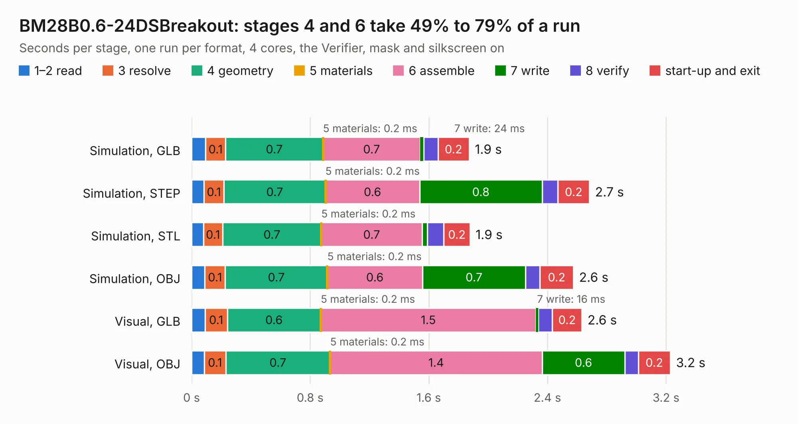

# 2518. BM28B0.6-24DSBreakout

Board 2,518 of the 3,131 of [Corpus Testing](../Corpus-Testing.md), on [Corpus Page 24](../CorpusTestingPages/Corpus-Testing-24.md#2518-bm28b06-24dsbreakout).

| Mode and format | 1–2 read | 3 resolve | 4 geometry | 5 materials | 6 assemble | 7 write | 8 verify | start-up and exit | Total |
|---|---:|---:|---:|---:|---:|---:|---:|---:|---:|
| Simulation, GLB | 95&nbsp;ms | 0.1 | 0.7 | 0.2&nbsp;ms | 0.7 | 24&nbsp;ms | 97&nbsp;ms | 0.2 | 1.9 |
| Simulation, STEP | 83&nbsp;ms | 0.1 | 0.7 | 0.2&nbsp;ms | 0.6 | 0.8 | 0.1 | 0.2 | 2.7 |
| Simulation, STL | 80&nbsp;ms | 0.1 | 0.7 | 0.2&nbsp;ms | 0.7 | 37&nbsp;ms | 0.1 | 0.2 | 1.9 |
| Simulation, OBJ | 90&nbsp;ms | 0.1 | 0.7 | 0.2&nbsp;ms | 0.6 | 0.7 | 96&nbsp;ms | 0.2 | 2.6 |
| Visual, GLB | 91&nbsp;ms | 0.1 | 0.6 | 0.2&nbsp;ms | 1.5 | 16&nbsp;ms | 95&nbsp;ms | 0.2 | 2.6 |
| Visual, OBJ | 87&nbsp;ms | 0.1 | 0.7 | 0.2&nbsp;ms | 1.4 | 0.6 | 90&nbsp;ms | 0.2 | 3.2 |

<table align="center"><tr><td valign="top">

| Board | Repo: [scottbez1/smartknob](https://github.com/scottbez1/smartknob) Board: `BM28B0.6-24DSBreakout.kicad_pcb` |
|---|---|
| Folder | electronics / BM28B0.6-24DSBreakout |
| Complexity | 105&nbsp;/&nbsp;1000 (size&nbsp;105, features&nbsp;0) |
| Tested | 9th November 2026 |
| Copper&nbsp;layers | 2 |
| File&nbsp;format | KiCad 5 (20171130) |
| Parts,&nbsp;tracks,&nbsp;vias | 3, 84, 0 |
| Triangles,&nbsp;simulation | 143,778 in 39 parts |
| Verifier | PASS in all six runs |

</td><td valign="top">

<table>
<tr><th>File type</th><th>File size</th><th>Peak memory used</th></tr>
<tr><th colspan="3" align="left">Simulation</th></tr>
<tr><td>GLB</td><td align="right">4.8&nbsp;MB</td><td align="right">184&nbsp;MB</td></tr>
<tr><td>STEP</td><td align="right">19&nbsp;MB</td><td align="right">199&nbsp;MB</td></tr>
<tr><td>STL</td><td align="right">7.2&nbsp;MB</td><td align="right">191&nbsp;MB</td></tr>
<tr><td>OBJ</td><td align="right">14&nbsp;MB</td><td align="right">198&nbsp;MB</td></tr>
<tr><th colspan="3" align="left">Visual</th></tr>
<tr><td>GLB</td><td align="right">3.2&nbsp;MB</td><td align="right">165&nbsp;MB</td></tr>
<tr><td>OBJ</td><td align="right">8.9&nbsp;MB</td><td align="right">163&nbsp;MB</td></tr>
</table>

</td></tr></table>

| Previous | Next |
|:---|---:|
| [2517. SnarkBarker](b2517b_snark-barker_SnarkBarker.md) | [2519. LevelShifterBreakout](b2519b_smartknob_LevelShifterBreakout.md) |
