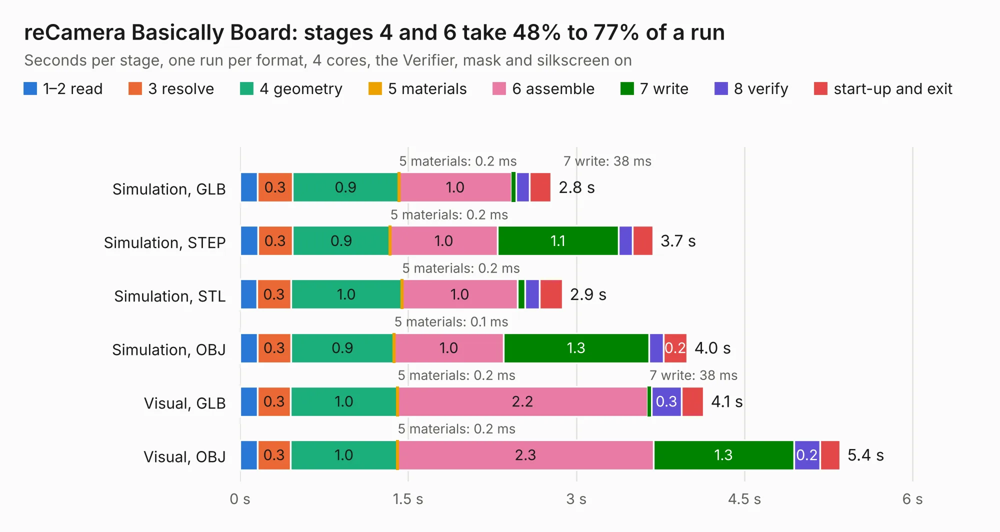

# 2519. reCamera Basically Board

Board 2,519 of the 3,111 of [Corpus Testing](../Corpus-Testing.md), on [Corpus Page 24](../CorpusTestingPages/Corpus-Testing-24.md#2519-recamera-basically-board).

| Mode and format | 1–2 read | 3 resolve | 4 geometry | 5 materials | 6 assemble | 7 write | 8 verify | start-up and exit | Total |
|---|---:|---:|---:|---:|---:|---:|---:|---:|---:|
| Simulation, GLB | 0.2 | 0.3 | 0.9 | 0.2&nbsp;ms | 1.0 | 38&nbsp;ms | 0.1 | 0.2 | 2.8 |
| Simulation, STEP | 0.2 | 0.3 | 0.9 | 0.2&nbsp;ms | 1.0 | 1.1 | 0.1 | 0.2 | 3.7 |
| Simulation, STL | 0.2 | 0.3 | 1.0 | 0.2&nbsp;ms | 1.0 | 65&nbsp;ms | 0.1 | 0.2 | 2.9 |
| Simulation, OBJ | 0.2 | 0.3 | 0.9 | 0.1&nbsp;ms | 1.0 | 1.3 | 0.1 | 0.2 | 4.0 |
| Visual, GLB | 0.2 | 0.3 | 1.0 | 0.2&nbsp;ms | 2.2 | 38&nbsp;ms | 0.3 | 0.2 | 4.1 |
| Visual, OBJ | 0.2 | 0.3 | 1.0 | 0.2&nbsp;ms | 2.3 | 1.3 | 0.2 | 0.2 | 5.4 |

<table align="center"><tr><td valign="top">

| Board | Repo: [Seeed-Studio/OSHW-reCamera-Series](https://github.com/Seeed-Studio/OSHW-reCamera-Series) Board: `reCamera Basically Board.kicad_pcb` |
|---|---|
| Folder | hardware / recamera-2002 / products / gimbal / power-board / PCB / reCamera_Gimbal_Power_Supply_v1.0_SCH&PCB_250109 |
| Complexity | 207&nbsp;/&nbsp;1000 (size&nbsp;152, features&nbsp;55) |
| KESE&nbsp;features | through vias, rounded, trapezoid or chamfered pads, filled zones, curved board outline |
| Tested | 9th November 2026 |
| Copper&nbsp;layers | 2 |
| File&nbsp;format | KiCad 8 (20240108) |
| Parts,&nbsp;tracks,&nbsp;vias | 30, 148, 85 |
| Triangles,&nbsp;simulation | 260,730 in 28 parts |
| Verifier | PASS in all six runs |

</td><td valign="top">

<table>
<tr><th>File type</th><th>File size</th><th>Peak memory used</th></tr>
<tr><th colspan="3" align="left">Simulation</th></tr>
<tr><td>GLB</td><td align="right">9.1&nbsp;MB</td><td align="right">232&nbsp;MB</td></tr>
<tr><td>STEP</td><td align="right">38&nbsp;MB</td><td align="right">259&nbsp;MB</td></tr>
<tr><td>STL</td><td align="right">13&nbsp;MB</td><td align="right">225&nbsp;MB</td></tr>
<tr><td>OBJ</td><td align="right">26&nbsp;MB</td><td align="right">224&nbsp;MB</td></tr>
<tr><th colspan="3" align="left">Visual</th></tr>
<tr><td>GLB</td><td align="right">8.1&nbsp;MB</td><td align="right">237&nbsp;MB</td></tr>
<tr><td>OBJ</td><td align="right">23&nbsp;MB</td><td align="right">242&nbsp;MB</td></tr>
</table>

</td></tr></table>

| Previous | Next |
|:---|---:|
| [2518. reCamera Gimbal](b2518b_OSHW-reCamera-Series_reCamera-Gimbal.md) | [2520. reCamera S101 v1.0](b2520b_OSHW-reCamera-Series_reCamera-S101-v1-0.md) |
