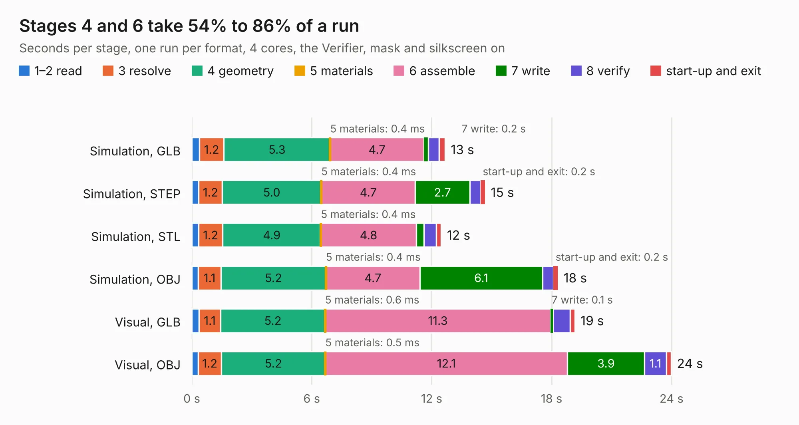

# 2522. reCamera 2002 S4 GC2053 Sensor Board_V1.0_SCH&PCB_250905

Board 2,522 of the 3,111 of [Corpus Testing](../Corpus-Testing.md), on [Corpus Page 24](../CorpusTestingPages/Corpus-Testing-24.md#2522-recamera-2002-s4-gc2053-sensor-board_v10_schpcb_250905).

| Mode and format | 1–2 read | 3 resolve | 4 geometry | 5 materials | 6 assemble | 7 write | 8 verify | start-up and exit | Total |
|---|---:|---:|---:|---:|---:|---:|---:|---:|---:|
| Simulation, GLB | 0.4 | 1.2 | 5.3 | 0.4&nbsp;ms | 4.7 | 0.2 | 0.5 | 0.3 | 12.7 |
| Simulation, STEP | 0.3 | 1.2 | 5.0 | 0.4&nbsp;ms | 4.7 | 2.7 | 0.5 | 0.2 | 14.7 |
| Simulation, STL | 0.3 | 1.2 | 4.9 | 0.4&nbsp;ms | 4.8 | 0.4 | 0.6 | 0.3 | 12.5 |
| Simulation, OBJ | 0.3 | 1.1 | 5.2 | 0.4&nbsp;ms | 4.7 | 6.1 | 0.5 | 0.2 | 18.3 |
| Visual, GLB | 0.4 | 1.1 | 5.2 | 0.6&nbsp;ms | 11.3 | 0.1 | 0.9 | 0.2 | 19.2 |
| Visual, OBJ | 0.3 | 1.2 | 5.2 | 0.5&nbsp;ms | 12.1 | 3.9 | 1.1 | 0.2 | 24.0 |

<table align="center"><tr><td valign="top">

| Board | Repo: [Seeed-Studio/OSHW-reCamera-Series](https://github.com/Seeed-Studio/OSHW-reCamera-Series) Board: `reCamera 2002 S4 GC2053 Sensor Board_V1.0_SCH&PCB_250905.kicad_pcb` |
|---|---|
| Folder | hardware / recamera-2002 / sensors / s401-gc2053 / PCB |
| Complexity | 340&nbsp;/&nbsp;1000 (size&nbsp;200, features&nbsp;140) |
| KESE&nbsp;features | through vias, custom pads, rounded, trapezoid or chamfered pads, arc tracks, filled zones, copper drawings, curved board outline, stack-up, dielectric εr and tanδ, copper finish |
| Tested | 9th November 2026 |
| Copper&nbsp;layers | 4 |
| File&nbsp;format | KiCad 9 (20241229) |
| Parts,&nbsp;tracks,&nbsp;vias | 71, 615, 307 |
| Triangles,&nbsp;simulation | 1,419,266 in 89 parts |
| Verifier | PASS in all six runs |

</td><td valign="top">

<table>
<tr><th>File type</th><th>File size</th><th>Peak memory used</th></tr>
<tr><th colspan="3" align="left">Simulation</th></tr>
<tr><td>GLB</td><td align="right">48&nbsp;MB</td><td align="right">605&nbsp;MB</td></tr>
<tr><td>STEP</td><td align="right">199&nbsp;MB</td><td align="right">625&nbsp;MB</td></tr>
<tr><td>STL</td><td align="right">71&nbsp;MB</td><td align="right">563&nbsp;MB</td></tr>
<tr><td>OBJ</td><td align="right">144&nbsp;MB</td><td align="right">944&nbsp;MB</td></tr>
<tr><th colspan="3" align="left">Visual</th></tr>
<tr><td>GLB</td><td align="right">27&nbsp;MB</td><td align="right">600&nbsp;MB</td></tr>
<tr><td>OBJ</td><td align="right">82&nbsp;MB</td><td align="right">629&nbsp;MB</td></tr>
</table>

</td></tr></table>

| Previous | Next |
|:---|---:|
| [2521. reCamera S101 v1.1](b2521b_OSHW-reCamera-Series_reCamera-S101-v1-1.md) | [2523. SFUSat-Radio](b2523b_cubesat-radio_SFUSat-Radio.md) |
