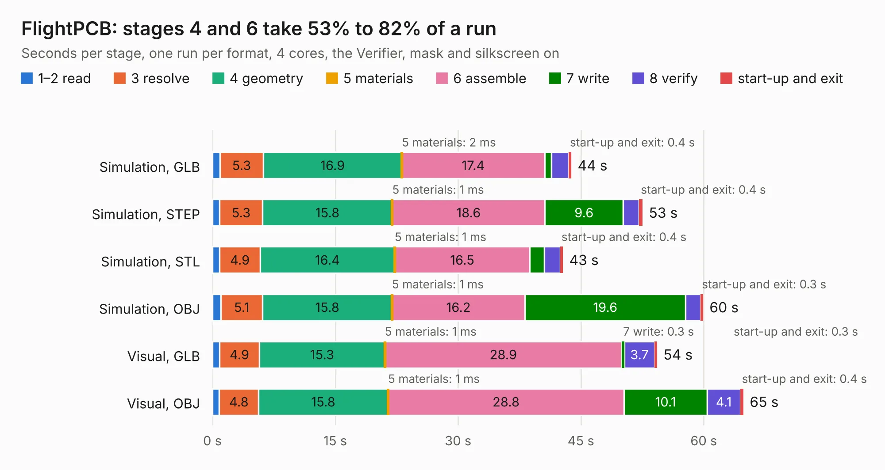

# 2523. FlightPCB

Board 2,523 of the 3,106 of [Corpus Testing](../Corpus-Testing.md), on [Corpus Page 24](../CorpusTestingPages/Corpus-Testing-24.md#2523-flightpcb).

| Mode and format | 1–2 read | 3 resolve | 4 geometry | 5 materials | 6 assemble | 7 write | 8 verify | start-up and exit | Total |
|---|---:|---:|---:|---:|---:|---:|---:|---:|---:|
| Simulation, GLB | 0.9 | 5.3 | 16.9 | 2&nbsp;ms | 17.4 | 0.8 | 2.1 | 0.4 | 43.8 |
| Simulation, STEP | 0.9 | 5.3 | 15.8 | 1&nbsp;ms | 18.6 | 9.6 | 2.0 | 0.4 | 52.5 |
| Simulation, STL | 0.9 | 4.9 | 16.4 | 1&nbsp;ms | 16.5 | 1.8 | 1.9 | 0.4 | 42.8 |
| Simulation, OBJ | 1.0 | 5.1 | 15.8 | 1&nbsp;ms | 16.2 | 19.6 | 1.9 | 0.3 | 59.9 |
| Visual, GLB | 0.9 | 4.9 | 15.3 | 1&nbsp;ms | 28.9 | 0.3 | 3.7 | 0.3 | 54.3 |
| Visual, OBJ | 0.8 | 4.8 | 15.8 | 1&nbsp;ms | 28.8 | 10.1 | 4.1 | 0.4 | 64.8 |

<table align="center"><tr><td valign="top">

| Board | Repo: [shubhamai/tsar](https://github.com/shubhamai/tsar) Board: `FlightPCB.kicad_pcb` |
|---|---|
| Folder | v1 |
| Complexity | 398&nbsp;/&nbsp;1000 (size&nbsp;283, features&nbsp;115) |
| KESE&nbsp;features | through vias, slotted holes, rounded, trapezoid or chamfered pads, arc tracks, filled zones, TrueType text, stack-up, dielectric εr and tanδ |
| Tested | 9th November 2026 |
| Copper&nbsp;layers | 4 |
| File&nbsp;format | KiCad 8 (20240108) |
| Parts,&nbsp;tracks,&nbsp;vias | 188, 3,309, 418 |
| Triangles,&nbsp;simulation | 3,693,058 in 258 parts |
| Verifier | PASS in all six runs |

</td><td valign="top">

<table>
<tr><th>File type</th><th>File size</th><th>Peak memory used</th></tr>
<tr><th colspan="3" align="left">Simulation</th></tr>
<tr><td>GLB</td><td align="right">128&nbsp;MB</td><td align="right">1.1&nbsp;GB</td></tr>
<tr><td>STEP</td><td align="right">566&nbsp;MB</td><td align="right">1.3&nbsp;GB</td></tr>
<tr><td>STL</td><td align="right">185&nbsp;MB</td><td align="right">1.0&nbsp;GB</td></tr>
<tr><td>OBJ</td><td align="right">397&nbsp;MB</td><td align="right">2.5&nbsp;GB</td></tr>
<tr><th colspan="3" align="left">Visual</th></tr>
<tr><td>GLB</td><td align="right">70&nbsp;MB</td><td align="right">1.2&nbsp;GB</td></tr>
<tr><td>OBJ</td><td align="right">223&nbsp;MB</td><td align="right">1.6&nbsp;GB</td></tr>
</table>

</td></tr></table>

| Previous | Next |
|:---|---:|
| [2522. tulipcc](b2522b_tulipcc_tulipcc.md) | [2524. FlightPCB](b2524b_tsar_v2_FlightPCB.md) |
