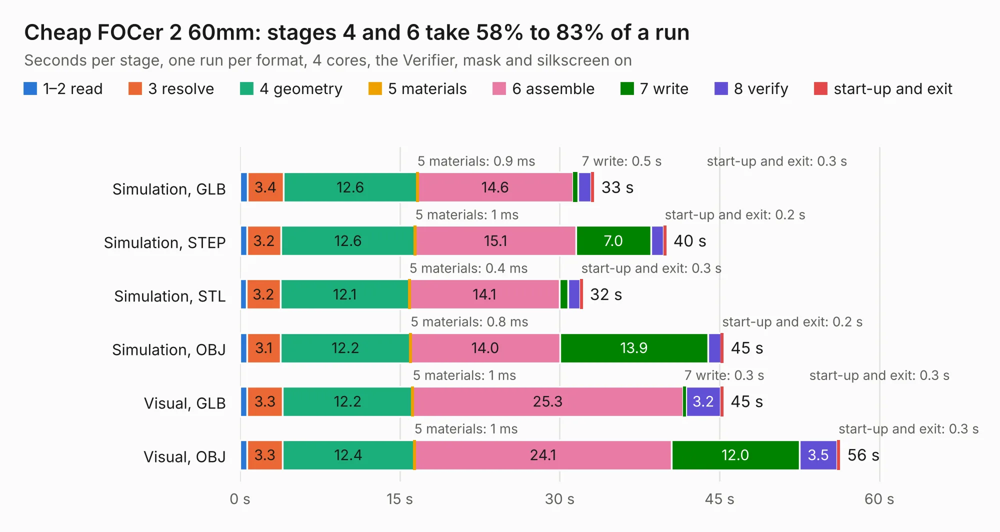

# 2524. Cheap FOCer 2 60mm

Board 2,524 of the 3,111 of [Corpus Testing](../Corpus-Testing.md), on [Corpus Page 24](../CorpusTestingPages/Corpus-Testing-24.md#2524-cheap-focer-2-60mm).

| Mode and format | 1–2 read | 3 resolve | 4 geometry | 5 materials | 6 assemble | 7 write | 8 verify | start-up and exit | Total |
|---|---:|---:|---:|---:|---:|---:|---:|---:|---:|
| Simulation, GLB | 0.7 | 3.4 | 12.6 | 0.9&nbsp;ms | 14.6 | 0.5 | 1.2 | 0.3 | 33.2 |
| Simulation, STEP | 0.7 | 3.2 | 12.6 | 1&nbsp;ms | 15.1 | 7.0 | 1.2 | 0.2 | 40.0 |
| Simulation, STL | 0.6 | 3.2 | 12.1 | 0.4&nbsp;ms | 14.1 | 0.8 | 1.1 | 0.3 | 32.2 |
| Simulation, OBJ | 0.7 | 3.1 | 12.2 | 0.8&nbsp;ms | 14.0 | 13.9 | 1.2 | 0.2 | 45.4 |
| Visual, GLB | 0.7 | 3.3 | 12.2 | 1&nbsp;ms | 25.3 | 0.3 | 3.2 | 0.3 | 45.3 |
| Visual, OBJ | 0.7 | 3.3 | 12.4 | 1&nbsp;ms | 24.1 | 12.0 | 3.5 | 0.3 | 56.3 |

<table align="center"><tr><td valign="top">

| Board | Repo: [shamansystems/cheap-focer-2](https://github.com/shamansystems/cheap-focer-2) Board: `Cheap FOCer 2 60mm.kicad_pcb` |
|---|---|
| Folder | source |
| Complexity | 312&nbsp;/&nbsp;1000 (size&nbsp;257, features&nbsp;55) |
| KESE&nbsp;features | through vias, slotted holes, rounded, trapezoid or chamfered pads, filled zones |
| Tested | 9th November 2026 |
| Copper&nbsp;layers | 2 |
| File&nbsp;format | KiCad 5 (20171130) |
| Parts,&nbsp;tracks,&nbsp;vias | 175, 2,158, 727 |
| Triangles,&nbsp;simulation | 2,647,782 in 143 parts |
| Verifier | PASS in all six runs |

</td><td valign="top">

<table>
<tr><th>File type</th><th>File size</th><th>Peak memory used</th></tr>
<tr><th colspan="3" align="left">Simulation</th></tr>
<tr><td>GLB</td><td align="right">90&nbsp;MB</td><td align="right">899&nbsp;MB</td></tr>
<tr><td>STEP</td><td align="right">414&nbsp;MB</td><td align="right">1.1&nbsp;GB</td></tr>
<tr><td>STL</td><td align="right">132&nbsp;MB</td><td align="right">856&nbsp;MB</td></tr>
<tr><td>OBJ</td><td align="right">277&nbsp;MB</td><td align="right">1.7&nbsp;GB</td></tr>
<tr><th colspan="3" align="left">Visual</th></tr>
<tr><td>GLB</td><td align="right">70&nbsp;MB</td><td align="right">1.2&nbsp;GB</td></tr>
<tr><td>OBJ</td><td align="right">219&nbsp;MB</td><td align="right">1.5&nbsp;GB</td></tr>
</table>

</td></tr></table>

| Previous | Next |
|:---|---:|
| [2523. SFUSat-Radio](b2523b_cubesat-radio_SFUSat-Radio.md) | [2525. portapack_h1](b2525b_portapack-hackrf_portapack-h1.md) |
