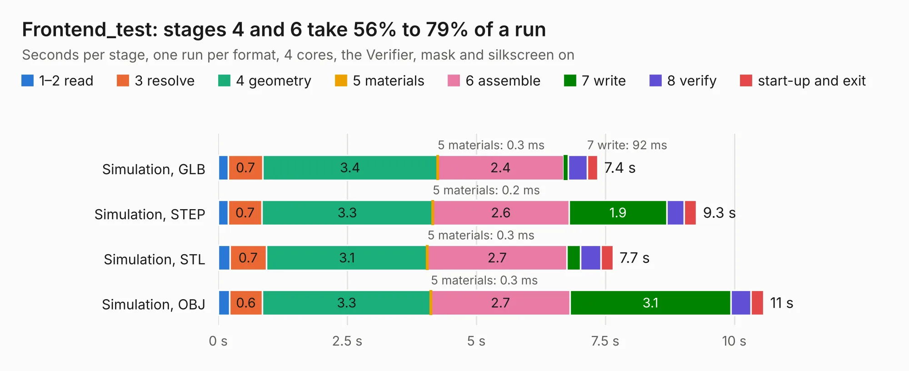

# 2526. Frontend_test

Board 2,526 of the 3,101 of [Corpus Testing](../Corpus-Testing.md), on [Corpus Page 24](../CorpusTestingPages/Corpus-Testing-24.md#2526-frontend_test).

| Mode and format | 1–2 read | 3 resolve | 4 geometry | 5 materials | 6 assemble | 7 write | 8 verify | start-up and exit | Total |
|---|---:|---:|---:|---:|---:|---:|---:|---:|---:|
| Simulation, GLB | 0.2 | 0.7 | 3.4 | 0.3&nbsp;ms | 2.4 | 92&nbsp;ms | 0.4 | 0.2 | 7.4 |
| Simulation, STEP | 0.2 | 0.7 | 3.3 | 0.2&nbsp;ms | 2.6 | 1.9 | 0.3 | 0.2 | 9.3 |
| Simulation, STL | 0.2 | 0.7 | 3.1 | 0.3&nbsp;ms | 2.7 | 0.3 | 0.4 | 0.2 | 7.7 |
| Simulation, OBJ | 0.2 | 0.6 | 3.3 | 0.3&nbsp;ms | 2.7 | 3.1 | 0.4 | 0.2 | 10.6 |
| Visual, GLB | 0.2 | 0.7 | 3.4 | 0.2&nbsp;ms | 4.9 | 86&nbsp;ms | 0.6 | 0.2 | 10.2 |
| Visual, OBJ | 0.2 | 0.7 | 3.4 | 0.3&nbsp;ms | 5.1 | 2.1 | 0.7 | 0.2 | 12.4 |

<table align="center"><tr><td valign="top">

| Board | Repo: [SingularitySurfer/SingularitySurfer-FPGA-Lock-In-Amplifier](https://github.com/SingularitySurfer/SingularitySurfer-FPGA-Lock-In-Amplifier) Board: `Frontend_test.kicad_pcb` |
|---|---|
| Folder | BOARD / Frontend_test |
| Complexity | 213&nbsp;/&nbsp;1000 (size&nbsp;158, features&nbsp;55) |
| KESE&nbsp;features | through vias, rounded, trapezoid or chamfered pads, filled zones, curved board outline |
| Tested | 9th November 2026 |
| Copper&nbsp;layers | 2 |
| File&nbsp;format | KiCad 5 (20171130) |
| Parts,&nbsp;tracks,&nbsp;vias | 46, 247, 65 |
| Triangles,&nbsp;simulation | 645,840 in 59 parts |
| Verifier | PASS in all six runs |

</td><td valign="top">

<table>
<tr><th>File type</th><th>File size</th><th>Peak memory used</th></tr>
<tr><th colspan="3" align="left">Simulation</th></tr>
<tr><td>GLB</td><td align="right">23&nbsp;MB</td><td align="right">350&nbsp;MB</td></tr>
<tr><td>STEP</td><td align="right">112&nbsp;MB</td><td align="right">429&nbsp;MB</td></tr>
<tr><td>STL</td><td align="right">32&nbsp;MB</td><td align="right">355&nbsp;MB</td></tr>
<tr><td>OBJ</td><td align="right">66&nbsp;MB</td><td align="right">482&nbsp;MB</td></tr>
<tr><th colspan="3" align="left">Visual</th></tr>
<tr><td>GLB</td><td align="right">16&nbsp;MB</td><td align="right">407&nbsp;MB</td></tr>
<tr><td>OBJ</td><td align="right">48&nbsp;MB</td><td align="right">467&nbsp;MB</td></tr>
</table>

</td></tr></table>

| Previous | Next |
|:---|---:|
| [2525. mainboard](b2525b_mainboard-hardware_revC-fm_mainboard.md) | [2527. SingularitySurfer_V1](b2527b_SingularitySurfer-FPGA-Lock-In-Amplifier_SingularitySurfer-V1.md) |
