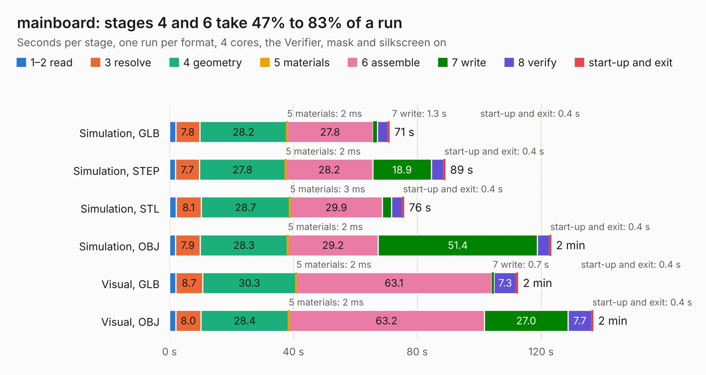

# 2526. mainboard

Board 2,526 of the 3,105 of [Corpus Testing](../Corpus-Testing.md), on [Corpus Page 24](../CorpusTestingPages/Corpus-Testing-24.md#2526-mainboard).

| Mode and format | 1–2 read | 3 resolve | 4 geometry | 5 materials | 6 assemble | 7 write | 8 verify | start-up and exit | Total |
|---|---:|---:|---:|---:|---:|---:|---:|---:|---:|
| Simulation, GLB | 2.0 | 7.8 | 28.2 | 2&nbsp;ms | 27.8 | 1.3 | 3.5 | 0.4 | 71.0 |
| Simulation, STEP | 1.9 | 7.7 | 27.8 | 2&nbsp;ms | 28.2 | 18.9 | 4.0 | 0.4 | 89.0 |
| Simulation, STL | 2.1 | 8.1 | 28.7 | 3&nbsp;ms | 29.9 | 2.9 | 3.5 | 0.4 | 75.7 |
| Simulation, OBJ | 1.9 | 7.9 | 28.3 | 2&nbsp;ms | 29.2 | 51.4 | 4.0 | 0.4 | 123.2 |
| Visual, GLB | 2.0 | 8.7 | 30.3 | 2&nbsp;ms | 63.1 | 0.7 | 7.3 | 0.4 | 112.5 |
| Visual, OBJ | 2.1 | 8.0 | 28.4 | 2&nbsp;ms | 63.2 | 27.0 | 7.7 | 0.4 | 136.8 |

<table align="center"><tr><td valign="top">

| Board | Repo: [sierra-lobo/mainboard-hardware](https://github.com/sierra-lobo/mainboard-hardware) Board: `mainboard.kicad_pcb` |
|---|---|
| Folder | revA-proto |
| Complexity | 373&nbsp;/&nbsp;1000 (size&nbsp;293, features&nbsp;80) |
| KESE&nbsp;features | through vias, custom pads, rounded, trapezoid or chamfered pads, filled zones, copper drawings, curved board outline |
| Tested | 9th November 2026 to 10th November 2026 |
| Copper&nbsp;layers | 6 |
| File&nbsp;format | KiCad 5 (20171130) |
| Parts,&nbsp;tracks,&nbsp;vias | 310, 3,216, 717 |
| Triangles,&nbsp;simulation | 7,297,760 in 361 parts |
| Verifier | PASS in all six runs |

</td><td valign="top">

<table>
<tr><th>File type</th><th>File size</th><th>Peak memory used</th></tr>
<tr><th colspan="3" align="left">Simulation</th></tr>
<tr><td>GLB</td><td align="right">253&nbsp;MB</td><td align="right">1.9&nbsp;GB</td></tr>
<tr><td>STEP</td><td align="right">977&nbsp;MB</td><td align="right">2.5&nbsp;GB</td></tr>
<tr><td>STL</td><td align="right">365&nbsp;MB</td><td align="right">1.9&nbsp;GB</td></tr>
<tr><td>OBJ</td><td align="right">802&nbsp;MB</td><td align="right">4.7&nbsp;GB</td></tr>
<tr><th colspan="3" align="left">Visual</th></tr>
<tr><td>GLB</td><td align="right">142&nbsp;MB</td><td align="right">2.3&nbsp;GB</td></tr>
<tr><td>OBJ</td><td align="right">462&nbsp;MB</td><td align="right">3.0&nbsp;GB</td></tr>
</table>

</td></tr></table>

| Previous | Next |
|:---|---:|
| [2525. rp-micro](b2525b_rp-micro_rp-micro.md) | [2527. mainboard](b2527b_mainboard-hardware_revB-em_mainboard.md) |
